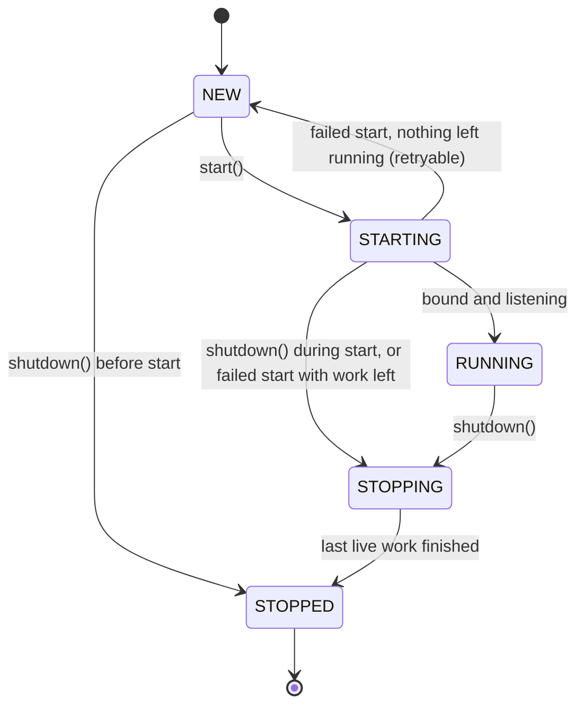
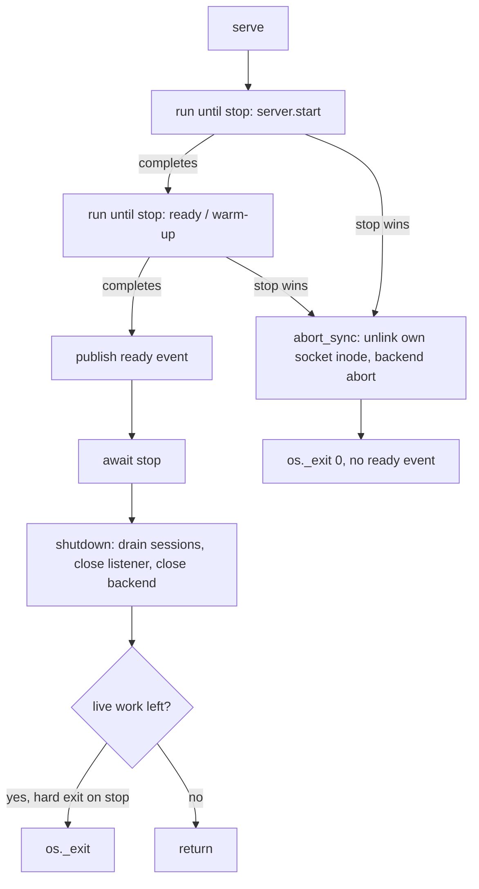

# Server architecture

How the server starts, stops and cleans up, and what a supervisor (a menu bar
app, launchd, a test harness) can rely on. For running it, see
[Operations](operations.md). For the wire format, see [Protocol](protocol.md).

The code is in `stt_server/server.py` (`TranscriptionServer`, `serve`),
`stt_server/__main__.py` (the CLI and preflight) and `stt_server/supervise.py`
(the ready/error events and the stdin watcher). The exact rules are in the
`TranscriptionServer` and `serve` docstrings; this page is the map.

## Why there is a lifecycle at all

A model load takes seconds to minutes and runs in a worker thread that cannot be
cancelled. A parent can die, or ask for a stop, at any point during it. Three
things must still hold:

- A second server for the same socket must never replace a live one.
- A stop during startup must exit promptly and must never announce `ready`.
- A hard exit must not leave a stale socket file behind.

## Lifecycle

`TranscriptionServer` is one explicit state machine. A state changes only
through `_transition`, which rejects any edge not in `_TRANSITIONS`.

The single-server lock is held from early in `STARTING` until the server
returns to `NEW` or reaches `STOPPED`. A server that was shut down, or whose
failed start left work running, is single-use: build a new one.

## Single-server lock

Each Unix socket has a sibling `<socket>.lock` file, held with `flock`. It exists
because `connect()` cannot tell a stale socket from a live server whose listen
backlog is full: macOS returns `ECONNREFUSED` for both. Liveness is therefore
decided by the lock, not by probing the socket. The kernel drops the lock when
the process dies, so it cannot go stale, and clients never touch it. The file
itself stays on disk, because unlinking it would race a concurrent starter.

The lock is taken after the socket directory is verified and **before** the
model loads, so a second instance fails in milliseconds. The CLI preflight
(`_preflight_listener`) also reports a held lock as `EADDRINUSE` before loading
anything. Only `ECONNREFUSED` and `ENOENT` count as a stale socket; a timeout,
`EAGAIN` or any other error is treated as occupied or fatal.

## Invariants

1. The lock is never held in `NEW` or `STOPPED`.
2. The lock is released only inside `_transition`, and `_transition` refuses to
   enter `NEW` or `STOPPED` while any live work remains.
3. Every task the server creates is in the **live-work ledger** from creation:
   the bind, the bound listener, its close, sessions and decode tasks, an
   in-flight start or drain, the backend `close()`, an adopted startup or
   readiness step, and a backend worker thread.
4. An entry stays live until its own cleanup has run, not merely until its future
   is done. A cleanup that raises keeps the entry live (marked stuck), so the lock
   is never released while work is untracked. This fails closed.
5. Every wait on code the server does not own is bounded. What outlives its
   bound stays in the ledger and keeps the lock.
6. A backend that was started is `close()`d on every exit from `start()` that
   does not reach `RUNNING`, and its optional `abort()` runs after it.

## Stop during startup

Under `serve --supervised` (and the CLI generally), startup and the warm-up step
each race against a stop signal (SIGTERM, SIGINT, or stdin EOF).

Why a hard exit: a model load runs in a thread that cannot be cancelled, so the
process cannot wait for it. `abort_sync()` does the cleanup that is safe without
waiting:

- It unlinks the socket **only if** its inode is the one this process bound, so
  it never removes a socket someone else created at the same path. The inode is
  recorded inside the bind step itself; recording it later left a loop turn in
  which a hard exit found an unrecorded socket and left the file behind.
- It calls the backend's `abort()` hook, which must be cheap and non-blocking,
  for example removing a private temp dir.
- It deliberately does **not** release the lock. The kernel does that when the
  process exits. Releasing it earlier would let a new server start loading while
  this process's model thread still exists.

Embedders calling `serve()` without `hard_exit_on_stop=True` get a different
path: the pending step is cancelled and waited for, bounded by the drain timeout,
and anything that ignores the cancel is handed to the server with `adopt()` so it
keeps the lock until it ends.

## What a supervisor can rely on

- stdout carries only JSON lines. `ready` is printed once, after the listener is
  bound and the model is warm, and never after a stop has won.
- A fatal error prints one `error` event with a stable `code` and exits 1.
  See [Error codes](../README.md#error-codes-per-repo).
- stdin EOF and SIGTERM both stop the server. The server exits when its parent
  dies, because the parent holds the other end of the stdin pipe.
- A second `serve` for a socket a live server owns exits with `EADDRINUSE` before
  loading a model. It never replaces the running server, so a supervisor that
  finds a server already running (for example a launchd agent) should attach to
  it rather than start another.
- After a normal stop, or after SIGKILL and a restart, the socket path is usable
  again. `scripts/smoke_supervised.py` checks both against real models.

## Backends

A backend implements `TranscriptionBackend` and may add `abort()` (cleanup that
survives a failed start or a hard exit) and `idle()` (reports when no decode
thread is left, so the lock is kept until then). `DecodeGuardMixin` in
`stt_server/backends/_thread_util.py` holds the shared decode lock and in-flight
drain. The checklist for adding one is in the
[README](../README.md#adding-a-backend).
