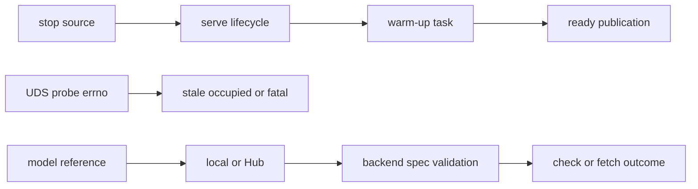
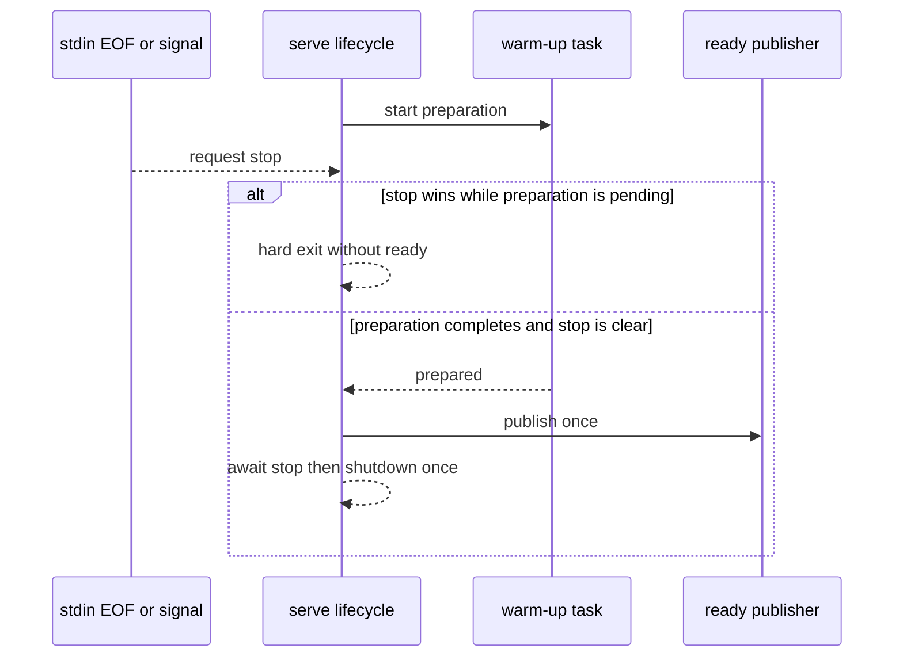

# Bug: PR #14 review findings

**Status:** Complete
**Component:** Server Runtime
**Assigned to:** Codex
**Priority:** High
**Branch:** `fix/pr14-review-findings`
**Created:** 2026-10-24
**Review Gates:** none

## Objective

Resolve the three PR #14 review findings without weakening the UDS trust boundary or changing unrelated runtime behaviour: supervised shutdown during warm-up, conservative Unix-socket occupancy detection, and honest local-model prefetch results.

## Context

PR #14 adds supervised serving, prefetch support, and the Kyutai backend. Review found three false-success or delayed-exit paths at those integration seams. The branch is based on `main` at `2707c68`; the reviewed branch began this fix at `3fdce6a`.

## Requirements

- Race supervised stop against both server startup and readiness preparation. Split warm-up from the irreversible `ready` publication, make stop dominant before publication, and move the cleanup boundary above both races. If a non-cancellable worker is still running when stop wins, exit promptly without emitting `ready`; that hard exit is the only cleanup bypass, while normal and cancellable paths shut down exactly once through `finally`.
- Treat only `ECONNREFUSED` or `ENOENT` from a UDS connect probe as proof that a socket is stale. Timeout, `EAGAIN`, permission failures, and unknown errors are occupied/fatal and must not permit replacement.
- Existing PR #13 socket-directory and peer-credential trust checks remain unchanged.
- Strings beginning with `/`, `./`, `../`, or `~` are explicit local references; existing bare relative paths remain local, while other strings remain Hub repository IDs. Local references must be directories and satisfy the selected backend's `SnapshotSpec.required` patterns. Those patterns prove structural prefetch completeness, not every third-party loader semantic. Kyutai local paths are explicitly unsupported. Check and fetch modes both emit a `ConfigError` error event.
- Add focused regressions, run formatting/lint, and pass the full suite. Do not stage, commit, push, or change branches.

## Review Focus

- Stop must win at every pre-ready await without a late ready event or a cancellability hang.
- UDS preflight must preserve the original live socket inode for ambiguous probe failures.
- Local completeness must reuse backend `SnapshotSpec.required` patterns rather than duplicate a divergent file list.

## Implementation Checklist

### Phase 1: Supervised readiness cancellation

**Impl files:** `stt_server/server.py`
**Test files:** `tests/test_supervised_cli.py`
**Test command:** `uv run pytest tests/test_supervised_cli.py -q`
**Goal:** A stop observed before readiness completes prevents `ready` and cannot wait on a non-cancellable model worker.

- Race the ready callback against the existing stop future.
- Start with a failing blocked-warm-up regression and record its red state.
- Split asynchronous warm-up preparation from synchronous ready-event publication; check stop before publication.
- Preserve prompt hard-exit behaviour when stop wins while the awaited work remains pending.
- Move the cleanup boundary above the races and prove normal shutdown runs exactly once.

### Phase 2: Conservative UDS preflight

**Impl files:** `stt_server/__main__.py`
**Test files:** `tests/test_supervised_cli.py`
**Test command:** `uv run pytest tests/test_supervised_cli.py -q`
**Goal:** Only narrowly proven stale sockets may reach replacement; all ambiguous probe errors preserve the inode and fail closed.

- Classify probe errors by errno.
- Start with failing timeout and `EAGAIN` inode-preservation regressions.
- Cover the complete classifier: `ECONNREFUSED`/`ENOENT` permit stale replacement; timeout/`EAGAIN` report occupied; `EACCES`/`EPERM` and an unknown errno remain fatal. Every occupied/fatal branch preserves the inode.

### Phase 3: Local-model prefetch validation

**Impl files:** `stt_server/prefetch.py`
**Test files:** `tests/test_prefetch_cli.py`
**Test command:** `uv run pytest tests/test_prefetch_cli.py -q`
**Goal:** Missing or incomplete local model paths never produce cached/complete success.

- Start with failing missing and incomplete path regressions in check and fetch modes.
- Classify the model reference and derive its backend spec before branching into mode-specific outcomes.
- Validate local directories with the backend's required snapshot patterns.
- Cover missing, incomplete, and complete supported paths in both modes, including Kyutai rejection and a sentinel required-pattern assertion.

### Phase 4: Verification and documentation

**Impl files:** `docs/dev_plans/20261024-bug-pr14-review-findings.md, docs/dev_plans/README.md`
**Test files:** `tests/test_supervised_cli.py, tests/test_prefetch_cli.py`
**Test command:** `uv run pytest -q`
**Validation cmd:** `uv run ruff format --check . && uv run ruff check .`

- Sweep the touched files for the same three mechanisms.
- Record focused and full-suite results.

## Technical Specifications

### Files to Modify

- `stt_server/server.py` — extend the supervised stop race through readiness.
- `stt_server/__main__.py` — narrow stale-socket classification.
- `stt_server/prefetch.py` — validate local model paths and required files.
- `tests/test_supervised_cli.py` — readiness-stop and UDS probe regressions.
- `tests/test_prefetch_cli.py` — local path check/fetch regressions.
- `docs/dev_plans/20261024-bug-pr14-review-findings.md` and `docs/dev_plans/README.md` — decision record and status index.

### New Files to Create

- No runtime or test modules; only this plan file.

### Architecture Decisions

- Reuse the existing hard-exit strategy only when stop wins against work that may be blocked in a non-cancellable worker.
- Map ambiguous UDS probe failures to `EADDRINUSE`, preserving the original errno only for permission/fatal failures where it is actionable.
- Represent a local model with the selected backend's `SnapshotSpec` so local and Hub structural completeness share `_complete()` without claiming a complete third-party loader contract.

### Dependencies

- No dependency changes. Current constraints include Python `>=3.12`, `websockets>=16,<17`, pytest `>=8`, and Ruff `>=0.8`.

### Integration Seams

| Seam | Writer | Caller | Contract |
|---|---|---|---|
| stop future | stdin watcher / signal handler | `serve()` lifecycle | Stop before ready prevents output and prompt exit is bounded. |
| UDS inode | existing listener | `_preflight_listener()` | Ambiguous probe failures never authorize unlink/rebind. |
| model requirement patterns | backend `prefetch_specs()` | local validation | The same required globs define Hub and local completeness. |

## Architecture & Call Flow

| Step | Trigger | Enters context | Cleared/persisted | Turn boundary |
|---|---|---|---|---|
| 1 | stdin EOF or SIGINT/SIGTERM | shared stop future | Persists through lifecycle | Stop future resolves |
| 2 | listener started | warm-up callback | Worker may outlive task cancellation | Warm-up completes or stop wins |
| 3 | warm-up complete and stop clear | listener/backend metadata | One JSON event is emitted | Ready published |
| 4 | UDS path exists | probe error and original inode | No mutation during preflight | Classified stale/occupied/fatal |
| 5 | prefetch model argument | lexical source type and backend spec | Check emits status; fetch emits completion/error | CLI returns |

## Testing Notes

### Test Approach

- [x] Subprocess regression for EOF during blocked warm-up with a prompt-exit bound and no ready output; retain the existing blocked-startup coverage.
- [x] Lifecycle regression for the normal/cancellable path with exactly one shutdown.
- [x] Parameterized UDS regressions for stale, occupied, permission, and unknown errors with inode checks.
- [x] CLI regressions for missing, incomplete, and complete local paths in check and fetch modes, Kyutai rejection, and sentinel-pattern reuse.
- [x] Ruff and full pytest suite.

### Test Results

- [x] Focused tests pass.
- [x] Ruff format and lint pass.
- [x] Full suite passes.

### Edge Cases Tested

- [x] Stop arrives after bind but before warm-up completes.
- [x] Probe timeout and full-backlog-style `EAGAIN` preserve the socket inode.
- [x] Missing and incomplete local paths cannot become vacuous success.
- [x] Kyutai local paths are rejected explicitly.

## Acceptance Criteria

- Each review finding has a regression test that fails on the pre-fix code and passes after the fix.
- The same-mechanism sweep finds no additional affected call sites in the touched files.
- PR #13 trust-boundary checks remain intact.
- Ruff and the full test suite pass.
- Worktree changes remain unstaged and uncommitted on `fix/pr14-review-findings`.

<!-- reviewed: 2026-10-25 @ 94b64342ec5c04420480e64eea558ff259f096bd -->

## Progress

- [x] Phase 1: Supervised readiness cancellation
- [x] Phase 2: Conservative UDS preflight
- [x] Phase 3: Local-model prefetch validation
- [x] Phase 4: Verification and documentation
- [x] Follow-up fixes after the PR #14 re-review (see below)

## Findings

- Explore found one supervised `ready` callback, one UDS listener preflight, and one local-model classification call site in the touched runtime files.
- Red-state regressions reproduced the readiness hang, broad UDS error acceptance, and vacuous local-model success before runtime changes.
- Focused post-fix gates: 9 supervised/readiness/preflight cases passed; all 26 prefetch tests passed; Ruff format and check passed.
- Initial pass only (superseded by the per-round counts in the Round records below; the final suite is 639 passed, 3 skipped, 1 known failure): the background full suite reached 344 passed and 3 skipped, but the sandbox denied TCP and UDS binds with `EPERM`, causing 36 failures and 15 setup errors. No failure asserted changed behavior.

## Issues & Solutions

- The existing pytest launcher had a stale shebang. `uv sync --inexact` retained the environment; verification used `.venv/bin/python -m pytest` against the installed pytest 9.0.3.
- The sandbox and computer-use safety layer both prevent a socket-capable full-suite run in this session. Phase 4 remains open.

## Follow-up fixes (after the original three findings)

Recorded here, below the review marker, so the reviewed plan above stays signed
off. Each landed with a regression test that fails on the pre-fix code.

- **Hard-exit cleanup.** A stop during startup/warm-up that exits via
  `os._exit` first runs `TranscriptionServer.abort_sync()`: it unlinks the Unix
  socket only if it is still the inode this process bound, and calls the
  backend's optional `abort()` hook (parakeet/nemotron private temp dir). The
  single-server lock is NOT released there; the kernel drops it at exit, so a new
  server cannot start loading while the old process still exists.
- **Hard exit is opt-in.** `serve(..., hard_exit_on_stop=False)` is the library
  default: a stop during startup/warm-up cancels the pending step (bounded wait)
  and runs the normal `shutdown()`. `python -m stt_server serve` (plain and
  `--supervised`) passes `True`, keeping the prompt exit for the process owner.
- **Prefetch progress.** `total_bytes`/`files_total` count only files not yet
  cached, `downloaded_bytes` includes partial `.incomplete` blobs, and a final
  progress event reaches the total before `done`.
- **Kyutai config-named weights.** Prefetch and the loader take `mimi_name`,
  `moshi_name` and `tokenizer_name` from the repo's `config.json` (one
  `weight_files()` shared by both), and each name must be a plain filename: no
  `/`, `..` or glob characters, since it is used as an `allow_patterns`/`fnmatch`
  pattern.
- **Error classification.** A bare `ConnectionError`/`TimeoutError` is a
  `ModelDownloadError` only when tagged by `snapshot.download_phase()`, which
  wraps a backend's fetch-and-load call and prefetch's Hub calls, never a
  decode (warm-up is no longer tagged wholesale). A prefetch failure where the
  snapshot itself is unusable (incomplete, corrupt or incomplete `config.json`,
  incomplete local directory) is the new `ModelInvalidError`; existing codes are
  unchanged. `_run_serve` chains its `SystemExit` with an explicit `from exc`.
- **`DecodeGuardMixin`.** One decode-lock pair, in-flight counter and bounded
  `close()` drain for all four MLX backends; `_run_guarded_decode` undoes the
  in-flight mark if the decode thread fails to start.
- **Single-server flock on `<socket>.lock`.** Taken before the model load; the
  supervised preflight treats a held lock as a live server (a full backlog no
  longer passes as stale). A pre-existing owned lock file with group/other bits
  is tightened to `0600`, a foreign one refused; the preflight probe uses a
  shared lock and a starter retries a contended lock for 250 ms, so a probe never
  makes a concurrent real start fail.
- **Lifecycle.** A failed `start()` runs the backend `abort()` hook (no temp-dir
  leak per failed start); `shutdown()` is bounded even if a task swallows
  cancellation (drain timeout + 2 s cancel grace, `wait_closed` bounded too) and
  releases the lock in a `finally`.
- **Structure.** `backends.BACKENDS` is the single registry for CLI choices,
  `--model` defaults, construction and prefetch modules; `SnapshotSpec` moved to
  the stdlib-only `stt_server.snapshot` (re-exported by `prefetch`); the optional
  `abort()` hook and `prefetch_specs()` are documented in `backend.py`.

Deferred (design scope, not fixed here): pinning Kyutai (or any backend) to a
Hub revision, and a CI job that loads a real Kyutai model.

## Review-gauntlet round 2 fixes

Also below the marker. Each substantive fix has a regression test that was
mutation-checked (reverting the fix makes it fail).

- **`shutdown()` wins over an in-flight `start()`.** `shutdown()` sets a
  permanent closing flag; `start()` checks it after `backend.start()` and after
  the bind, closes whatever it bound (inode-checked unlink) and releases the
  lock itself. `shutdown()` leaves the lock to an in-flight start, so a start
  that outlived `serve`'s bounded cancel can neither bind after `serve` returns
  nor let a new server take the path while it might. The bind is shielded so a
  cancel mid-bind cannot drop a serving listener.
- **Stuck session tasks.** Tasks still alive after the cancel grace keep the
  single-server lock until the last one finishes (`stuck_work_count`). With
  `hard_exit_on_stop=True` (the CLI) `serve` then `os._exit`s (0 after a
  requested stop, 1 if failing) instead of hanging in `asyncio.run` teardown;
  embedders own such tasks.
- **Lock file.** Mode set by `fchmod` whenever it is not `0600` (umask-proof);
  an unopenable existing lock is a clear `EACCES`. Both lock opens use
  `O_NONBLOCK`; the preflight probe `fstat`s and reads a non-regular or
  foreign-owned file as not held.
- **Error classification.** `supervise.ConfigError(ValueError)` marks explicit
  config rejections (`ServerConfig`, socket-dir enforcement, prefetch backend /
  local-path checks); a bare `ValueError` is `BackendStartError`.
  `HFValidationError` is `ConfigError`. The kyutai serve-path loader tags an
  unparseable / incomplete `config.json` `ModelInvalidError`, matching prefetch;
  a `config.json` that is valid JSON but not an object is an unusable snapshot
  (`--check`: `cached: false`).
- **`abort()` contract.** It may run while a decode / lazy-load daemon thread
  still runs; parakeet/nemotron already tolerate that (the decode fails or
  completes, `start()` recreates the temp dir). Documented and pinned by a test.
- **Structure.** `backends.import_backend()` is the single lookup and lazy
  import; `_resolve_model` takes defaults only from the registry (`None` for
  echo); `abort_backend` dispatches on the now-exported `AbortableBackend`.
- **Docs.** README prefetch code fence, per-repo error-code table (unknown code
  = `BackendStartError`), "Adding a backend" checklist; operations.md kyutai
  note, lock-file details and the mixed-version upgrade caveat; CHANGELOG.

## Review-gauntlet round 3 fixes

Also below the marker; each fix mutation-checked.

- **Lifecycle state machine (root cause of six findings).** The
  `_started`/`_starting`/`_closing`/`_stuck_tasks` flags and the lock fd handed
  to task done-callbacks are replaced by one `_State` enum
  (`new -> starting -> running -> stopping -> stopped`) changed only through
  `_transition` (a fixed table), with the lock fd always on the server
  (`holds_socket_lock`). Invariants: the lock is held iff the state is
  starting, running, or stopping with live work; it is released once, by a
  failed start (`starting -> new`) or by `stopping -> stopped`, which waits for
  every piece of live work (an in-flight start, the drain, leftover session
  tasks read from the tasks themselves rather than from how far the drain got,
  and the backend's new optional `idle()` future, so a decode thread behind a
  cancelled task keeps the lock). Decisions: single-use after `shutdown()`
  (`start()` raises), a failed start is retryable, a concurrent `start()`
  raises without touching the lock, a cancelled `shutdown()` cancels the
  sessions it left and keeps the lock, a start unwinding after
  `backend.start()` returned `close()`s the backend, and the drain unlinks our
  socket inode. Tests: `tests/test_server_lifecycle.py` (state x event matrix
  plus concurrent start/shutdown, cancel during start/drain/close, decode
  thread, `DecodeGuardMixin.idle()`).
- **Stuck-task exit reports the failure.** `serve(on_fatal=...)`: the CLI
  passes its reporter, so the `os._exit` path prints the error and emits the
  supervised `error` event (exit 1). Subprocess test through `cli.main()`.
- **`prefetch --check`** raises a config error (`HFValidationError`) instead of
  reporting `cached: false`, matching a fetch.
- **Structure.** `ConfigError` moved to the stdlib-only `stt_server.errors`
  (`is_config_error`; re-exported by `supervise`, exported by the package); the
  core no longer imports `supervise` at module load. `import_backend()` returns
  entry, module and class and raises `ConfigError` for an unknown name, which
  the CLI turns into its exit message.
- **Docs.** CHANGELOG `Changed` section (hard-exit default, `ConfigError`
  narrowing, registry defaults, single-use server, `import_backend`); README
  kyutai sentence scoped to prefetch; serve `--model` comment points at the
  registry; operations.md lock note; `backend.py` hook contracts.

Quarantined (not changed): a cancelled `backend.start()` whose model load runs
on a worker thread still releases the lock on unwind -- no current backend
loads in `start()` (they load on first decode), and tracking it needs a
`start()`-side hook.

Owner decision, resolved before merge (2026-10-25): the `Status:` line now
reads Complete, and the Kyutai requirement says check and fetch both emit a
`ConfigError` error event, matching the code and tests. The marker hash was
recomputed for those above-marker edits (administrative).

### Round 4 (review gauntlet)

- **One lock-release choke point.** The round-3 state machine still released
  the lock by convention at two call sites, and each cancel/failure edge leaked
  a variant. Now `_transition` into `new`/`stopped` is the only release and
  refuses while the one live-work predicate (`_live_reasons`: bound listener,
  session/decode tasks, start/drain/backend-close/bind/readiness steps,
  `idle()` future) is non-empty. A failed start runs the same `_drain` as
  `shutdown()` (sessions it accepted are drained; leftovers move it to
  `stopping`, single-use, instead of `new`); a second cancel mid-bind tracks the
  bind and closes its listener when it exists; `backend.close()` is one
  server-owned task bounded by the drain timeout (a hung close lingers in
  `stuck_work_count`, so the CLI hard-exits); the running drain is a
  server-owned task, so a cancelled `shutdown()` caller never abandons the
  close and later callers wait for it; `serve` adopts a startup/readiness step
  that outlived its bounded cancel. Tests in `tests/test_server_lifecycle.py`
  (double cancel, failed start x {shutdown, cancel} x {prompt, stubborn}
  session, hung close, cancelled first shutdown then second, uncancellable
  readiness, refused release), each mutation-checked.
- `serve(on_fatal=...)` without `hard_exit_on_stop=True` raises `ConfigError`.
- `IdleAwareBackend` exported from the package; `backend.py` `abort()`/`idle()`
  contracts corrected (a failed start closes a started backend, then aborts).

Quarantined in round 4 (refactors beyond the review scope, risky this late):
splitting `server.py` (socket-dir security / lock / lifecycle / protocol /
`serve`), moving the error markers and `mark_*` helpers from `snapshot.py` /
`supervise.py` into `errors.py`, and a typed `prefetch_specs` protocol.

### Round 5 (review gauntlet)

Two residual root causes behind the round-5 server findings, fixed
structurally:

- **Per-attempt state survived a failed start's return to `new`.** The retry's
  shutdown reused attempt 1's finished `_close_task` (backend never closed:
  starts=2, closes=1, or attempt 1's close error re-raised), and `_server` /
  `_bound_socket_id` kept attempt 1's listener and socket inode. Now one reset
  point, `_reset_attempt()`, runs on every transition into `new` (only legal
  with no live work) and clears every per-attempt slot together: listener,
  socket inode, close task, drain task, session sets, the ledger's finished
  entries, the shutdown event.
- **Two ledgers for leftover work.** `_live_work` gated the lock while
  `_lingering` fed `stuck_work_count` (serve's hard exit), so an orphan bind or
  an `idle()` future held the lock without counting as stuck. Now one ledger
  (`_live_work: dict[key, _Work(kind, stuck)]`): `_live_reasons()` and
  `stuck_work_count` are both views of it; the listener and session/decode
  tasks (tracked from creation) are entries; an orphan bind, its listener's
  `wait_closed`, a backend worker thread and an adopted step are entered as
  stuck. The orphan listener's lock is released only after its socket really
  closed (`Server.close()` only schedules it).
- `wait_stopped()` is the public "lock is free" wait (tests no longer use the
  private event); `shutdown()` documents that returning does not always mean
  that. `start()` from `stopping`/`stopped` names the cause (shutdown vs a
  failed start that left work running).
- Docs: single-use rule (shutdown, or failed start left work running) in the
  class docstring, `backend.py` `abort()` contract, CHANGELOG, operations.md,
  README; the `shutdown()` bound (drain timeout + two cancel graces + close
  bound); one lock-file mode rule matching the code; README `ConfigError` row
  lists an unknown backend name.

Quarantined in round 5: closing the event loop while an `idle()` future is
pending strands the lock until process exit (the release runs as a loop
callback; a fix needs an off-loop release path). Documented in
`wait_stopped()`: await it before closing the loop.

### Round 6 (review gauntlet)

The round-6 server findings were gaps in the ledger's definition of "live",
fixed at the definition:

- **Live until its own cleanup ran.** `_live_entries` dropped a future as soon
  as it was done, before its done-callbacks had registered successor work: an
  orphan bind and another entry finishing in the same loop tick let the
  other's `_settle` release the lock and reset the attempt before the orphan
  listener was closed and unlinked. Each tracked future now has ONE
  done-callback, `_retire`, which runs the entry's `then` cleanup (the orphan
  bind's `_close_orphan_listener`, registering the listener close) and only
  then pops it and re-settles. Old invariant: "live = future not done";
  new: "live = in the ledger; an entry leaves only after its cleanup, so
  successor-then-retire is atomic".
- **Every server task in the ledger from creation.** The normal bind task and
  the listener's `wait_closed` were created outside it, and a `wait_closed`
  past its grace was cancelled (which only ended our wait: websockets' close
  task and the handshakes it waits for kept running). The bind is tracked at
  creation; `_begin_listener_close` registers the close before retiring the
  bound listener (shared by the normal and the orphan close); a close past its
  grace lingers, stuck. After a drain every still-running non-step entry is
  marked stuck, so "lock held" and `stuck_work_count > 0` still agree. A test
  installs a task factory and fails if any task created from `server.py`
  leaves the ledger before it completes.
- **One session registry.** `_active_handlers` / `_active_decodes` are gone;
  the drain waits on and cancels the ledger's `session` entries.
- `_reset_attempt` has a structural test: `vars()` after a failed start's
  return to `new` against a fresh instance, with an explicit allow-list of
  attempt-spanning fields, and `_reset_attempt` alone must assign every
  per-attempt slot.
- `stuck_task_count` renamed `stuck_work_count` (unreleased, no alias); the
  CLI logs "N pieces of work outlived shutdown".
- `serve`: a `shutdown()` failure during cleanup no longer replaces the
  primary failure (it is logged; the primary reaches the caller / `on_fatal`).
- Docs: CHANGELOG `shutdown()` bound (drain timeout + two 2 s cancel graces +
  close bounded by the drain timeout); `abort()` contract "stopping or
  stopped"; `ConfigError` docstring lists `serve(on_fatal=...)` and the Hub
  validation case via `is_config_error()`.

### Round 7 (review gauntlet)

The round-7 server findings were one class: exits from lock-holding scopes
that did not fail closed. Fixed together:

- **A failing cleanup keeps its entry.** `_retire` popped the entry in a
  `finally`, so an orphan bind whose `listener.close()` raised left the
  listener serving, the ledger empty and the lock released. Now a `then` that
  raises leaves the entry live, marked stuck, and logs; the lock stays held
  until the process exits (the CLI's hard exit sees it). Old invariant: "an
  entry leaves after its cleanup ran"; new: "an entry leaves only after its
  cleanup SUCCEEDED".
- **One handoff primitive.** `_hand_off(predecessor, successor, kind)`
  registers the successor (a future via `_track`, or a plain key: a bound
  listener, a step token) and only then drops the predecessor. The listener's
  adopt and close and `_begin_work` go through it; entries are added only by
  it and `_track` and dropped only by `_end_work`. A `then` given for an
  already-done future runs at once through `_retire` instead of being dropped.
- **Every `serve` exit settles a pending step.** Cancelling `serve` itself
  left the startup / readiness task running outside the ledger while
  `shutdown()` closed the backend and released the lock. `_abandon_step`
  (cancel, bounded wait, `adopt` one that outlives it, even if that wait is
  cancelled) now runs for a stop and, in `serve`'s `finally`, for any other
  exit; the readiness task is in the ledger from creation (`start()` keeps
  its own in-flight entry). Matrix test: {startup, readiness} x {stop, cancel}
  x {prompt, ignores cancellation}, plus a failing readiness step.
- **The hard exit reads the whole ledger.** `live_work_count` (new, the
  ledger's size) is what holds the lock and what `serve`'s hard exit reads;
  `stuck_work_count` is a diagnostic ("entries that outlived their bound").
  The post-drain sweep that kept the two equal (and skipped non-future
  entries) is gone. Test: a leftover step token (a non-future entry) still
  triggers the hard exit.
- **MLX completeness** (`prefetch --check`): `weights.*` accepted files
  `mlx_whisper.load_models.load_model` never opens (it reads
  `weights.safetensors`, else `weights.npz`). A `required` entry may now list
  alternatives (`a|b`); MLX requires `weights.safetensors|weights.npz`.
- Docs: operations lock-hold bullet adds the listener close, a stubborn
  startup / readiness step and a failing cleanup; README `abort()` runs alone
  when `start()` had not returned; `_CANCEL_GRACE_SECONDS` / `_on_close`
  comments; test renamed `test_cli_stuck_work_exit_still_reports_the_failure`.

### Round 8

- **Required alternatives are structural.** `SnapshotSpec.required` entries
  are a glob or a tuple of alternative globs (`("weights.safetensors",
  "weights.npz")`); `_complete` no longer splits strings on `|`, and
  `check_plain_filenames` rejects `|`. Old invariant: "a `required` string may
  carry `a|b`", which made a Kyutai config name `x|config.json` pass
  completeness on `config.json`; new: "a string entry is one literal glob".
  Consumers swept: `_complete`, `_validated` (error text), `check_spec`,
  `fetch_spec`, local paths, the mlx spec. Alternatives are tested through Hub
  check, Hub fetch and local fetch.
- **Unexpandable `~user` model** is a missing local model (`cached: false` /
  `ModelInvalidError`), not a `BackendStartError` from `expanduser`.
- **serve() uses only public API.** `adopt(task, stuck=..., kind=...)` (kind
  `adopted` or `readiness`) and `live_work_reasons` replace serve's calls to
  `_track` / `_live_reasons`; which signal an embedder reads is documented
  once, in the `TranscriptionServer` docstring. `start()`'s `finally` drops
  its entry through `_end_work` (the one removal). The two hard exits are one
  routine (`abort` yes/no, exit code, failure to `on_fatal`), behaviour per
  call site unchanged.
- **No double wait.** `_abandon_step` clears `pending` before waiting, so a
  cancel of `serve` during a stop's bounded wait does not start a second one.
- Test added: a healthy `hard_exit_on_stop=True` shutdown with an idle and a
  mid-utterance client returns without `os._exit`, ledger empty, `stopped`.
- Docs: CHANGELOG / `serve()` / `wait_stopped()` / `__main__` comment name
  live work, not `stuck_work_count`; README "Adding a backend" step 1 defines
  `required`.

### Round 9

- **`adopt()` has a lifecycle precondition.** Root cause of all six
  findings: round 8's public `adopt()` had no state rule and a serve-shaped
  signature. Old invariant: "anything adopted is live work" (in `new` it made
  `shutdown()` raise and left the server startable; in `stopped` it ran with
  the lock released). New: "`adopt()` is valid only in `starting` /
  `running` / `stopping`; in `new` / `stopped` it raises `RuntimeError` and
  records nothing", so live work exists only where a lock is held.
- **Caller-intent signature.** `adopt(task, *, abandoned=False,
  label="step")`: the safe default is "you still await it"; `serve`'s
  `_abandon_step` passes `abandoned=True` and the stage as `label`. Labels are
  free-form (`live_work_reasons`: `"1 adopted: <label>"`); the closed `kind`
  set is gone. An already-failed future adopted `abandoned=True` is logged
  (the same `_log_leftover_failure` path as a pending one), not dropped.
  Call sites swept: `serve` (readiness from creation, `_abandon_step`), tests,
  CHANGELOG. `_abandon_step` skips `adopt` when the server is `new` /
  `stopped`: only a startup task that never ran its first step can be pending
  there (`start()` leaves those states synchronously).
- **`wait_closed()`** is listed in the signal block as listener-only (not a
  lock / stop signal); kept rather than aliased to `wait_stopped()`, the
  smaller change that keeps its existing meaning.
- Tests: the adopt matrix {new, starting, running, stopping, stopped} x
  {pending, done-ok, done-failed, cancelled} x {abandoned} (40 cases:
  refusal, ledger and stuck counts, failure log, lock held iff live work,
  `shutdown()` and `wait_stopped()` after each). Mutation-checked: no
  precondition (16 fail), `stopped` allowed (8), no done-failed log (3),
  default `abandoned=True` (1). The supervised stop-during-warm-up test
  stubbed `start()` to a no-op, leaving the server `new` while readiness ran
  (unreachable with the real `start()`, and now refused); it uses the real
  `start()` on TCP port 0.

### Round 10

- **`serve` releases its signal handlers.** Root cause: `serve` installed
  SIGINT / SIGTERM with `loop.add_signal_handler` and never removed them, so
  after a failed start (or any return) SIGTERM resolved a stop future nobody
  awaited and the process survived it. Old invariant: "handlers live for the
  loop". New: "handlers `serve` installed are removed on every return or
  raise from it" (installed inside the `try`, removed from the outermost
  `finally`). Test: start-fails and stop exits, `remove_signal_handler`
  returns False afterwards; mutation (no removal) fails both.
- **One adopt precondition.** `_abandon_step`'s literal `("new", "stopped")`
  duplicated `_ADOPTABLE_STATES`; the public `can_adopt` property is derived
  from it and read by `adopt()` itself and by `serve`. The adopt matrix
  asserts `can_adopt` per state; mutation (`can_adopt` true in `new`) fails 8.
- **`stuck_work_count` folded into `live_work_reasons`.** It had no
  production reader. The stuck mark is now part of each reason
  (`"2 session/decode tasks (1 stuck)"`), so `serve`'s hard-exit log shows
  it; the counter is the private `_stuck_work_count` (tests only). Swept:
  server docstrings, tests (lifecycle, socket lock), CHANGELOG; README and
  operations.md never named it. Mutation (no suffix) fails 6.
- **Echo prefetch refuses an explicit `--model`.** `_cmd_prefetch` replaced
  any echo model with `None`, so it reported cached / complete. The model now
  reaches `_module_specs`, which raises `ConfigError` for echo (repo id and
  local path alike: echo's entry allows local paths, so the refusal is in
  `_module_specs`, not `local_specs_for`). Test: 4 cases (check/fetch x
  path/repo id); mutation fails all 4.
- Docs: CHANGELOG [Unreleased] Fixed bullets state final-state rules; the new
  public API moved to Added (`listening_port()` stays in Fixed: it existed in
  0.3.3, only its Unix-socket return changed); the Kyutai `|` bullet names
  the refused input and the error. operations.md lists the held-lock causes.
  Test docstrings state the invariant pinned instead of review-round labels.

## Final Results

- All phases and follow-ups complete on `fix/pr14-review-findings`, including
  the round-2 to round-10 fixes; Ruff format/check clean; full suite 639 passed, 3 skipped,
  1 failed: the pre-existing, unrelated
  `tests/test_justfile_recipes.py::test_stt_list_prints_socket_in_tilde_form`.
