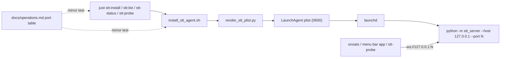
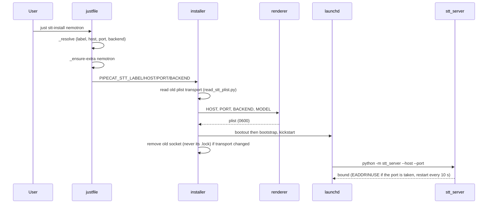

# Task: STT LaunchAgents on loopback TCP ports (TTS parity)

**Status**: Implemented, in review (PR #16). Open before merge: the live checks not run on this machine (token-file auth, port-collision loop, socket rollback, login persistence). Open Question 2 (Koda/onoats installer invocation) is answered; the Koda-side follow-ups do not block this merge
**Component**: Install & Packaging
**Assigned to**: Varun Singh
**Priority**: High
**Branch**: feat/stt-recipes-tcp-endpoints
**Created**: 2026-10-25
**Completed**:
**Review Gates**: none

## Objective

Make STT LaunchAgents bind a canonical loopback TCP port per backend, the way `pipecat-local-tts-server` does, and let the `just stt-*` recipes probe any endpoint. Add Kyutai as a fourth agent backend running from its own virtualenv. Ship as 0.5.0 (breaking default transport).

## Context

- The STT agents bind Unix sockets (`stt.sock`, `parakeet.sock`, `nemotron.sock`). The TTS agents bind loopback TCP ports (one backend, one process, one port), and TTS keeps the Unix socket only as the ad-hoc quick-start.
- The menu bar app (in `pipecat-local-tts-server/macos`) starts STT servers on TCP and cannot see socket agents. The TTS recipes resolve those servers; the STT recipes cannot, because they know only the three canonical sockets. Moving the agents to TCP and using the app's own port numbers lets `just stt-status` and `just stt-list` see app-started servers on the same ports.
- Menu bar interop is a dependency, not a deliverable of this plan. The app does not adopt an occupied port yet: its adopt plan (`pipecat-local-tts-server/macos/docs/plans/20261025-feature-macos-adopt-external-servers.md`) is Not Started and `ServiceLifecycle.swift` reports an occupied port as `failed(.portBusy)`. Until that ships, an app-started server and an agent on the same port contend, and the app shows "Port busy". The recipes work either way; `stt-probe` reaches any endpoint.
- Decided by the user (2026-10-25/26): move agents to TCP; loopback only; no token on loopback (same as TTS); `PIPECAT_STT_SOCKET` stays as an explicit opt-in so existing socket agents and onoats keep working until migrated; Kyutai gets full agent support from its own venv; version 0.5.0.
- Decided in `/review-plan` (2026-10-26): ports align with the menu bar app: whisper 9565 and kyutai 9665 are the app's existing numbers (`Service.swift`, `CoreTests.swift:30-31`; Apple Speech 9465 is the app's own and is not an agent). Parakeet 9765 and Nemotron 9865 are new numbers continuing the series; the app does not use them today, and they must be agreed with the app side before release. Env tokens are refused in the renderer, same as TTS.
- A `stt-probe` recipe (explicit `--socket-path` / `--host`+`--port` / `--uri`, passes through to `status`) was added in the first commit on this branch (`0eedf0a`). Its tests are in `tests/test_justfile_recipes.py`.

## Requirements

- One TCP listener per agent (the server binds exactly one listener; TCP and Unix socket cannot share a process).
- Port map is the single source of truth: the documented table in `docs/operations.md`, mirrored by the justfile `_resolve` and the installer's default port. A test fails on drift. The renderer validates the port range 1-65535 only, as in TTS, and is not part of the mirror. Canonical ports (all on `127.0.0.1`): whisper/mlx 9565, parakeet 9765, nemotron 9865, kyutai 9665. `echo` has no canonical port, so an `echo` install requires an explicit `PIPECAT_STT_PORT`.
- Host is loopback only (`127.0.0.1`, `::1`, `localhost`, the set the server accepts). The renderer rejects any other `HOST` with exit 2 and writes no plist.
- Transport selection: `PIPECAT_STT_SOCKET` (alias `KODA_STT_SOCKET`) set and non-empty means socket mode, and its plist is byte-identical to today's. Otherwise the agent is TCP. An empty string counts as unset in both the installer and the renderer. The installer exports `SOCKET_PATH` only in socket mode and `HOST`/`PORT` only in TCP mode; the renderer treats both as an error. No new `KODA_*` aliases for the new variables.
- Auth: no token on loopback by default. `--auth-token-file` is optional. The renderer refuses `PIPECAT_STT_AUTH_TOKEN` (and the `KODA_` alias) in its environment, as TTS does, and tells the caller to use a token file. This is a breaking change for agents installed with an env token and is called out in the CHANGELOG and migration guide.
- Kyutai runs from `.venv-kyutai`. `_ensure-extra` creates it with `--python 3.12` and never syncs the kyutai extra into the shared `.venv` (it conflicts with mlx, parakeet and nemotron). `.venv-kyutai/` is added to `.gitignore`.
- Interpreter selection: one variable, `PIPECAT_STT_PYTHON`, overrides the interpreter. The installer defaults it to `<repo>/.venv-kyutai/bin/python` for kyutai and `<repo>/.venv/bin/python` otherwise. The justfile `_ensure-extra` creates the venv at the path the installer expects, and the Kyutai seam depends on that one default.
- The installer reads the existing plist's `ProgramArguments` (via `scripts/read_stt_plist.py`, stdlib `plistlib`) before `bootout`. If the old agent was a socket agent and the new one is TCP, it prints a one-line endpoint-changed note and removes the old socket, owner-checked. Uninstall removes the socket based on the transport found in the installed plist, not on the caller's env. Neither removes `<socket>.lock`: the server never unlinks it, and an installer unlink after its lock check would let two servers lock two inodes at one path (changed in review round 6; before that both were removed).
- `stt_server/client.py` and `stt_server/protocol.py` stay untouched (`test_branch_diff_does_not_touch_koda_surface` fails otherwise).
- Docs say plainly that loopback TCP has no peer-uid check: any local process can connect. Unix sockets keep the uid check. Docs also say a taken port makes launchd restart the agent every 10 seconds (`KeepAlive` with `ThrottleInterval: 10`) and name the log to read.

## Review Focus

- Security: TCP loses the Unix-socket peer-cred (uid) check. Confirm the docs state this and that `--auth-token-file` works for those who want a token. Confirm the renderer refuses env tokens and never writes a secret into the plist.
- Renderer injection safety: every new value (`HOST`, `PORT`, `AUTH_TOKEN_FILE`) is allowlist-validated and goes through `plistlib`.
- Backward compatibility: the socket opt-in plist is byte-identical to the current snapshot; legacy `koda.*` retirement in the installer is unchanged. Stdout of the installer is not part of that guarantee.
- Mirror test: the port table in `docs/operations.md` equals `_resolve` and the installer's default port. The renderer is checked for backend names only (`_BACKEND_RE`) and the port range.
- Kyutai venv isolation: an install or enable of any other backend must not touch `.venv-kyutai`, and a kyutai install must not touch `.venv`.
- The lock file `<socket>.lock` exists only for sockets; TCP exclusivity comes from the port bind (`EADDRINUSE`).
- Downstream: a reinstall without `PIPECAT_STT_SOCKET` flips an agent to TCP. Confirm how onoats and Koda invoke the installer before merge.

## Implementation Checklist

### Phase 1: Renderer

**Impl files:** `scripts/render_stt_plist.py`
**Test files:** `tests/test_render_stt_plist.py, tests/snapshots/pipecat-stt.plist, tests/snapshots/pipecat-stt-tcp.plist`
**Test command:** `.venv/bin/python -m pytest tests/test_render_stt_plist.py -v`
**Goal:** The TCP plist is the default; the socket plist is unchanged byte-for-byte when `SOCKET_PATH` is given.

- Accept `HOST` (default `127.0.0.1` only when `SOCKET_PATH` is unset) and `PORT` (1-65535); emit `--host H --port P` instead of `--socket-path`. `SOCKET_PATH` and `HOST`/`PORT` are mutually exclusive; both set is exit 2. Empty strings count as unset. Give the test helper `_run_render` a way to drop keys from the base env.
- Reject non-loopback `HOST`: parametrize accepts (`127.0.0.1`, `::1`, `localhost`) and rejects (`0.0.0.0`, `127.0.0.2`, `192.168.1.10`, a hostile string); assert exit 2 and no plist written.
- Add `kyutai` to `_BACKEND_RE`; keep `MODEL` required.
- Optional `AUTH_TOKEN_FILE` (absolute path, `_ABSPATH_RE`) passes `--auth-token-file`; omitted by default. Refuse `PIPECAT_STT_AUTH_TOKEN` / `KODA_STT_AUTH_TOKEN` in the environment with a message pointing to `AUTH_TOKEN_FILE`. Replace the existing "token written to env" renderer test.
- Log basename for `pipecat.stt-server.kyutai` follows the existing dot-to-dash rule.
- New snapshot for the TCP default; the existing socket snapshot stays as the opt-in case (the existing byte-for-byte test already runs with `SOCKET_PATH` set).

### Phase 2: Installer

**Impl files:** `scripts/install_stt_agent.sh`
**Test files:** `tests/test_install_migration.py`
**Test command:** `.venv/bin/python -m pytest tests/test_install_migration.py -v`
**Goal:** `install` with no transport env produces a TCP agent on the backend's canonical port; with `PIPECAT_STT_SOCKET` it produces today's socket agent.

- New env `PIPECAT_STT_HOST` (default `127.0.0.1`), `PIPECAT_STT_PORT` (default from the backend's canonical port; `echo` errors without one), `PIPECAT_STT_AUTH_TOKEN_FILE`. Export `HOST`/`PORT`/`AUTH_TOKEN_FILE` to the renderer in TCP mode only; in socket mode export `SOCKET_PATH` only. Today `render_plist()` exports every variable unconditionally, so gate the exports.
- Socket mode only when `PIPECAT_STT_SOCKET` (or `KODA_STT_SOCKET`) is non-empty; keep `validate_socket_path` and socket-dir creation for that case only. TCP mode skips the socket directory work and must not create `~/Library/Caches/pipecat-stt`.
- `DEFAULT_MODEL` arm for kyutai (`kyutai/stt-1b-en_fr-mlx`).
- Interpreter: replace the hardcoded `PYTHON=$REPO_ROOT/.venv/bin/python` (line 91) with `PIPECAT_STT_PYTHON`, defaulting per backend as in Requirements. Make the "run `uv sync` first" hint backend-specific. Run the `-x` check only for subcommands that need the interpreter, so `uninstall`, `status` and `logs` do not require `.venv-kyutai`. `WorkingDirectory` stays `REPO_ROOT`.
- Install prints `endpoint: host:port` (or `socket:` in socket mode). Read the old plist before `bootout`; on a socket-to-TCP change print the endpoint-changed note and remove the old socket (never its `.lock`). Uninstall decides socket cleanup from the installed plist.
- Tests: default install per backend reads `--port` from the rendered plist; no socket dir is created and the plist has no `--socket-path`; socket opt-in goes through the real installer and matches the socket snapshot; a seeded `--socket-path` plist triggers the note and cleanup; kyutai paths use `PIPECAT_STT_PYTHON` pointing at the test interpreter; empty-string `PIPECAT_STT_SOCKET` means TCP. The installer default-port-versus-docs comparison is added in Phase 3 with the mirror test.

### Phase 3: Port table, justfile and mirror test

**Impl files:** `docs/operations.md, justfile, .gitignore`
**Test files:** `tests/test_justfile_recipes.py`
**Test command:** `.venv/bin/python -m pytest tests/test_justfile_recipes.py tests/test_install_migration.py -v`
**Goal:** The documented port table lands in the same commit as the code that mirrors it, so no phase boundary leaves the mirror test red.

- Replace the "Per-ASR socket convention" table in `docs/operations.md` with a "Per-backend port convention" table (ASR, LaunchAgent label, port; the kyutai row replaces the "not wired" note, quoting its sentence exactly: "is not wired into the LaunchAgent tooling"). Rewrite `_readme_map()` and `test_justfile_map_mirrors_readme` to parse it and compare label and port against `_resolve` and the installer's default (invoke the installer's default-port logic, not the justfile delegation stub, which passes the port explicitly). Update `test_resolve_maps_each_backend` and `test_install_uninstall_delegate_exact_env` (the `SOCKET=` assertions) in this phase.
- `_resolve` prints four fields: label, host, port, backend-name; add `kyutai` (`pipecat.stt-server.kyutai`, 9665, `kyutai`). Update all five callers together: `stt-status`, `stt-disable`, `stt-enable`, `stt-install`, `stt-uninstall` (the last three and `stt-disable`/`stt-enable` currently read three lines).
- `stt-status` mirrors `tts-status`: a target with `/` or an existing socket file is `--socket-path`, probing the socket first; a bare backend name resolves to `--host/--port`; use a longer probe timeout (model load after install). No socket fallback in `stt-list` when no plist exists.
- `stt-list` reads host, port, socket and auth-token-file from each plist (a `_plist_endpoint` helper like TTS) so custom and socket agents are probed too, and forwards `--auth-token-file`; keep the always-exit-0 behaviour. Test fixtures are rendered plists (TCP, socket, token-file), not the empty plists `_home_with_agents` writes today.
- Keep `stt-probe`; add tests (it requires an explicit endpoint, exits 2 otherwise, forwards `--json`). `stt-install`/`stt-uninstall` pass `PIPECAT_STT_HOST`/`PORT` from `_resolve`; socket mode only when the caller sets `PIPECAT_STT_SOCKET`.
- `_ensure-extra`: the kyutai arm runs `UV_PROJECT_ENVIRONMENT=.venv-kyutai uv sync --python 3.12 --extra kyutai`, never touches `.venv`, and probes `.venv-kyutai/bin/python -c "import moshi_mlx"`. The other arms keep `uv sync --extra X --inexact` into `.venv`. Extend the `uv` stub to log `UV_PROJECT_ENVIRONMENT` and `--python`, unset `PIPECAT_STT_SKIP_DEP_SYNC` in these tests, and make the venv path overridable for tests. Add `.venv-kyutai/` to `.gitignore` in this commit.
- Decide the known-failing `test_stt_list_prints_socket_in_tilde_form`: rewrite it against a rendered socket plist so it passes on macOS temp dirs, so Phase 5 needs no deselect.
- Update the justfile header comment: the map mirrors the `docs/operations.md` port table.

### Phase 4: Docs and release

**Impl files:** `docs/operations.md, docs/integration.md, docs/migration.md, README.md, CHANGELOG.md, pyproject.toml, uv.lock, docs/dev_plans/README.md`
**Test files:** `tests/test_docs_port_caveats.py`
**Test command:** `.venv/bin/python -m pytest tests/test_docs_port_caveats.py tests/test_justfile_recipes.py tests/test_render_stt_plist.py tests/test_install_migration.py -v`

- `docs/operations.md`: TCP agent workflow, Kyutai agent and its venv, socket opt-in, the no-uid-check caveat, the 10-second restart loop when a port is taken, status/probe examples (use the STT ports, not the TTS kokoro port 8765; note the TTS 8665-9365 and menu bar 9465-9665 ranges), token-file instructions replacing the env token. `docs/integration.md`: clients use `STT_WS_HOST`/`STT_WS_PORT` for agents. `docs/migration.md`: upgrading a socket agent (reinstall, then update client config), the env-token refusal, and a rollback line: `PIPECAT_STT_SOCKET=<path> just stt-install <backend>`. `README.md`: quick-starts and per-backend examples.
- Before writing the onoats migration steps, read onoats' config loader to confirm how it takes a server endpoint; until then those lines are marked unverified.
- CHANGELOG `[0.5.0]` with an upgrade note: the default agent transport changed; set `PIPECAT_STT_SOCKET` to keep a socket agent; env tokens are refused. Bump `pyproject.toml` and `uv.lock` to 0.5.0. Index row in `docs/dev_plans/README.md`.
- A small test greps `docs/operations.md` for the no-uid-check caveat and the restart-loop note, so those acceptance criteria are mechanical.

### Phase 5: Verify on this machine

**Impl files:** none
**Test files:** none
**Test command:** `.venv/bin/python -m pytest -q`
**Validation cmd:** `just stt-probe --host 127.0.0.1 --port 9865`

- Full suite, `ruff format`, `ruff check`.
- Manual (needs the user): reinstall the mlx and nemotron agents, confirm `just stt-list` and `just stt-status` show TCP endpoints, and check a client session with `just stt-probe --host 127.0.0.1 --port <port>` plus a transcription from `TranscriptionClient`. `scripts/smoke_supervised.py` spawns its own servers on sockets and cannot target an agent; add a TCP scenario to it only if a named task asks for one. Do not touch the running agents without the user's go-ahead.
- Kyutai: create `.venv-kyutai`, install the agent, and run a real decode. This is the first time `moshi_mlx` runs under `stt_server` as an agent. If it fails to load, keep the kyutai row but mark it experimental and record the failure in Findings.

## Technical Specifications

### Files to Modify

- `scripts/render_stt_plist.py` - `HOST`/`PORT`/`AUTH_TOKEN_FILE`, kyutai allowlist, loopback check, socket/TCP exclusivity, env-token refusal.
- `scripts/install_stt_agent.sh` - transport env, per-backend default port, `PIPECAT_STT_PYTHON`, kyutai model, old-plist read, endpoint output, socket-mode-only socket handling, gated exports.
- `justfile` - `_resolve` (4 fields, kyutai), `stt-status`, `stt-list`, `stt-probe`, `stt-install`/`stt-uninstall`/`stt-disable`/`stt-enable`, `_ensure-extra`.
- `docs/operations.md`, `docs/integration.md`, `docs/migration.md`, `README.md`, `CHANGELOG.md`, `pyproject.toml`, `uv.lock`, `docs/dev_plans/README.md`, `.gitignore`.
- `tests/test_render_stt_plist.py`, `tests/test_install_migration.py`, `tests/test_justfile_recipes.py`, `tests/snapshots/pipecat-stt.plist` (+ a new TCP snapshot).

### New Files to Create

- `tests/snapshots/pipecat-stt-tcp.plist` - TCP default snapshot.
- `tests/test_docs_port_caveats.py` - greps the docs for the caveats the acceptance criteria name.

### Architecture Decisions

- Loopback only: the server enforces it, so the renderer fails early (no TTS-style "non-loopback needs a token" branch is reachable).
- Socket stays opt-in, not removed, so onoats and existing agents migrate on the user's schedule; a non-empty `PIPECAT_STT_SOCKET` means socket mode.
- Ports follow the menu bar app's numbers (whisper 9565, kyutai 9665) so one convention covers recipes and app. Parakeet 9765 and Nemotron 9865 were proposed and confirmed by the app side on 2026-10-26 (Open Questions item 1). Agent and app contend for a port until the app's adopt plan ships.
- The renderer is range-only for ports, as in TTS; the mirror covers the docs table, `_resolve` and the installer.
- No new `KODA_*` aliases for `HOST`/`PORT`/`AUTH_TOKEN_FILE` (aliases are deprecated). Env tokens are refused (TTS parity) in a release that is already breaking.
- Kyutai gets a separate venv rather than sharing `.venv`, because of the declared extra conflict (`moshi_mlx` pins `mlx<0.27`, `huggingface-hub<0.29`; Python 3.12 only, so `--python 3.12` is explicit).
- Port collision: no pre-install bind check (same as TTS). A taken port shows as a 10-second restart loop in the agent log; the docs say so.
- No code change in `stt_server/` (server already supports `--host/--port/--auth-token-file`); `client.py`/`protocol.py` untouched.

### Dependencies

- None new. `just` 1.59 (`[positional-arguments]` used by `stt-probe`, verified to forward `"$@"`). `uv` with `--python` support.

### Integration Seams

| Seam | Writer (task) | Caller (task) | Contract |
|------|---------------|---------------|----------|
| Port map | `docs/operations.md` table (Phase 3) | `_resolve` (Phase 3), installer default (Phase 2) | The three agree; the mirror test fails on drift. The renderer holds no port map. |
| Renderer env | `install_stt_agent.sh` (Phase 2) | `render_stt_plist.py` (Phase 1) | Socket mode exports `SOCKET_PATH` only; TCP mode exports `HOST`/`PORT` (+ optional `AUTH_TOKEN_FILE`) only; empty equals unset on both sides |
| Plist endpoint | renderer (Phase 1) | `stt-list` `_plist_endpoint` (Phase 3), installer old-plist read (Phase 2) | Reads `--host/--port` or `--socket-path` and `--auth-token-file` from `ProgramArguments` |
| Interpreter | `PIPECAT_STT_PYTHON` default in the installer (Phase 2) | `_ensure-extra` kyutai arm (Phase 3) | One variable and one default path, `.venv-kyutai/bin/python` for kyutai |
| Consumer default | `stt-install` (Phase 3) | clients: `STT_WS_HOST`/`STT_WS_PORT` (docs, Phase 4) | A bare install binds TCP; an env-less client resolves to nothing, so the docs and the migration guide state the env to set |

## Architecture & Call Flow

Component graph:

Trigger order for `just stt-install nemotron`:

| Step | Trigger | Enters context | Cleared/persisted | Turn boundary |
|------|---------|----------------|-------------------|---------------|
| 1 | `just stt-install <backend>` | backend name | process env only | resolve done |
| 2 | `_ensure-extra` | extra name, venv path | packages persist in `.venv` / `.venv-kyutai` | probe passes |
| 3 | installer | env vars, old plist transport | plist persisted in `~/Library/LaunchAgents`; old socket removed (its `.lock` kept) | plist written |
| 4 | launchd | plist | agent state persists across logins (`RunAtLoad`, `KeepAlive`) | agent bound |
| 5 | client connects | `STT_WS_HOST`/`PORT` or `--host/--port` | none | `hello` received |

## Testing Notes

### Test Approach

- [x] Renderer: TCP default and socket opt-in snapshots; exclusivity; empty-string semantics; loopback accept/reject set; kyutai allowed; invalid port; token-file path validation; env token refused
- [x] Installer: default TCP per backend (port read from the rendered plist); socket opt-in through the real installer; no socket dir in TCP mode; seeded socket plist triggers the note and cleanup; legacy `koda.*` migration unchanged; kyutai via `PIPECAT_STT_PYTHON`
- [x] Justfile (stubbed `uv`/`launchctl`): `_resolve` four fields; five callers; `stt-status` target resolution; `stt-list` against rendered TCP, socket and token-file plists; `stt-probe` requires an explicit endpoint; `_ensure-extra` kyutai arm logs `UV_PROJECT_ENVIRONMENT` and `--python 3.12`
- [x] Mirror test: operations.md port table equals `_resolve` and the installer default
- [x] Docs test: no-uid-check caveat and restart-loop note present
- [x] Guard: `test_branch_diff_does_not_touch_koda_surface` still passes

### Test Results

- [x] All existing tests pass, including the rewritten tilde-form test (no deselect)
- [x] New tests added and passing
- [ ] Manual verification complete (Phase 5): agents reinstalled and decoding live; `stt-list`/`stt-status` verified by the user after migration; token-file auth checked live 2026-10-27 on a spare loopback port without launchd (loose, symlinked, relative, missing and `/tmp` files refused; a private 0600 file accepted and bearer auth enforced); port-collision loop, socket rollback and login persistence not yet checked live

### Edge Cases Tested

- [x] Both `SOCKET_PATH` and `HOST`/`PORT` set
- [x] Empty-string `PIPECAT_STT_SOCKET`
- [x] Reinstall over an existing socket agent (note printed, socket removed, `.lock` kept)
- [x] Kyutai install does not modify `.venv`; mlx install does not modify `.venv-kyutai`
- [ ] Port already bound at kickstart: manual only (launchd-level; server-level `EADDRINUSE` is covered by `tests/test_supervised_cli.py`)

## Acceptance Criteria

- `just stt-install <whisper|parakeet|nemotron|kyutai>` creates a loopback TCP agent on 9565/9765/9865/9665 by default.
- With `PIPECAT_STT_SOCKET` set, the rendered plist is byte-identical to `tests/snapshots/pipecat-stt.plist`.
- `just stt-status <backend>` and `just stt-probe --host H --port N` probe the live server; `stt-list` shows TCP and socket agents with the live backend.
- The port table, `_resolve` and the installer default agree and the mirror test enforces it.
- The renderer refuses env tokens and non-loopback hosts, with tests.
- `docs/operations.md` states the no-uid-check caveat and the restart-loop behaviour (docs test).
- Full suite, `ruff format` and `ruff check` clean with no deselect; CHANGELOG `[0.5.0]` with upgrade notes; version 0.5.0.

## Open Questions

1. ~~Parakeet 9765 and Nemotron 9865 are proposals.~~ RESOLVED 2026-10-26: the `pipecat-local-tts-server` session (menu bar app side) confirmed both numbers match its toolbar plan, needs no 0.5.0 pin, and asked to be told when 0.5.0 is released (reported by that session; not checked against its repo here). `docs/operations.md` stays the port table of record.
2. ~~Koda and onoats: how do they invoke the installer?~~ ANSWERED 2026-10-26 (reported by the onoats-bot and Koda sessions after a code check; not read in their repos from here). onoats never runs the installer; it only runs `launchctl kickstart` when `[stt].launchd_label` is set, sets no `PIPECAT_STT_*`/`KODA_STT_*` variable, and with nothing configured uses a live `stt.sock` if present, else `127.0.0.1:9565` (9765/9865 need `ws_host`/`ws_port`); its change is held until 0.5.0 is released. Koda runs the installer directly (`./koda stt install|uninstall|start|stop|restart|logs` execs `install_stt_agent.sh <verb>` with the caller's environment and no flags), so a bare `./koda stt install` now installs a TCP agent. Koda-side follow-ups, not blocking this merge: its `.env` line `STT_WS_SOCKET=...nemotron.sock` outranks `STT_WS_HOST`/`PORT` and must go after a TCP reinstall; its wrapper exports `STT_WS_DEFAULT_SOCKET=...stt.sock`, which outranks onoats' TCP default and points at a socket that is removed once the old job unloads; its README, `docs/architecture.md` and `docs/operator-runbook-stt-extraction.md` still describe `KODA_STT_AUTH_TOKEN`. Koda has no token-file config. Operators who want to keep a socket agent set `PIPECAT_STT_SOCKET` (or `KODA_STT_SOCKET`) in the environment of `./koda stt install`.
3. ~~onoats' config loader~~ RESOLVED 2026-10-26: verified against onoats-bot `1a7b8c7` (see Findings); it reads `STT_WS_HOST`/`STT_WS_PORT`, and a leftover `ws_socket` outranks them.
4. ~~Does `moshi_mlx` load as an agent from `.venv-kyutai`?~~ RESOLVED 2026-10-26: it loads and decodes live; no "experimental" fallback needed.

<!-- reviewed: 2026-10-26 @ 806e7fcf835d25e85e9d75f6e640ccf0c52fe2a6 -->

## Progress

- [x] Phase 1: Renderer
- [x] Phase 2: Installer
- [x] Phase 3: Port table, justfile and mirror test
- [x] Phase 4: Docs and release
- [x] Phase 5: Verify on this machine (2026-10-26: full suite 1204 passed / 7 skipped after the owner-requested post-round-7 fixes (1123 after round 7; 1044 after round 5) (a 54-cell transport scraper test was replaced by 9 cases) (801 at the first Phase 5 run), ruff format+check clean, all four agents running as loopback TCP agents reporting their live backend in `just stt-list`; the explicit `TranscriptionClient` decode check is recorded below for the three agents reinstalled first, and the fourth is reported decoding live by the user, not re-run here; token-file auth, port-collision restart loop, socket rollback and login persistence deferred, not checked live)

## Findings

- (append findings here as work proceeds)
- 2026-10-26: the user ran `just stt-list`, `just stt-status` (no argument) and `just stt-status kyutai` after reinstalling all three agents: TCP endpoints 9565/9865/9665 with live backends mlx/nemotron/kyutai; the no-argument form behaves as `stt-list`.
- Phase 1 reviewer (advisory, Minor, unfixed): (a) `scripts/render_stt_plist.py` module docstring (lines ~11-13) still describes env tokens via `env_first`; reword. (b) `_require` uses `re.match` with `$`, which accepts a trailing newline (AUTH_TOKEN_FILE/SOCKET_PATH/PYTHON); use `fullmatch` and add a trailing-newline test case.
- Phase 2 reviewer (advisory, Minor, unfixed): (a) `remove_socket_owned` (`scripts/install_stt_agent.sh` ~149-160) deletes whatever `--socket-path` the installed plist names after only an owner check; add `-S` / regular-file / no-symlink checks and validate_socket_path's lexical rules (warn and skip). (b) Socket mode silently drops `PIPECAT_STT_AUTH_TOKEN_FILE`/`HOST`/`PORT`; warn on stderr. (c) `test_env_auth_token_never_reaches_plist` should also assert the secret is absent from stderr. (d) No test for ambient `SOCKET_PATH`/`HOST`/`PORT`/`AUTH_TOKEN_FILE` leaking into the renderer.
- Phase 3 reviewer (advisory, all Minor, unfixed): (a) `_ensure-extra` shared arm does not clear an inherited `UV_PROJECT_ENVIRONMENT` (pin it or `env -u`; test with ambient value). (b) Mirror test uses a hard-coded `BACKENDS` tuple; derive it from `_resolve` and assert equality with the docs rows. (c) `test_port_table_matches_installer_default` skips without `.venv/bin/python` though it uses a `sys.executable` wrapper; drop the skipif. (d) `_venv_overrides` `forced=False` escape hatch silently weakens the shared-venv test; assert exactly one main-venv variable. (e) `stt-list` uses `read -r` without `IFS=`; paths with edge whitespace; add a spaces test. (f) `stt-install`/`stt-uninstall` always overwrite caller `PIPECAT_STT_HOST`/`PORT` with the `_resolve` values (matches the plan; docs must say custom ports need the installer script directly, or honour `${PIPECAT_STT_PORT:-$port}`). (g) Stale wording: `docs/operations.md` intro (lines ~9-11, 'separate socket'), `stt-probe` comment uses TTS port 8765 and 'canonical-socket recipes', `README.md:44` still says kyutai 'is not wired into' the tooling (Phase 4). (h) `stt-status` `-S` branch resolves bare socket names against the repo root.
- Review-fix round (2026-10-26): ALL findings above FIXED with regression tests, except Phase 3 (f), kept by decision (`stt-install`/`stt-uninstall` use the canonical host/port; docs say custom ports need the installer script). Also: `stt-status` now takes an optional target (no target = `stt-list`) and probes the installed plist's endpoint for a bare backend name (canonical host/port only when no plist exists); kyutai sync uses `--frozen`; `remove_socket_owned` only touches a real socket / regular lock under `$HOME`. Full suite 801 passed, 7 skipped.
- Phase 5 live verification (2026-10-26, user reinstalled three agents first; a later `just stt-list` showed all four, including parakeet on 9765, running on 127.0.0.1 with live backends, and the user's handoff states all four decode live): whisper 9565, nemotron 9865 and kyutai 9665 are loaded as loopback TCP agents; a `TranscriptionClient` decode of a synthesised sentence returned the expected text on all three. Open Question 4 RESOLVED: `moshi_mlx` loads and decodes as an agent from `.venv-kyutai` (no 'experimental' fallback needed). A nemotron reinstall hit `Bootstrap failed: 5` (bootout is asynchronous); fixed in the installer with a wait-for-unload loop and one bootstrap retry. `stt-list`/`stt-status` after migration were checked live by the user (see the 2026-10-26 finding above). Not yet checked live: token-file auth, port-collision restart loop, socket rollback, login persistence. The server's 'no --auth-token' warning used to recommend `PIPECAT_STT_AUTH_TOKEN` (refused by the installer); it is now an INFO line that names `--auth-token-file` (`stt_server/server.py`).
- Phase 4 onoats config loader VERIFIED against onoats-bot `1a7b8c7` (Open Question 3 resolved): `src/onoats/config/__init__.py:367-382` (`stt_ws_socket/host/port/uri` from env `STT_WS_*`, else `config.toml [stt] ws_*`, env wins); `src/onoats/runtime.py:408-426` `_ws_env`, `:291-312` -> this repo's `resolve_endpoint_from_env`. A leftover `ws_socket` outranks `ws_host`/`ws_port`. Koda/onoats installer invocation remains unverified (Open Question 2); docs say to check before upgrading.
- Phase 4 reviewer (advisory, unfixed). Important: (a) `docs/migration.md` understates the onoats hazard: `onoats init` (`init.py:443,758`) carries only `ws_socket`, drops `ws_host`/`ws_port`, and onoats then falls back to `_DEFAULT_STT_WS_SOCKET` (`runtime.py:288`), which the reinstall removed. (b) `docs/integration.md` Koda section does not state that `./koda stt install` without `PIPECAT_STT_SOCKET`/`KODA_STT_SOCKET` flips to TCP and removes the socket Koda's client falls back to. (c) `scripts/install_stt_agent.sh` header recipe still says a default-env install is a socket agent (now TCP 9565); operations.md points at that header. Minor: (d) README + migration step 2 custom-port example lacks `PIPECAT_STT_LABEL`/`BACKEND` (would replace the whisper agent). (e) token-file example `install -m 600 /dev/null ~/.config/...` fails when `~/.config` is missing. (f) A/B benchmark section still assumes sockets; add `--whisper-uri ws://127.0.0.1:9565 --parakeet-uri ws://127.0.0.1:9765`. (g) README:20 'Unix domain socket by default for `serve`' is wrong (no default endpoint). (h) CHANGELOG says `PIPECAT_STT_HOST/PORT/AUTH_TOKEN_FILE` go to the renderer; the renderer reads `HOST/PORT/AUTH_TOKEN_FILE`; `PIPECAT_STT_PYTHON` missing from CHANGELOG and integration.md. (i) `docs/dev_plans/README.md` row still 'Not started'; update at completion. (j) README still says every backend syncs with `--inexact`; kyutai uses `.venv-kyutai`.
- Review-gauntlet round 1 (2026-10-26), fixed with regression tests: old socket and `.lock` (the `.lock` is no longer removed since round 6) are removed only after the new job bootstrapped and the old one is seen unloaded (`uninstall` waits too), and a socket A->B reinstall retires A; socket cleanup rejects a symlinked directory component; a TCP reinstall over an agent that carried a token (env token or `--auth-token-file`) without `PIPECAT_STT_AUTH_TOKEN_FILE` fails instead of dropping auth; the token file is validated (regular, not a symlink, owned, no group/other bits, non-empty); `PIPECAT_STT_UNLOAD_WAIT` must be a non-negative integer; the installer's backend names equal the renderer's (`whisper` arm dropped, checked before any mkdir); the installer's plist reader uses the same element walk as `_plist_endpoint` (parity test); `stt-install`/`stt-uninstall` pass HOST/PORT only in TCP mode; nested `just` calls forward `la_dir`/`venv`/`kyutai_venv`; the docs version test is a floor, not a 0.5.0 pin. Kept by decision: no token by default on loopback; `stt-list`/`stt-status` forward the plist's `--auth-token-file` to the probe; a failed bootstrap still leaves the new plist in place (only the socket is kept). The server's 'no token' warning wording was fixed afterwards (now INFO, names `--auth-token-file`).
- /code-review follow-ups (2026-10-26), all fixed with tests: the env token gets the token file's visible-ASCII check (`stt_server.env.check_token_chars`, now `stt_server.auth`); the installer's token preflight loads the renderer's `_ABSPATH_RE` so the two cannot drift (now via the renderer's `--check-abspath` mode, round 4); the installer and the justfile read an installed plist through one stdlib helper, `scripts/read_stt_plist.py`, replacing two `plutil` loops and the parity test; the probes run `uv run --no-sync` so they cannot prune backend extras.
- Review-gauntlet round 4 (2026-10-26), fixed with regression tests: (1) `scripts/read_stt_plist.py` separates an absent, a readable and a malformed plist (truncated XML raised `ExpatError`, which escaped the catch, and every reader failure read as "no auth"): `--has-auth` exits 0 (token), 3 (no token; not 1, which a traceback or a broken `python3` shim also exits with) or 2 (cannot tell), the four-line sweep still exits 0 with blank fields and a one-line warning; the installer aborts an install on anything but 0/3 and an uninstall skips socket cleanup. (2) The token-file preflight validates and the plist records the symlink-free resolved path (validated == opened); a group-writable parent passes only when root owns it with group wheel (0) or admin (80), or it is sticky. (3) Socket and `.lock` cleanup probes the lock (shared non-blocking `flock`, as `socket_lock_held`) and leaves both when it is held or cannot be checked. (4) Docs: plan `plutil` mentions, migration.md now agrees with integration.md on the Koda wrapper, operations.md on when the lock is unlinked. (5) `LOOPBACK_HOSTS` and the token helpers (`read_token_file`, `check_token_chars`) moved to a new `stt_server/auth.py` (no re-export from `stt_server.env`); the server and the renderer use the one set, while `stt_server/client.py` keeps its private copy (Koda-imported surface, frozen on this branch) pinned by a test; the preflight calls the renderer's new `--check-abspath NAME VALUE` mode instead of loading the module for `_ABSPATH_RE`. Full suite after round 4: 991 passed / 7 skipped; ruff format+check and shellcheck clean.
- Review-gauntlet round 5 (2026-10-26), fixed with regression tests: (1) the plist reader reads serve flags with the server's grammar: `serve` now has `allow_abbrev=False` (full flag names only; `--auth-token /x` fails at startup), the reader handles `--flag=value` and does not take the element after `--supervised` as a value; a table-driven test compares it with the real parser (`_build_parser`). (2) `uninstall` waits for unload on every transport and prints `uninstall incomplete (still loaded)` with a warning instead of `uninstalled` when the job outlives the cap (exit 0 as before). (3) The token-file check reads the sticky bit from the numeric mode (1770 `T` counts) and refuses macOS ACL allow entries on the file, or allow entries with a write-class right on a walked directory (deny entries pass). (4) `installed_arg` uses the reader's new `--strict` form and fails on a malformed plist by itself, so it no longer depends on `installed_auth_state` running first; install runs the reader under `$PYTHON`, uninstall and the justfile keep the system `python3`. (5) The held-lock test takes the lock through `acquire_socket_lock` and pins `_lock_path`; `lock_free` stays a deliberately stricter local copy. (6) Docs: a trailing newline in a token file is stripped and fine; `stt_server/auth.py` docstring. Full suite after round 5: 1044 passed / 7 skipped; ruff format+check and shellcheck clean.
- Review-gauntlet round 6 (2026-10-26), fixed with regression tests: (1) the token-file parent walk no longer exempts a sticky directory: group write passes only on a root-owned `wheel`/`admin` directory and other write never, so a token file under `/tmp` is refused (the server re-opens the path at every start; an owner/`O_NOFOLLOW` check in `read_token_file` is left to a follow-up ticket). (2) Socket cleanup removes only the stale socket and never unlinks `<socket>.lock`, matching the server (a probe-then-unlink let two starters lock two inodes at one path). (3) A timed-out wait on `uninstall` (or a socket-path-changing install) prints the command that removes the stale socket by hand instead of advising a re-run that could not find it. (4) The raw-token refusal expands only lengths, so `bash -x` never traces the token. (5) `_ensure-extra` probes `PIPECAT_STT_PYTHON` when set and fails instead of syncing the venv. (6) `lock_free` runs under `READER_PYTHON`. (7) Docs: README documents `PINNED_REVISIONS`; parakeet 9765 / nemotron 9865 are recorded as confirmed. Full suite after round 6: 1082 passed / 7 skipped; ruff format+check and shellcheck clean.
- Review-gauntlet round 7 (2026-10-26), fixed with regression tests: (1) socket cleanup holds its shared flock on `<socket>.lock` through the unlink: the lock check, the socket checks (lstat socket, not a symlink, owned) and the unlink run in one python process (`unlink_socket_under_lock`), so a server that locks and binds meanwhile never loses its fresh socket; with no regular `.lock` the entry is re-read before the unlink, and the installer still never creates or unlinks the `.lock` (table test over lock {absent, free, held} x target {socket, regular, symlink, other uid}, with an `os.remove` audit hook). (2) The manual removal command printed after a timed-out wait is offered only for a path the shared `socket_path_unsafe` predicate accepts, and is `test -S P && ! test -L P && test -O P && rm -f -- P` with P `%q`-quoted. (3) `_ensure-extra` re-probes the import after a successful `uv sync` and fails if it still fails. (4) `stt-disable` waits (30 s cap) until launchd no longer lists the label before printing `booted out`, so `stt-enable` right after it no longer hits bootstrap error 5. (5) Docs: no remaining claim that reinstall or uninstall removes the `.lock`; CHANGELOG records the round-6 `PIPECAT_STT_PYTHON` probe. Not fixed (ticketed or low impact): the server-side token-file parent rule (with the `O_NOFOLLOW` hardening ticket); `_ensure-extra`'s default interpreter can diverge from the installer's under a `venv=` override. Full suite after round 7: 1123 passed / 7 skipped; ruff format+check and shellcheck clean.

- Owner-requested fixes after round 7 (2026-10-26), each with regression tests: the five design conflicts parked in rounds 1-7 are reversed; see Decision Deltas below. (1) The token-file policy is one Python implementation, `stt_server.auth.load_token_file` / `check_token_file_policy`; the installer's preflight calls it (its bash walk and `acl_allows` are gone) and `serve --auth-token-file` runs it at every start (`O_NOFOLLOW` open, `fstat` of the descriptor, then the resolved parent walk; the token is read from the same descriptor), so the two sides agree by construction; a table test runs every cell (path, mode, owner, the 14 parent cells, the 10 ACL cells, content) through both the installer and `_resolve_auth_token`. (2) `stt-enable` probes the interpreter its installed plist runs (`ProgramArguments[0]`, via the plist reader), never the caller's `PIPECAT_STT_PYTHON`. (3) `stt-install` passes the interpreter it probed (`_agent-python`) to the installer as `PIPECAT_STT_PYTHON`. (4) `scripts/read_stt_plist.py` answers one named field per call (`--field host|port|socket-path|auth-token-file|interpreter`); the four positional lines are gone. (5) The installer's `canonical_port` is the only backend->port map; `install_stt_agent.sh port [BACKEND]` prints it without launchctl or filesystem access and `_resolve` asks it. Full suite after these fixes: 1204 passed / 7 skipped; ruff format+check and shellcheck clean.

## Decision Deltas

Decisions reversed after review round 7, at the owner's request (2026-10-26; reason for each: owner requested after round 7). The signed-off sections above the review marker keep the original wording; where they disagree, these entries supersede them.

| Date | Was (decision) | Now | Supersedes above the marker | Reason |
|------|----------------|-----|-----------------------------|--------|
| 2026-10-26 | `scripts/read_stt_plist.py` prints host, port, socket-path, auth-token-file as four positional lines that the installer and `_plist_endpoint` split by order | One keyed field per call (`--field NAME`, `--strict` and `--has-auth` unchanged), plus `interpreter` (`ProgramArguments[0]`); the justfile helper is `_plist_field PLIST NAME [strict]`; no consumer depends on line order (structural test) | Integration Seams "Plist endpoint" row (`_plist_endpoint`), Phase 3 `_plist_endpoint` bullet | owner requested after round 7 |
| 2026-10-26 | The justfile keeps its own backend->port map in `_resolve`, mirrored against the docs table and the installer default | The installer's `canonical_port` is the single map; `install_stt_agent.sh port [BACKEND]` prints it (no launchctl, no filesystem), `_resolve` asks it; the docs table is checked against the installer | Integration Seams "Port map" row, Acceptance Criteria "port table, `_resolve` and the installer default agree" (now: `_resolve` derives from the installer) | owner requested after round 7 |
| 2026-10-26 | `stt-enable` (via `_ensure-extra`) probes `PIPECAT_STT_PYTHON` from the caller's env, else the default venv | `stt-enable` probes the installed plist's `ProgramArguments[0]`; the env/default rule applies only when no plist is installed (`stt-install`, which now passes the probed interpreter to the installer as `PIPECAT_STT_PYTHON`, so the justfile and installer defaults can no longer diverge, `venv=` override included) | Integration Seams "Interpreter" row | owner requested after round 7 |
| 2026-10-26 | Server-side token-file hardening (`O_NOFOLLOW`, owner, parent rule at `serve` start) ticketed, not done; the policy lived only in the installer's bash | Done: one Python policy in `stt_server/auth.py`, run by the installer preflight and by `serve --auth-token-file` at every start; behaviour change for hand or supervised launches (a `0644`, relative, symlinked or `/tmp` token file now stops `serve` with a message naming the file and the fix) | Technical Specifications "No code change in `stt_server/`" note | owner requested after round 7 |

### Review Waivers

- (none)

## Issues & Solutions

- (none yet)

## Final Results

- (fill on completion)
- Review-gauntlet round 4 (2026-10-26): the architecture lens flagged the justfile's second copy of the installer's socket-alias rule (reworked in rounds 1-3). Decided by the user: remove it. `stt-install`/`stt-uninstall` now run the installer under `env -u PIPECAT_STT_HOST -u PIPECAT_STT_PORT`, so the installer alone decides socket vs TCP and defaults to the canonical host/port; Phase 3 (f) still holds (recipes use the canonical values, a custom host/port needs the installer script). The justfile alias-pair scraper test is replaced by a test that the justfile no longer mentions the alias pair.
