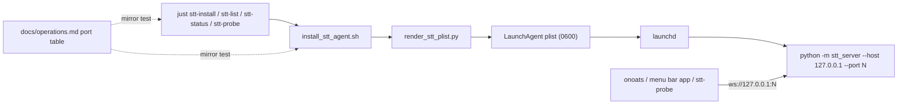

# Task: STT LaunchAgents on loopback TCP ports (TTS parity)

**Status**: Not Started
**Component**: Install & Packaging
**Assigned to**: Varun Singh
**Priority**: High
**Branch**: feat/stt-recipes-tcp-endpoints
**Created**: 2026-10-25
**Completed**: (fill when done)
**Review Gates**: none

## Objective

Make STT LaunchAgents bind a canonical loopback TCP port per backend, the way `pipecat-local-tts-server` does, and let the `just stt-*` recipes probe any endpoint. Add Kyutai as a fourth agent backend running from its own virtualenv. Ship as 0.5.0 (breaking default transport).

## Context

- The STT agents bind Unix sockets (`stt.sock`, `parakeet.sock`, `nemotron.sock`). The TTS agents bind loopback TCP ports (one backend, one process, one port), and TTS keeps the Unix socket only as the ad-hoc quick-start.
- The menu bar app (in `pipecat-local-tts-server/macos`) starts STT servers on TCP and cannot see socket agents. The TTS recipes resolve those servers; the STT recipes cannot, because they know only the three canonical sockets. Moving the agents to TCP and using the app's own port numbers lets `just stt-status` and `just stt-list` see app-started servers on the same ports.
- Menu bar interop is a dependency, not a deliverable of this plan. The app does not adopt an occupied port yet: its adopt plan (`pipecat-local-tts-server/macos/docs/plans/20261025-feature-macos-adopt-external-servers.md`) is Not Started and `ServiceLifecycle.swift` reports an occupied port as `failed(.portBusy)`. Until that ships, an app-started server and an agent on the same port contend, and the app shows "Port busy". The recipes work either way; `stt-probe` reaches any endpoint.
- Decided by the user (2026-10-25/26): move agents to TCP; loopback only; no token on loopback (same as TTS); `PIPECAT_STT_SOCKET` stays as an explicit opt-in so existing socket agents and onoats keep working until migrated; Kyutai gets full agent support from its own venv; version 0.5.0.
- Decided in `/review-plan` (2026-10-26): ports align with the menu bar app: whisper 9565 and kyutai 9665 are the app's existing numbers (`Service.swift`, `CoreTests.swift:30-31`; Apple Speech 9465 is the app's own and is not an agent). Parakeet 9765 and Nemotron 9865 are new numbers continuing the series; the app does not use them today, and they must be agreed with the app side before release. Env tokens are refused in the renderer, same as TTS.
- A `stt-probe` recipe (explicit `--socket-path` / `--host`+`--port` / `--uri`, passes through to `status`) was added in the first commit on this branch (`0eedf0a`). It has no tests yet.

## Requirements

- One TCP listener per agent (the server binds exactly one listener; TCP and Unix socket cannot share a process).
- Port map is the single source of truth: the documented table in `docs/operations.md`, mirrored by the justfile `_resolve` and the installer's default port. A test fails on drift. The renderer validates the port range 1-65535 only, as in TTS, and is not part of the mirror. Canonical ports (all on `127.0.0.1`): whisper/mlx 9565, parakeet 9765, nemotron 9865, kyutai 9665. `echo` has no canonical port, so an `echo` install requires an explicit `PIPECAT_STT_PORT`.
- Host is loopback only (`127.0.0.1`, `::1`, `localhost`, the set the server accepts). The renderer rejects any other `HOST` with exit 2 and writes no plist.
- Transport selection: `PIPECAT_STT_SOCKET` (alias `KODA_STT_SOCKET`) set and non-empty means socket mode, and its plist is byte-identical to today's. Otherwise the agent is TCP. An empty string counts as unset in both the installer and the renderer. The installer exports `SOCKET_PATH` only in socket mode and `HOST`/`PORT` only in TCP mode; the renderer treats both as an error. No new `KODA_*` aliases for the new variables.
- Auth: no token on loopback by default. `--auth-token-file` is optional. The renderer refuses `PIPECAT_STT_AUTH_TOKEN` (and the `KODA_` alias) in its environment, as TTS does, and tells the caller to use a token file. This is a breaking change for agents installed with an env token and is called out in the CHANGELOG and migration guide.
- Kyutai runs from `.venv-kyutai`. `_ensure-extra` creates it with `--python 3.12` and never syncs the kyutai extra into the shared `.venv` (it conflicts with mlx, parakeet and nemotron). `.venv-kyutai/` is added to `.gitignore`.
- Interpreter selection: one variable, `PIPECAT_STT_PYTHON`, overrides the interpreter. The installer defaults it to `<repo>/.venv-kyutai/bin/python` for kyutai and `<repo>/.venv/bin/python` otherwise. The justfile `_ensure-extra` creates the venv at the path the installer expects, and the Kyutai seam depends on that one default.
- The installer reads the existing plist's `ProgramArguments` (via `plutil`) before `bootout`. If the old agent was a socket agent and the new one is TCP, it prints a one-line endpoint-changed note and removes the old socket and `.lock`, owner-checked. Uninstall removes the socket and `.lock` based on the transport found in the installed plist, not on the caller's env.
- `stt_server/client.py` and `stt_server/protocol.py` stay untouched (`test_branch_diff_does_not_touch_koda_surface` fails otherwise).
- Docs say plainly that loopback TCP has no peer-uid check: any local process can connect. Unix sockets keep the uid check. Docs also say a taken port makes launchd restart the agent every 10 seconds (`KeepAlive` with `ThrottleInterval: 10`) and name the log to read.

## Review Focus

- Security: TCP loses the Unix-socket peer-cred (uid) check. Confirm the docs state this and that `--auth-token-file` works for those who want a token. Confirm the renderer refuses env tokens and never writes a secret into the plist.
- Renderer injection safety: every new value (`HOST`, `PORT`, `AUTH_TOKEN_FILE`) is allowlist-validated and goes through `plistlib`.
- Backward compatibility: the socket opt-in plist is byte-identical to the current snapshot; legacy `koda.*` retirement in the installer is unchanged. Stdout of the installer is not part of that guarantee.
- Mirror test: the port table in `docs/operations.md` equals `_resolve` and the installer's default port. The renderer is checked for backend names only (`_BACKEND_RE`) and the port range.
- Kyutai venv isolation: an install or enable of any other backend must not touch `.venv-kyutai`, and a kyutai install must not touch `.venv`.
- The lock file `<socket>.lock` exists only for sockets; TCP exclusivity comes from the port bind (`EADDRINUSE`).
- Downstream: a reinstall without `PIPECAT_STT_SOCKET` flips an agent to TCP. Confirm how onoats and Koda invoke the installer before merge.

## Implementation Checklist

### Phase 1: Renderer

**Impl files:** `scripts/render_stt_plist.py`
**Test files:** `tests/test_render_stt_plist.py, tests/snapshots/pipecat-stt.plist, tests/snapshots/pipecat-stt-tcp.plist`
**Test command:** `.venv/bin/python -m pytest tests/test_render_stt_plist.py -v`
**Goal:** The TCP plist is the default; the socket plist is unchanged byte-for-byte when `SOCKET_PATH` is given.

- Accept `HOST` (default `127.0.0.1` only when `SOCKET_PATH` is unset) and `PORT` (1-65535); emit `--host H --port P` instead of `--socket-path`. `SOCKET_PATH` and `HOST`/`PORT` are mutually exclusive; both set is exit 2. Empty strings count as unset. Give the test helper `_run_render` a way to drop keys from the base env.
- Reject non-loopback `HOST`: parametrize accepts (`127.0.0.1`, `::1`, `localhost`) and rejects (`0.0.0.0`, `127.0.0.2`, `192.168.1.10`, a hostile string); assert exit 2 and no plist written.
- Add `kyutai` to `_BACKEND_RE`; keep `MODEL` required.
- Optional `AUTH_TOKEN_FILE` (absolute path, `_ABSPATH_RE`) passes `--auth-token-file`; omitted by default. Refuse `PIPECAT_STT_AUTH_TOKEN` / `KODA_STT_AUTH_TOKEN` in the environment with a message pointing to `AUTH_TOKEN_FILE`. Replace the existing "token written to env" renderer test.
- Log basename for `pipecat.stt-server.kyutai` follows the existing dot-to-dash rule.
- New snapshot for the TCP default; the existing socket snapshot stays as the opt-in case (the existing byte-for-byte test already runs with `SOCKET_PATH` set).

### Phase 2: Installer

**Impl files:** `scripts/install_stt_agent.sh`
**Test files:** `tests/test_install_migration.py`
**Test command:** `.venv/bin/python -m pytest tests/test_install_migration.py -v`
**Goal:** `install` with no transport env produces a TCP agent on the backend's canonical port; with `PIPECAT_STT_SOCKET` it produces today's socket agent.

- New env `PIPECAT_STT_HOST` (default `127.0.0.1`), `PIPECAT_STT_PORT` (default from the backend's canonical port; `echo` errors without one), `PIPECAT_STT_AUTH_TOKEN_FILE`. Export `HOST`/`PORT`/`AUTH_TOKEN_FILE` to the renderer in TCP mode only; in socket mode export `SOCKET_PATH` only. Today `render_plist()` exports every variable unconditionally, so gate the exports.
- Socket mode only when `PIPECAT_STT_SOCKET` (or `KODA_STT_SOCKET`) is non-empty; keep `validate_socket_path` and socket-dir creation for that case only. TCP mode skips the socket directory work and must not create `~/Library/Caches/pipecat-stt`.
- `DEFAULT_MODEL` arm for kyutai (`kyutai/stt-1b-en_fr-mlx`).
- Interpreter: replace the hardcoded `PYTHON=$REPO_ROOT/.venv/bin/python` (line 91) with `PIPECAT_STT_PYTHON`, defaulting per backend as in Requirements. Make the "run `uv sync` first" hint backend-specific. Run the `-x` check only for subcommands that need the interpreter, so `uninstall`, `status` and `logs` do not require `.venv-kyutai`. `WorkingDirectory` stays `REPO_ROOT`.
- Install prints `endpoint: host:port` (or `socket:` in socket mode). Read the old plist before `bootout`; on a socket-to-TCP change print the endpoint-changed note and remove the old socket and `.lock`. Uninstall decides socket cleanup from the installed plist.
- Tests: default install per backend reads `--port` from the rendered plist; no socket dir is created and the plist has no `--socket-path`; socket opt-in goes through the real installer and matches the socket snapshot; a seeded `--socket-path` plist triggers the note and cleanup; kyutai paths use `PIPECAT_STT_PYTHON` pointing at the test interpreter; empty-string `PIPECAT_STT_SOCKET` means TCP. The installer default-port-versus-docs comparison is added in Phase 3 with the mirror test.

### Phase 3: Port table, justfile and mirror test

**Impl files:** `docs/operations.md, justfile, .gitignore`
**Test files:** `tests/test_justfile_recipes.py`
**Test command:** `.venv/bin/python -m pytest tests/test_justfile_recipes.py tests/test_install_migration.py -v`
**Goal:** The documented port table lands in the same commit as the code that mirrors it, so no phase boundary leaves the mirror test red.

- Replace the "Per-ASR socket convention" table in `docs/operations.md` with a "Per-backend port convention" table (ASR, LaunchAgent label, port; the kyutai row replaces the "not wired" note, quoting its sentence exactly: "is not wired into the LaunchAgent tooling"). Rewrite `_readme_map()` and `test_justfile_map_mirrors_readme` to parse it and compare label and port against `_resolve` and the installer's default (invoke the installer's default-port logic, not the justfile delegation stub, which passes the port explicitly). Update `test_resolve_maps_each_backend` and `test_install_uninstall_delegate_exact_env` (the `SOCKET=` assertions) in this phase.
- `_resolve` prints four fields: label, host, port, backend-name; add `kyutai` (`pipecat.stt-server.kyutai`, 9665, `kyutai`). Update all five callers together: `stt-status`, `stt-disable`, `stt-enable`, `stt-install`, `stt-uninstall` (the last three and `stt-disable`/`stt-enable` currently read three lines).
- `stt-status` mirrors `tts-status`: a target with `/` or an existing socket file is `--socket-path`, probing the socket first; a bare backend name resolves to `--host/--port`; use a longer probe timeout (model load after install). No socket fallback in `stt-list` when no plist exists.
- `stt-list` reads host, port, socket and auth-token-file from each plist (a `_plist_endpoint` helper like TTS) so custom and socket agents are probed too, and forwards `--auth-token-file`; keep the always-exit-0 behaviour. Test fixtures are rendered plists (TCP, socket, token-file), not the empty plists `_home_with_agents` writes today.
- Keep `stt-probe`; add tests (it requires an explicit endpoint, exits 2 otherwise, forwards `--json`). `stt-install`/`stt-uninstall` pass `PIPECAT_STT_HOST`/`PORT` from `_resolve`; socket mode only when the caller sets `PIPECAT_STT_SOCKET`.
- `_ensure-extra`: the kyutai arm runs `UV_PROJECT_ENVIRONMENT=.venv-kyutai uv sync --python 3.12 --extra kyutai`, never touches `.venv`, and probes `.venv-kyutai/bin/python -c "import moshi_mlx"`. The other arms keep `uv sync --extra X --inexact` into `.venv`. Extend the `uv` stub to log `UV_PROJECT_ENVIRONMENT` and `--python`, unset `PIPECAT_STT_SKIP_DEP_SYNC` in these tests, and make the venv path overridable for tests. Add `.venv-kyutai/` to `.gitignore` in this commit.
- Decide the known-failing `test_stt_list_prints_socket_in_tilde_form`: rewrite it against a rendered socket plist so it passes on macOS temp dirs, so Phase 5 needs no deselect.
- Update the justfile header comment: the map mirrors the `docs/operations.md` port table.

### Phase 4: Docs and release

**Impl files:** `docs/operations.md, docs/integration.md, docs/migration.md, README.md, CHANGELOG.md, pyproject.toml, uv.lock, docs/dev_plans/README.md`
**Test files:** `tests/test_docs_port_caveats.py`
**Test command:** `.venv/bin/python -m pytest tests/test_docs_port_caveats.py tests/test_justfile_recipes.py tests/test_render_stt_plist.py tests/test_install_migration.py -v`

- `docs/operations.md`: TCP agent workflow, Kyutai agent and its venv, socket opt-in, the no-uid-check caveat, the 10-second restart loop when a port is taken, status/probe examples (use the STT ports, not the TTS kokoro port 8765; note the TTS 8665-9365 and menu bar 9465-9665 ranges), token-file instructions replacing the env token. `docs/integration.md`: clients use `STT_WS_HOST`/`STT_WS_PORT` for agents. `docs/migration.md`: upgrading a socket agent (reinstall, then update client config), the env-token refusal, and a rollback line: `PIPECAT_STT_SOCKET=<path> just stt-install <backend>`. `README.md`: quick-starts and per-backend examples.
- Before writing the onoats migration steps, read onoats' config loader to confirm how it takes a server endpoint; until then those lines are marked unverified.
- CHANGELOG `[0.5.0]` with an upgrade note: the default agent transport changed; set `PIPECAT_STT_SOCKET` to keep a socket agent; env tokens are refused. Bump `pyproject.toml` and `uv.lock` to 0.5.0. Index row in `docs/dev_plans/README.md`.
- A small test greps `docs/operations.md` for the no-uid-check caveat and the restart-loop note, so those acceptance criteria are mechanical.

### Phase 5: Verify on this machine

**Impl files:** none
**Test files:** none
**Test command:** `.venv/bin/python -m pytest -q`
**Validation cmd:** `just stt-probe --socket-path ~/Library/Caches/pipecat-stt/nemotron.sock`

- Full suite, `ruff format`, `ruff check`.
- Manual (needs the user): reinstall the mlx and nemotron agents, confirm `just stt-list` and `just stt-status` show TCP endpoints, and check a client session with `just stt-probe --host 127.0.0.1 --port <port>` plus a transcription from `TranscriptionClient`. `scripts/smoke_supervised.py` spawns its own servers on sockets and cannot target an agent; add a TCP scenario to it only if a named task asks for one. Do not touch the running agents without the user's go-ahead.
- Kyutai: create `.venv-kyutai`, install the agent, and run a real decode. This is the first time `moshi_mlx` runs under `stt_server` as an agent. If it fails to load, keep the kyutai row but mark it experimental and record the failure in Findings.

## Technical Specifications

### Files to Modify

- `scripts/render_stt_plist.py` - `HOST`/`PORT`/`AUTH_TOKEN_FILE`, kyutai allowlist, loopback check, socket/TCP exclusivity, env-token refusal.
- `scripts/install_stt_agent.sh` - transport env, per-backend default port, `PIPECAT_STT_PYTHON`, kyutai model, old-plist read, endpoint output, socket-mode-only socket handling, gated exports.
- `justfile` - `_resolve` (4 fields, kyutai), `stt-status`, `stt-list`, `stt-probe`, `stt-install`/`stt-uninstall`/`stt-disable`/`stt-enable`, `_ensure-extra`.
- `docs/operations.md`, `docs/integration.md`, `docs/migration.md`, `README.md`, `CHANGELOG.md`, `pyproject.toml`, `uv.lock`, `docs/dev_plans/README.md`, `.gitignore`.
- `tests/test_render_stt_plist.py`, `tests/test_install_migration.py`, `tests/test_justfile_recipes.py`, `tests/snapshots/pipecat-stt.plist` (+ a new TCP snapshot).

### New Files to Create

- `tests/snapshots/pipecat-stt-tcp.plist` - TCP default snapshot.
- `tests/test_docs_port_caveats.py` - greps the docs for the caveats the acceptance criteria name.

### Architecture Decisions

- Loopback only: the server enforces it, so the renderer fails early (no TTS-style "non-loopback needs a token" branch is reachable).
- Socket stays opt-in, not removed, so onoats and existing agents migrate on the user's schedule; a non-empty `PIPECAT_STT_SOCKET` means socket mode.
- Ports follow the menu bar app's numbers (whisper 9565, kyutai 9665) so one convention covers recipes and app. Parakeet 9765 and Nemotron 9865 are proposed and need agreement with the app side. Agent and app contend for a port until the app's adopt plan ships.
- The renderer is range-only for ports, as in TTS; the mirror covers the docs table, `_resolve` and the installer.
- No new `KODA_*` aliases for `HOST`/`PORT`/`AUTH_TOKEN_FILE` (aliases are deprecated). Env tokens are refused (TTS parity) in a release that is already breaking.
- Kyutai gets a separate venv rather than sharing `.venv`, because of the declared extra conflict (`moshi_mlx` pins `mlx<0.27`, `huggingface-hub<0.29`; Python 3.12 only, so `--python 3.12` is explicit).
- Port collision: no pre-install bind check (same as TTS). A taken port shows as a 10-second restart loop in the agent log; the docs say so.
- No code change in `stt_server/` (server already supports `--host/--port/--auth-token-file`); `client.py`/`protocol.py` untouched.

### Dependencies

- None new. `just` 1.59 (`[positional-arguments]` used by `stt-probe`, verified to forward `"$@"`). `uv` with `--python` support.

### Integration Seams

| Seam | Writer (task) | Caller (task) | Contract |
|------|---------------|---------------|----------|
| Port map | `docs/operations.md` table (Phase 3) | `_resolve` (Phase 3), installer default (Phase 2) | The three agree; the mirror test fails on drift. The renderer holds no port map. |
| Renderer env | `install_stt_agent.sh` (Phase 2) | `render_stt_plist.py` (Phase 1) | Socket mode exports `SOCKET_PATH` only; TCP mode exports `HOST`/`PORT` (+ optional `AUTH_TOKEN_FILE`) only; empty equals unset on both sides |
| Plist endpoint | renderer (Phase 1) | `stt-list` `_plist_endpoint` (Phase 3), installer old-plist read (Phase 2) | Reads `--host/--port` or `--socket-path` and `--auth-token-file` from `ProgramArguments` |
| Interpreter | `PIPECAT_STT_PYTHON` default in the installer (Phase 2) | `_ensure-extra` kyutai arm (Phase 3) | One variable and one default path, `.venv-kyutai/bin/python` for kyutai |
| Consumer default | `stt-install` (Phase 3) | clients: `STT_WS_HOST`/`STT_WS_PORT` (docs, Phase 4) | A bare install binds TCP; an env-less client resolves to nothing, so the docs and the migration guide state the env to set |

## Architecture & Call Flow

Component graph:

Trigger order for `just stt-install nemotron`:

| Step | Trigger | Enters context | Cleared/persisted | Turn boundary |
|------|---------|----------------|-------------------|---------------|
| 1 | `just stt-install <backend>` | backend name | process env only | resolve done |
| 2 | `_ensure-extra` | extra name, venv path | packages persist in `.venv` / `.venv-kyutai` | probe passes |
| 3 | installer | env vars, old plist transport | plist persisted in `~/Library/LaunchAgents`; old socket and lock removed | plist written |
| 4 | launchd | plist | agent state persists across logins (`RunAtLoad`, `KeepAlive`) | agent bound |
| 5 | client connects | `STT_WS_HOST`/`PORT` or `--host/--port` | none | `hello` received |

## Testing Notes

### Test Approach

- [ ] Renderer: TCP default and socket opt-in snapshots; exclusivity; empty-string semantics; loopback accept/reject set; kyutai allowed; invalid port; token-file path validation; env token refused
- [ ] Installer: default TCP per backend (port read from the rendered plist); socket opt-in through the real installer; no socket dir in TCP mode; seeded socket plist triggers the note and cleanup; legacy `koda.*` migration unchanged; kyutai via `PIPECAT_STT_PYTHON`
- [ ] Justfile (stubbed `uv`/`launchctl`): `_resolve` four fields; five callers; `stt-status` target resolution; `stt-list` against rendered TCP, socket and token-file plists; `stt-probe` requires an explicit endpoint; `_ensure-extra` kyutai arm logs `UV_PROJECT_ENVIRONMENT` and `--python 3.12`
- [ ] Mirror test: operations.md port table equals `_resolve` and the installer default
- [ ] Docs test: no-uid-check caveat and restart-loop note present
- [ ] Guard: `test_branch_diff_does_not_touch_koda_surface` still passes

### Test Results

- [ ] All existing tests pass, including the rewritten tilde-form test (no deselect)
- [ ] New tests added and passing
- [ ] Manual verification complete (Phase 5)

### Edge Cases Tested

- [ ] Both `SOCKET_PATH` and `HOST`/`PORT` set
- [ ] Empty-string `PIPECAT_STT_SOCKET`
- [ ] Reinstall over an existing socket agent (note printed, socket and lock removed)
- [ ] Kyutai install does not modify `.venv`; mlx install does not modify `.venv-kyutai`
- [ ] Port already bound at kickstart: manual only (launchd-level; server-level `EADDRINUSE` is covered by `tests/test_supervised_cli.py`)

## Acceptance Criteria

- `just stt-install <whisper|parakeet|nemotron|kyutai>` creates a loopback TCP agent on 9565/9765/9865/9665 by default.
- With `PIPECAT_STT_SOCKET` set, the rendered plist is byte-identical to `tests/snapshots/pipecat-stt.plist`.
- `just stt-status <backend>` and `just stt-probe --host H --port N` probe the live server; `stt-list` shows TCP and socket agents with the live backend.
- The port table, `_resolve` and the installer default agree and the mirror test enforces it.
- The renderer refuses env tokens and non-loopback hosts, with tests.
- `docs/operations.md` states the no-uid-check caveat and the restart-loop behaviour (docs test).
- Full suite, `ruff format` and `ruff check` clean with no deselect; CHANGELOG `[0.5.0]` with upgrade notes; version 0.5.0.

## Open Questions

1. Parakeet 9765 and Nemotron 9865 are proposals. Agree them with the menu bar app side before release.
2. Koda and onoats: how do they invoke the installer? A bare `just stt-install` flips their agent to TCP. Check before merge, or ship their config change first.
3. onoats' config loader: does it take host and port? Unverified; blocks the onoats lines in `docs/migration.md`.
4. Does `moshi_mlx` load as an agent under `stt_server` from `.venv-kyutai`? Verified only to resolve; Phase 5 decides, with "experimental" as the fallback.

<!-- reviewed: 2026-10-26 @ d034778002cd36e25a6affd86027dd555c657c51 -->

## Progress

- [x] Phase 1: Renderer
- [x] Phase 2: Installer
- [ ] Phase 3: Port table, justfile and mirror test
- [ ] Phase 4: Docs and release
- [ ] Phase 5: Verify on this machine

## Findings

- (append findings here as work proceeds)
- Phase 1 reviewer (advisory, Minor, unfixed): (a) `scripts/render_stt_plist.py` module docstring (lines ~11-13) still describes env tokens via `env_first`; reword. (b) `_require` uses `re.match` with `$`, which accepts a trailing newline (AUTH_TOKEN_FILE/SOCKET_PATH/PYTHON); use `fullmatch` and add a trailing-newline test case.
- Phase 2 reviewer (advisory, Minor, unfixed): (a) `remove_socket_owned` (`scripts/install_stt_agent.sh` ~149-160) deletes whatever `--socket-path` the installed plist names after only an owner check; add `-S` / regular-file / no-symlink checks and validate_socket_path's lexical rules (warn and skip). (b) Socket mode silently drops `PIPECAT_STT_AUTH_TOKEN_FILE`/`HOST`/`PORT`; warn on stderr. (c) `test_env_auth_token_never_reaches_plist` should also assert the secret is absent from stderr. (d) No test for ambient `SOCKET_PATH`/`HOST`/`PORT`/`AUTH_TOKEN_FILE` leaking into the renderer.

### Review Waivers

- (none)

## Issues & Solutions

- (none yet)

## Final Results

- (fill on completion)
