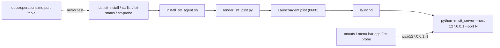
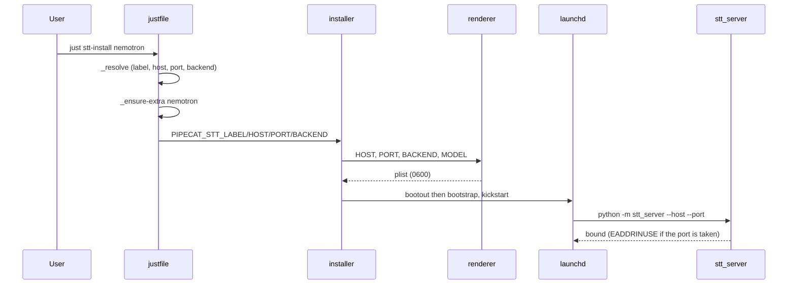

# Task: STT LaunchAgents on loopback TCP ports (TTS parity)

**Status**: Not Started
**Component**: Install & Packaging
**Assigned to**: Varun Singh
**Priority**: High
**Branch**: feat/stt-recipes-tcp-endpoints
**Created**: 2026-10-25
**Completed**: (fill when done)
**Review Gates**: none

## Objective

Make STT LaunchAgents bind a canonical loopback TCP port per backend, the way `pipecat-local-tts-server` does, and let the `just stt-*` recipes probe any endpoint. Add Kyutai as a fourth agent backend running from its own virtualenv. Ship as 0.5.0 (breaking default transport).

## Context

- The STT agents bind Unix sockets (`stt.sock`, `parakeet.sock`, `nemotron.sock`). The TTS agents bind loopback TCP ports (one backend, one process, one port), and TTS keeps the Unix socket only as the ad-hoc quick-start.
- The menu bar app (in `pipecat-local-tts-server/macos`) starts STT servers on TCP and cannot see socket agents. The TTS recipes resolve those servers; the STT recipes cannot, because they know only the three canonical sockets. Sharing the TTS transport and port convention removes that gap.
- Decided by the user (2026-10-25): move agents to TCP; ports 7765 mlx/whisper, 7865 parakeet, 7965 nemotron, 8065 kyutai on `127.0.0.1`; no token on loopback (same as TTS); `PIPECAT_STT_SOCKET` stays as an explicit opt-in so existing socket agents and onoats keep working until migrated; Kyutai gets full agent support from its own venv; version 0.5.0.
- A `stt-probe` recipe (explicit `--socket-path` / `--host`+`--port` / `--uri`, passes through to `status`) is already in the working tree, uncommitted.

## Requirements

- One TCP listener per agent (the server binds exactly one listener; TCP and Unix socket cannot share a process).
- Port map is the single source of truth: documented table in `docs/operations.md`, mirrored by the justfile `_resolve`, the installer default, and the renderer allowlist, with a test that fails on drift.
- Host is loopback only. The server already rejects non-loopback binds (`ServerConfig.__post_init__`), so the renderer rejects any non-loopback `HOST` up front with a clear error instead of installing an agent that cannot start.
- `PIPECAT_STT_SOCKET` (alias `KODA_STT_SOCKET`) set explicitly still renders a socket agent with the current validation and plist (byte-identical to today). No new `KODA_*` aliases for the new variables.
- Kyutai runs from `.venv-kyutai`; `_ensure-extra` must never sync the kyutai extra into the shared `.venv` (it conflicts with mlx, parakeet and nemotron).
- `stt_server/client.py` and `stt_server/protocol.py` stay untouched (`test_branch_diff_does_not_touch_koda_surface` fails otherwise).
- Docs say plainly that loopback TCP has no peer-uid check: any local process can connect. Unix sockets keep the uid check.

## Review Focus

- Security: TCP loses the Unix-socket peer-cred (uid) check. Confirm the docs state this, that `--auth-token-file` still works for those who want a token, and that the renderer never writes a secret into the plist beyond today's behaviour (`PIPECAT_STT_AUTH_TOKEN` is written into `EnvironmentVariables` today; plist is 0600). Decide whether to retire that in this change or leave it (see Open Questions).
- Renderer injection safety: every new value (`HOST`, `PORT`, `AUTH_TOKEN_FILE`) is allowlist-validated and goes through `plistlib`.
- Backward compatibility: socket opt-in output is byte-identical to the current snapshot; legacy `koda.*` retirement in the installer is unchanged.
- Mirror test: port table in `docs/operations.md` equals `_resolve`, the installer default and `_BACKEND_RE`/port allowlist.
- Kyutai venv isolation: an install or enable of any other backend must not touch `.venv-kyutai`, and a kyutai install must not touch `.venv`.
- The lock file `<socket>.lock` exists only for sockets; TCP exclusivity comes from the port bind (`EADDRINUSE`).

## Implementation Checklist

### Phase 1: Port map and renderer

**Impl files:** `scripts/render_stt_plist.py`
**Test files:** `tests/test_render_stt_plist.py, tests/snapshots/pipecat-stt.plist`
**Test command:** `.venv/bin/python -m pytest tests/test_render_stt_plist.py -v`
**Goal:** The TCP plist is the default; the socket plist is unchanged byte-for-byte when `SOCKET_PATH` is given.

- Accept `HOST` (default `127.0.0.1`) and `PORT` (1-65535); emit `--host H --port P` instead of `--socket-path`. `SOCKET_PATH` and `HOST`/`PORT` are mutually exclusive; both set is an error.
- Reject non-loopback `HOST` (allow `127.0.0.1`, `::1`, `localhost`, matching `server.py`).
- Add `kyutai` to `_BACKEND_RE`; keep `MODEL` required.
- Optional `AUTH_TOKEN_FILE` (absolute path) passes `--auth-token-file`; omitted by default.
- Log basename for `pipecat.stt-server.kyutai` follows the existing dot-to-dash rule.
- New snapshot for the TCP default; the existing socket snapshot stays as the opt-in case.

### Phase 2: Installer

**Impl files:** `scripts/install_stt_agent.sh`
**Test files:** `tests/test_install_migration.py`
**Test command:** `.venv/bin/python -m pytest tests/test_install_migration.py -v`
**Goal:** `install` with no transport env produces a TCP agent on the backend's canonical port; with `PIPECAT_STT_SOCKET` it produces today's socket agent.

- New env `PIPECAT_STT_HOST` (default `127.0.0.1`), `PIPECAT_STT_PORT` (default from the backend's canonical port), `PIPECAT_STT_AUTH_TOKEN_FILE`. Export them to the renderer as `HOST`/`PORT`/`AUTH_TOKEN_FILE`.
- Socket mode only when `PIPECAT_STT_SOCKET` (or `KODA_STT_SOCKET`) is set; keep `validate_socket_path` and socket-dir creation for that case only. TCP mode skips the socket directory work.
- `DEFAULT_MODEL` arm for kyutai (`kyutai/stt-1b-en_fr-mlx`).
- Install prints `endpoint: host:port` (or `socket:` in socket mode). Uninstall removes the socket file and its `.lock` only in socket mode.
- Re-installing over an existing socket agent for the same label replaces it (existing `bootout` + `bootstrap`); print a one-line note that the endpoint changed.
- Kyutai interpreter: `PYTHON` defaults to `<repo>/.venv-kyutai/bin/python` for the kyutai backend, `<repo>/.venv/bin/python` otherwise. Confirm how the script resolves `PYTHON` today before changing it.

### Phase 3: justfile recipes

**Impl files:** `justfile`
**Test files:** `tests/test_justfile_recipes.py`
**Test command:** `.venv/bin/python -m pytest tests/test_justfile_recipes.py -v`
**Goal:** Recipes resolve a backend name to label, host, port and backend-name from one map, and read the live endpoint from the plist for `stt-list`.

- `_resolve` prints four fields: label, host, port, backend-name; add `kyutai` (`pipecat.stt-server.kyutai`, 8065, `kyutai`). Update the unknown-backend error text.
- `stt-status` mirrors `tts-status`: a target with `/` or an existing socket file is `--socket-path`; a bare backend name resolves to `--host/--port`; use a longer probe timeout (model load after install).
- `stt-list` reads host, port, socket and auth-token-file from each plist (a `_plist_endpoint` helper like TTS) so custom and socket agents are probed too; keep the always-exit-0 behaviour.
- Keep `stt-probe` (explicit endpoint). `stt-install`/`stt-uninstall` pass `PIPECAT_STT_HOST`/`PORT` from `_resolve`; socket mode only when the caller sets `PIPECAT_STT_SOCKET`.
- `_ensure-extra`: kyutai arm creates/syncs `.venv-kyutai` (`UV_PROJECT_ENVIRONMENT=.venv-kyutai`, Python 3.12) and never runs in `.venv`; probe via `.venv-kyutai/bin/python -c "import moshi_mlx"`. The other arms keep `uv sync --extra X --inexact` into `.venv`.
- Update the header comment (map mirrors `docs/operations.md` port table).

### Phase 4: Mirror test, docs, release

**Impl files:** `docs/operations.md, docs/integration.md, docs/migration.md, README.md, CHANGELOG.md, pyproject.toml, uv.lock, docs/dev_plans/README.md`
**Test files:** `tests/test_justfile_recipes.py`
**Test command:** `.venv/bin/python -m pytest tests/test_justfile_recipes.py tests/test_render_stt_plist.py tests/test_install_migration.py -v`

- Replace the "Per-ASR socket convention" table in `docs/operations.md` with a "Per-backend port convention" table (ASR, LaunchAgent label, port); rewrite `_readme_map()` and `test_justfile_map_mirrors_readme` to parse it and compare label and port against `_resolve`, the installer default and the renderer.
- `docs/operations.md`: TCP agent workflow, Kyutai agent and its venv, socket opt-in, the no-uid-check note, status/probe examples, remove the "kyutai is not wired" note. `docs/integration.md`: onoats and clients use `STT_WS_HOST`/`STT_WS_PORT` for agents. `docs/migration.md`: upgrading a socket agent (reinstall, then update client config), plus the onoats `ws_socket` to host/port change. `README.md`: quick-starts and the per-backend examples.
- CHANGELOG `[0.5.0]` with an upgrade note: the default agent transport changed; set `PIPECAT_STT_SOCKET` to keep a socket agent. Bump `pyproject.toml` and `uv.lock` to 0.5.0. Index row in `docs/dev_plans/README.md`.

### Phase 5: Verify on this machine

**Impl files:** none
**Test files:** none
**Test command:** `.venv/bin/python -m pytest -q --deselect tests/test_justfile_recipes.py::test_stt_list_prints_socket_in_tilde_form`
**Validation cmd:** `just stt-status nemotron`

- Full suite, `ruff format`, `ruff check`.
- Manual (needs the user): reinstall the mlx and nemotron agents, confirm `just stt-list` and `just stt-status` show TCP endpoints, run `scripts/smoke_supervised.py` against a TCP agent, install and probe the kyutai agent from `.venv-kyutai`. Do not touch the running agents without the user's go-ahead.

## Technical Specifications

### Files to Modify

- `scripts/render_stt_plist.py` - `HOST`/`PORT`/`AUTH_TOKEN_FILE`, kyutai allowlist, loopback check, socket/TCP exclusivity.
- `scripts/install_stt_agent.sh` - transport env, per-backend default port, kyutai model and interpreter, endpoint output, socket-mode-only socket handling.
- `justfile` - `_resolve` (4 fields, kyutai), `stt-status`, `stt-list`, `stt-probe`, `stt-install`/`stt-uninstall`, `_ensure-extra`.
- `docs/operations.md`, `docs/integration.md`, `docs/migration.md`, `README.md`, `CHANGELOG.md`, `pyproject.toml`, `uv.lock`, `docs/dev_plans/README.md`.
- `tests/test_render_stt_plist.py`, `tests/test_install_migration.py`, `tests/test_justfile_recipes.py`, `tests/snapshots/pipecat-stt.plist` (+ a new TCP snapshot).

### New Files to Create

- `tests/snapshots/pipecat-stt-tcp.plist` - TCP default snapshot.

### Architecture Decisions

- Loopback only: the server enforces it, so the renderer fails early (no TTS-style "non-loopback needs a token" branch is reachable).
- Socket stays opt-in, not removed, so onoats and existing agents migrate on the user's schedule; `PIPECAT_STT_SOCKET` set means socket mode.
- No new `KODA_*` aliases for `HOST`/`PORT`/`AUTH_TOKEN_FILE` (aliases are deprecated).
- Kyutai gets a separate venv rather than sharing `.venv`, because of the declared extra conflict (`moshi_mlx` pins `mlx<0.27`, `huggingface-hub<0.29`; Python 3.12 only).
- No code change in `stt_server/` (server already supports `--host/--port/--auth-token-file`); `client.py`/`protocol.py` untouched.

### Dependencies

- None new. `just` 1.59 (`[positional-arguments]` used by `stt-probe`).

### Integration Seams

| Seam | Writer (task) | Caller (task) | Contract |
|------|---------------|---------------|----------|
| Port map | `docs/operations.md` table (Phase 4) | `_resolve` (Phase 3), installer default (Phase 2), renderer allowlist (Phase 1) | All four agree; mirror test fails on drift |
| Renderer env | `install_stt_agent.sh` (Phase 2) | `render_stt_plist.py` (Phase 1) | `HOST`/`PORT`/`SOCKET_PATH`/`AUTH_TOKEN_FILE` names and exclusivity rules identical on both sides |
| Plist endpoint | renderer (Phase 1) | `stt-list` `_plist_endpoint` (Phase 3) | Reads `--host/--port` or `--socket-path` from `ProgramArguments` |
| Kyutai interpreter | `_ensure-extra` creates `.venv-kyutai` (Phase 3) | installer sets `PYTHON` (Phase 2) | Same path in both |

## Architecture & Call Flow

Component graph:

Trigger order for `just stt-install nemotron`:

| Step | Trigger | Enters context | Cleared/persisted | Turn boundary |
|------|---------|----------------|-------------------|---------------|
| 1 | `just stt-install <backend>` | backend name | process env only | resolve done |
| 2 | `_ensure-extra` | extra name, venv path | packages persist in `.venv` / `.venv-kyutai` | probe passes |
| 3 | installer | env vars | plist persisted in `~/Library/LaunchAgents` | plist written |
| 4 | launchd | plist | agent state persists across logins (`RunAtLoad`, `KeepAlive`) | agent bound |

## Testing Notes

### Test Approach

- [ ] Renderer: TCP default and socket opt-in snapshots; exclusivity; non-loopback rejected; kyutai allowed; invalid port; token-file path validation
- [ ] Installer: default TCP per backend; socket opt-in unchanged; legacy `koda.*` migration unchanged; kyutai defaults
- [ ] Justfile (stubbed `uv`/`launchctl`): `_resolve` four fields; `stt-status` target resolution; `stt-list` reads TCP and socket plists; `stt-probe` requires an explicit endpoint
- [ ] Mirror test: operations.md port table equals `_resolve`, installer default and renderer
- [ ] Guard: `test_branch_diff_does_not_touch_koda_surface` still passes

### Test Results

- [ ] All existing tests pass (the known failing `test_stt_list_prints_socket_in_tilde_form` is addressed by the `stt-list` rewrite or stays deselected with a note)
- [ ] New tests added and passing
- [ ] Manual verification complete (Phase 5)

### Edge Cases Tested

- [ ] Both `SOCKET_PATH` and `HOST`/`PORT` set
- [ ] Port already bound at kickstart (`EADDRINUSE` in the agent log)
- [ ] Reinstall over an existing socket agent
- [ ] Kyutai install does not modify `.venv`; mlx install does not modify `.venv-kyutai`

## Acceptance Criteria

- `just stt-install <whisper|parakeet|nemotron|kyutai>` creates a loopback TCP agent on 7765/7865/7965/8065 by default.
- With `PIPECAT_STT_SOCKET` set, the installer output is identical to 0.4.0.
- `just stt-status <backend>` and `just stt-probe --host H --port N` probe the live server; `stt-list` shows TCP and socket agents with live backend.
- The port table, `_resolve`, installer default and renderer agree and the mirror test enforces it.
- Docs describe the no-uid-check caveat and the migration from socket agents (including onoats).
- Full suite, `ruff format` and `ruff check` clean; CHANGELOG `[0.5.0]` with upgrade notes; version 0.5.0.

## Open Questions (resolve in `/review-plan` or `/skein:grill`)

1. Retire `PIPECAT_STT_AUTH_TOKEN` written into the plist in favour of `--auth-token-file` (TTS refuses env tokens)? This plan leaves today's behaviour in place for non-breaking parity with 0.4.0.
2. Reuse the existing port-collision stance from TTS (no pre-check; `EADDRINUSE` shows in the agent log), or add a pre-install bind check?
3. Should `stt-list` keep probing the three canonical sockets as a fallback when no plist exists?
4. Kyutai venv location: `.venv-kyutai` in the repo root (assumed), or a path outside the repo?
5. Does the installer resolve `PYTHON` from the repo `.venv` today, and is overriding it per backend safe for the `uv`-managed plist `WorkingDirectory`? Verify before Phase 2.

## Progress

- [ ] Phase 1: Port map and renderer
- [ ] Phase 2: Installer
- [ ] Phase 3: justfile recipes
- [ ] Phase 4: Mirror test, docs, release
- [ ] Phase 5: Verify on this machine

## Findings

- (append findings here as work proceeds)

## Issues & Solutions

- (none yet)

## Final Results

- (fill on completion)
