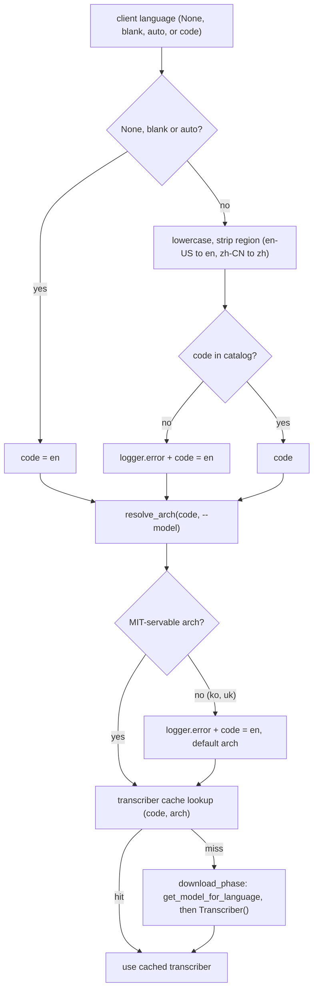
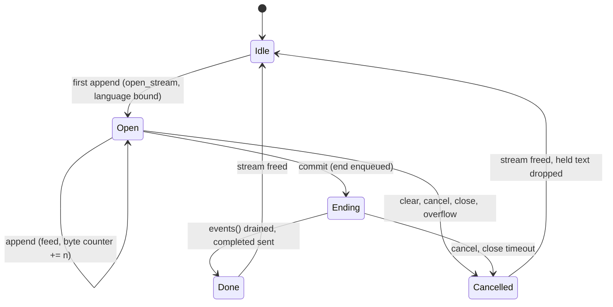
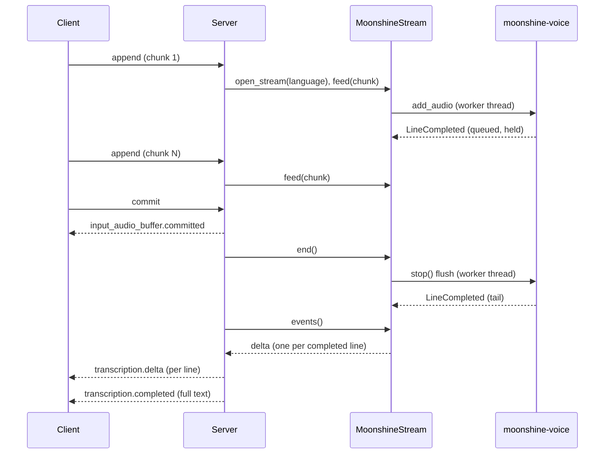

# Task: Moonshine Voice STT backend (multilingual, streaming-capable)

**Status**: Not Started
**Component**: ASR Backends
**Assigned to**: Varun Singh
**Priority**: Medium
**Branch**: feature/moonshine-streaming-backend
**Created**: 2026-11-14
**Review Gates**: full

## Objective

Add a `moonshine` backend built on the `moonshine-voice` package (MIT-licensed streaming models, ONNX on CPU, 8 languages), first as a commit-oriented backend with no server change, then, if a benchmark justifies it, as a streaming backend that overlaps decode with the incoming audio. The wire protocol stays as it is: no new event types and no protocol version bump.

## Context

- Today every backend is commit-oriented. `_run_decode` (`stt_server/server.py:1700-1770`) opens a stream, feeds the whole buffered utterance once, calls `end()`, then reads `events()`. `docs/protocol.md` says deltas "collapse to a single final-sized `delta` + `completed`". No backend emits partials.
- The wire protocol follows the OpenAI Realtime transcription shape: `committed`, then `delta` (append-only), then `completed`. Nothing in the repo defines interim or replaceable text. The Pipecat example service only reads `completed` (`stt_server/examples/pipecat_stt_service.py:130`).
- `moonshine-voice` 0.1.6 (MIT, PyPI) is not mlx-audio's v1 Moonshine port. It ships a native ONNX Runtime library (CPU only; CoreML is not shipped) with a `Transcriber`/`Stream` API. The macOS wheel is `macosx_15_0_arm64`, and Linux and Windows wheels exist. It declares `numpy, sounddevice, requests, tqdm, filelock, platformdirs, google-crc32c`, with no MLX and no `huggingface-hub`. Models download from `download.moonshine.ai` into a platformdirs cache, not from the HF Hub.
- Model catalog (read from the installed package): `en` {medium-streaming (default), small-streaming, base, tiny-streaming, tiny}, `es` {small-streaming (default), tiny-streaming, base}, `de` {small-streaming, tiny-streaming}, `ja` {small-streaming, tiny-streaming, base, tiny}, `ar`/`zh`/`vi` {tiny-streaming, base}, `tl` {tiny-streaming}, `ko` {tiny}, `uk` {base}. According to the upstream docs table (not verified in code), the non-streaming non-English models, plus `ko` and `uk`, are under the non-commercial Moonshine Community License; everything else is MIT.
- Phase 0 spike (scratchpad venv, Apple Silicon, two_cities.wav 44 s). Raw numbers are in `## Findings`:
  - Listener callbacks fire synchronously on the thread that called `add_audio`/`stop`.
  - `add_audio` blocks while the model runs: tiny p95 55 ms and max 80 ms; medium p95 170 ms and max 475 ms. It must never run on the event loop.
  - Text-in-progress revises heavily: 46 of 63 text changes were non-prefix rewrites (medium). A completed line (`LineCompleted`) is final.
  - Offline `transcribe_without_streaming` runs at RTF 0.075 on medium (3.35 s for 44 s) and 0.02 on tiny.
  - Medium en: 267 MB on disk, about 1.0 GB RSS after load, 1.95 GB peak with two transcribers loaded.
  - Two threads on one transcriber, or on two transcribers, gave about 2x wall time (no parallel speedup). With two transcribers the outputs differed (`identical outputs=False`). The cause is unproven (adaptive timing versus a race), so decodes are serialised.
  - Language ids are bare lowercase codes (`en`, `zh`). `en-US`, `EN`, `zh-CN` and `auto` raise `ValueError`.

## Requirements

- New `--backend moonshine` with extra `moonshine`; `uv sync --extra moonshine --inexact` installs it. The default model is the catalog default for the language (en: medium-streaming).
- `--model` takes a Moonshine architecture name (`tiny-streaming`, `small-streaming`, `medium-streaming`, `base-streaming`, `tiny`, `base`). A language is served by the requested arch if the catalog has it, otherwise by the best allowed arch for that language.
- Licence guard: serve only MIT models. Streaming archs are allowed for every language; non-streaming archs only for `en`. `ko` and `uk` (Community licence only) are treated as unsupported.
- Language contract, following the existing per-backend pattern (no server-side validation; the backend decides): `None`, blank or `"auto"` becomes `"en"`. Otherwise lowercase and strip the region (`en-US` becomes `en`, `zh-CN` becomes `zh`). An unsupported language logs an error (`logger.error`) and falls back to `"en"`; it does not raise.
- No new wire events and no `PROTOCOL_VERSION` change. Deltas stay append-only: one `delta` per completed line, then a final `completed` carrying the full transcript. The empty-decode contract is the same as the other backends (`delta` only on non-empty text, `completed` always).
- Decodes serialised across sessions, with the same SIGTERM-mid-decode drain, `abort()` and `idle()` behaviour as the other backends.
- Model download happens under `download_phase()`. `prefetch --backend moonshine` fetches and verifies without a decode. The server never downloads silently at an unexpected time.
- Model loading is lazy on first decode. Loaded transcribers are cached per (language, arch) with a bounded cache (default 3), because medium en holds about 1 GB.

## Review Focus

- Wire ordering: deltas must not reach the client before `input_audio_buffer.committed`. The item id is minted at commit, so a streaming backend holds its deltas until `events()` is read after `end()`.
- Phase 3 touches `server.py` session state for every backend. The non-streaming path must stay byte-for-byte unchanged (open at commit, feed once).
- Threading: `add_audio` blocks for up to hundreds of milliseconds, so every `moonshine-voice` call runs on a backend worker thread and never on the event loop. `idle()`, `abort()` and `close()` must hold with that thread alive. Callbacks run on the worker thread and must only enqueue.
- `clear`, `cancel`, `close`, overflow and teardown while a stream is open (Phase 3).
- The prefetch path outside the HF Hub (`prefetch.py` is HF-snapshot only today).
- Licence guard and the language normalisation table.
- Pin policy: HF SHAs do not apply; the pin is the exact `moonshine-voice` version, which fixes the model URLs and the `quantized_26_11_02` snapshot directory. This is an assumption to confirm in Phase 1.

## Implementation Checklist

### Phase 1: Commit-oriented moonshine backend (no server change)

**Impl files:** `stt_server/backends/moonshine.py, stt_server/backends/__init__.py, stt_server/prefetch.py, pyproject.toml, uv.lock`
**Test files:** `tests/test_moonshine_backend.py, tests/test_backend_missing_extra.py, tests/test_backend_registry.py, tests/test_prefetch_cli.py`
**Test command:** `uv run --inexact pytest tests/test_moonshine_backend.py tests/test_backend_missing_extra.py tests/test_backend_registry.py tests/test_prefetch_cli.py -q`
**Validation cmd:** `uv sync --extra moonshine --inexact && uv run --inexact python -m stt_server prefetch --backend moonshine`
**Goal:** A client sees the same event shape as every other backend (`delta` then `completed`) and the same error semantics, from a backend that needs no server change.

- `MoonshineBackend` in `stt_server/backends/moonshine.py`, mirroring `nemotron.py` structure: `DecodeGuardMixin` lock pair, lazy import with an actionable `ModuleNotFoundError` naming `uv sync --extra moonshine --inexact`, `abort()`, `close()` drain, `backend_name = "moonshine"`.
- Stream: buffer PCM16LE, convert to float32 (`/32768`) at `end()`, then `Transcriber.transcribe_without_streaming(audio, 16000)`; join line texts with a space. No temp WAV is needed (the API takes float arrays), so the private temp dir is dropped.
- Language normalisation and licence guard (see Requirements) in one pure function with a table test.
- Transcriber cache keyed by (language, arch), bounded, loaded under the thread lock inside `download_phase()`.
- Registry: `DEFAULT_MOONSHINE_MODEL`, a `BACKENDS["moonshine"]` entry with `local_model_paths=False` (the package resolves its own cache), and a documented rule for what `PINNED_REVISIONS` means for this backend (no entry; the package pin is the pin).
- `prefetch.py`: add an optional non-HF hook so `prefetch_specs` is not the only contract. A backend module may define `prefetch_fetchers(model)` returning check and fetch callables, and `specs_for`/`run_prefetch` handle both kinds. The moonshine hook calls `moonshine_voice.download.get_model_for_language` and verifies the snapshot directory.
- `pyproject.toml`: extra `moonshine = ["websockets>=16,<17", "moonshine-voice==0.1.6", "numpy>=1.26"]`; keywords. Run `uv lock` and check whether a `conflicts` pair is needed (expected: none, since there is no MLX and no `huggingface-hub` pin).
- Benchmark for the Phase 3 gate: run `scripts/benchmark_asr_ab.py` (or a small variant) for commit-to-completed latency on 3, 5 and 10 s utterances with the default model, and record it in `## Findings`.

### Phase 2: Install, operations and docs wiring

**Impl files:** `justfile, scripts/install_stt_agent.sh, scripts/render_stt_plist.py, docs/backends.md, docs/operations.md, docs/protocol.md, README.md, CHANGELOG.md, docs/dev_plans/README.md, .github/workflows/test.yml`
**Test files:** `tests/test_justfile_recipes.py, tests/test_render_stt_plist.py, tests/test_docs_navigation.py, tests/test_install_migration.py`
**Test command:** `uv run --inexact pytest tests/test_justfile_recipes.py tests/test_render_stt_plist.py tests/test_docs_navigation.py tests/test_install_migration.py -q`
**Goal:** `just stt-install moonshine` works like the other backends, and the docs structure tests keep passing.

- `justfile`: `_resolve` arms (lines ~60-63), `_agent-python` arms (~374-377), `_ensure-extra` arms (~410-413). Moonshine shares the default venv (no `kyutai_venv`-style separation) unless Phase 1's `uv lock` shows a conflict.
- `scripts/install_stt_agent.sh`: default-model arms (~136-141), port map (~160-162; take the next free port after the existing 9565/9665/9765/9865, expected 9965, to be checked against `scripts/squat_check.py`), error text (~191), case validation (~618-620), header docs (~20, 43-47).
- `scripts/render_stt_plist.py`: `_BACKEND_RE` (~52) and the hint string (~167).
- Tests that enumerate backends: `tests/test_justfile_recipes.py` (`BACKENDS` tuple ~53, port and label map ~58-59, assertions ~524-540 including the `docs/operations.md` port table), `tests/test_render_stt_plist.py` parametrisations (~271, ~307).
- Docs: `docs/backends.md` (new backend section, licence guard, language table, model download, 1 GB memory note), `docs/operations.md` (port table row, `stt-install`), README backend list (respect the 180-line and 1200-word limits and the single-owner heading rule in `tests/test_docs_navigation.py`), CHANGELOG, `docs/dev_plans/README.md` row, and the `docs/protocol.md` delta wording.
- CI: decide whether the Linux client job's explicit test list should include `tests/test_moonshine_backend.py` (it uses a fake module, so it needs no wheel); verify that `import moonshine_voice` does not require PortAudio before relying on the real package anywhere in CI.

### Phase 3: Streaming mode (gated on the Phase 1 benchmark)

**Impl files:** `stt_server/backend.py, stt_server/server.py, stt_server/backends/moonshine.py, docs/protocol.md, docs/architecture.md, docs/backends.md`
**Test files:** `tests/test_stt_server.py, tests/test_streaming_session.py, tests/test_moonshine_backend.py, tests/test_backend_protocol.py`
**Test command:** `uv run --inexact pytest tests/test_stt_server.py tests/test_streaming_session.py tests/test_moonshine_backend.py tests/test_backend_protocol.py -q`
**Goal:** Decode overlaps with the incoming audio so commit-to-completed latency is the tail flush, not a whole-utterance decode, with no change to wire event shapes or ordering and no change for non-streaming backends.

- Gate: proceed only if the Phase 1 benchmark shows offline commit-to-completed p50 above 300 ms for a 5 s utterance on the default model (a proposed threshold; the spike extrapolates to about 380 ms, but it measured a 44 s clip and not the tail flush). If it does not, stop here and record the result in `## Findings`.
- `backend.py`: an optional class attribute `streams_during_append: bool = False` (documented in the optional-hook block, with a runtime-checkable protocol like `abort`/`idle`).
- `server.py`: for a streaming backend, open the stream at the first append of a turn (language bound then; a later `session.update` language change applies to the next turn) and `feed()` each chunk to it. The server-side byte buffer is replaced by a byte counter, so `BUFFER_OVERFLOW` and `MAX_UNCOMMITTED_SECONDS` still hold. `_on_commit` reuses the open stream and then runs `end()` and `events()` as today. `_on_clear`, `_on_cancel`, `_on_close` and `_teardown_session` cancel the open stream. A commit with no open stream, and every non-streaming backend, keep the current path unchanged.
- `moonshine.py`: a single worker thread per backend consumes a queue of feed, end and cancel operations and calls `Stream.add_audio`/`stop`; the listener appends `LineCompleted` text to the stream's own list (a thread-safe queue). `feed()` only enqueues and never blocks the loop. `end()` enqueues `stop()` and awaits it. `events()` yields one `delta` per completed line and then `completed` (full text), after `end()`. A worker error surfaces from `end()`/`events()` and becomes `transcript.failed` through the existing `except` arm. `idle()` reports the worker queue and thread as drained.
- Uncompleted-line text is never sent (it revises); only `LineCompleted` text is.

## Technical Specifications

### Files to Modify
- `stt_server/backends/__init__.py` - `DEFAULT_MOONSHINE_MODEL`, `BACKENDS` entry (module `stt_server.backends.moonshine`, class `MoonshineBackend`, `local_model_paths=False`), registry docstring.
- `stt_server/prefetch.py` - non-HF fetcher hook alongside `SnapshotSpec` (`specs_for` at 113, `local_specs_for` at 122, `check_spec` at 227, `fetch_spec` at 271, `run_prefetch` at 368).
- `stt_server/backend.py` - Phase 3 optional attribute and docs; the module docstring "True streaming partials are deferred" stays true on the wire.
- `stt_server/server.py` - Phase 3 only: `_SessionState` (368-376), `_handle_binary_audio` (1480, overflow check 1510, `extend` 1518), `_on_commit` (1632-1672), `_on_clear` (1674-1697), `_run_decode` (1700-1770), `_on_close` (1805-1840), `_on_cancel` (1842-1870), `_teardown_session` (1872+); update the language comment at 1709-1715.
- `pyproject.toml`, `uv.lock` - new extra; `justfile`, `scripts/install_stt_agent.sh`, `scripts/render_stt_plist.py` - enumerations listed in Phase 2.
- Tests listed per phase; docs listed per phase.

### New Files to Create
- `stt_server/backends/moonshine.py` - the backend.
- `tests/test_moonshine_backend.py` - fake `moonshine_voice` injected with `monkeypatch.setitem(sys.modules, ...)`, following `tests/test_nemotron_backend.py:128-145`: protocol satisfaction, delta and completed shape, empty decode, failure propagation, cancel, decode serialisation, language table, licence guard, cache bound, `idle`/`abort`/`close` drain.
- `tests/test_streaming_session.py` - Phase 3 server tests with a fake streaming backend: ordering (`committed` before any `delta`), clear, cancel, close and overflow with an open stream, non-streaming parity.

### Architecture Decisions
- Decision 1: no new wire events. The wire contract is append-only `delta` plus `completed`, and the spike showed in-progress text is rewritten constantly (46 of 63 changes). Exposing it would need a replace-semantics event, which nothing else in the protocol has. Revisit as a follow-up if a client needs interim text.
- Decision 2: deltas are held until after `committed`. The item id is minted at commit, and OpenAI-style ordering is committed, deltas, completed. Streaming therefore buys lower commit latency (compute overlapped with speech), not earlier text on the wire.
- Decision 3: commit-oriented first, streaming second and gated. `transcribe_without_streaming` also works with the streaming models (spike E), and it needs no server change; Phase 3 is the only change that touches shared server state.
- Decision 4: serialise decodes. Concurrent runs showed no speedup and, with two transcribers, differing output; the cause is unproven.
- Decision 5: the pin is the `moonshine-voice` version. Not HF SHAs.
- Decision 6: `"auto"` or `None` maps to `"en"`, and an unsupported language logs an error and falls back to `"en"` (user decision, 2026-11-14). Moonshine has no language identification, which departs from the uniform "auto means detect" contract; document it. The client gets no signal on the wire.

### Dependencies
- `moonshine-voice==0.1.6` (MIT; macOS wheel needs macOS 15 or later, arm64). Transitive: `numpy`, `sounddevice` (PortAudio), `requests`, `tqdm`, `filelock`, `platformdirs`, `google-crc32c`.
- Runtime state outside the repo: model cache at `~/Library/Caches/moonshine_voice` (override `MOONSHINE_VOICE_CACHE`), which the LaunchAgent environment must be able to read and write.

### Detailed Design

#### Module and class layout (`stt_server/backends/moonshine.py`)

| Unit | Responsibility | Phase |
|---|---|---|
| `resolve_language(lang) -> (code, note)` | Pure. `None`/blank/`auto` becomes `en`; lowercase; strip region; unsupported becomes `en` plus an error note. The caller logs `note`. | 1 |
| `resolve_arch(code, requested) -> ModelArch \| None` | Pure. Applies the licence guard: streaming archs for every language, non-streaming only for `en`. `None` means "not servable", and the caller falls back to `en`. | 1 |
| `MoonshineBackend(DecodeGuardMixin)` | Registry entry point. Owns the bounded transcriber cache, the lock pair and in-flight counter, and `start`/`open_stream`/`abort`/`idle`/`close`. | 1 |
| `_TranscriberCache` | `OrderedDict[(code, arch), Transcriber]`, LRU, capacity 3. Loads under the thread lock inside `download_phase()`. It never evicts a transcriber with an open stream. | 1 |
| `_MoonshineStream` | Phase 1: buffers PCM16LE, converts at `end()`, calls `transcribe_without_streaming`. Phase 3: a thin handle that enqueues to the worker. | 1, 3 |
| `_Worker` | One daemon thread per backend. FIFO queue of `FEED`, `END` and `CANCEL` operations. It is the only caller of `add_audio`/`stop` and the only thread whose callbacks append line text. | 3 |
| `prefetch_fetchers(model)` | Module-level hook for `prefetch.py`: a check callable (snapshot directory present and complete) and a fetch callable (`get_model_for_language`). | 1 |

#### Language and model resolution

#### Session stream state (Phase 3)

A non-streaming backend never leaves `Idle` until commit, which is today's behaviour.

#### Threading model

- Phase 1: one daemon thread per decode through `_run_guarded_decode`, exactly like `nemotron.py`. The whole utterance is decoded under the thread lock.
- Phase 3: one persistent worker per backend, because `add_audio` is called about 10 times a second per stream and a thread per call would be wasteful. A single FIFO queue serialises everything, so two sessions streaming at once interleave at `add_audio` granularity. The cost is head-of-line latency: one session's pass (up to about 475 ms on medium) delays the other's. This matches the "serialise decodes" decision and is the safe default until the differing-output result is explained.
- The event loop only enqueues. `END` carries a future that the worker completes through `loop.call_soon_threadsafe`, so `end()` awaits without blocking.
- `idle()` returns a future that completes when the queue is empty and the worker is not inside a call. `close()` drains for a bounded time (3 s, the existing `_drain_inflight` default), then `abort()` stops the worker with a sentinel.

#### Failure modes

| Failure | Where it surfaces | Result |
|---|---|---|
| Model download fails (offline, DNS) | first decode, inside `download_phase()` | exception from `end()`/`events()`, then `transcript.failed` (the server marks it as a download error as for the other backends) |
| Model load fails (corrupt cache) | first decode | same path; `mark_model_invalid` semantics match the HF backends where applicable |
| Decode raises | worker or decode thread | future carries the exception, then `transcript.failed` with a generic message; details only in the server log |
| Worker thread dies (Phase 3) | next enqueue | the dead worker is replaced lazily; operations queued behind the failure fail with the stored exception |
| RTF above 1 (queue grows) | none on the wire | bounded by the existing 300 s uncommitted cap; log a warning when queued audio exceeds 10 s |
| Client disconnect or `cancel` mid-stream | `_teardown_session`, `_on_cancel` | `CANCEL` enqueued, held text dropped, stream freed |
| SIGTERM mid-decode | `close()` | bounded drain, then `abort()` |
| Unsupported or non-MIT language | `resolve_language`/`resolve_arch` | `logger.error`, falls back to `en`; the decode proceeds |

#### Configuration surface

| Setting | Source | Default | Note |
|---|---|---|---|
| Architecture | `--model` (arch name) | catalog default for the language | `tiny-streaming` is the low-memory choice (about 290 MB RSS against about 1 GB for medium) |
| Model cache directory | `MOONSHINE_VOICE_CACHE` (library) | platformdirs user cache | the LaunchAgent environment must be able to write it |
| Transcriber cache size | constant (3) in v1 | 3 | worst case about 3 GB RSS with medium models |
| Streaming update interval | library default (0.5 s) | 0.5 | the spike used 0.3; revisit in the Phase 3 benchmark |
| Languages to prefetch | open | `en` | `prefetch` has no language argument today. Resolve in Phase 1: either an env var or a flag. The existing `env.py` conventions decide which one, and I have not checked them. |

#### Audio path

PCM16LE from the wire becomes a `float32` array in `[-1, 1]` (`numpy.frombuffer(..., "<i2") / 32768`), then `.tolist()` for `add_audio` and `transcribe_without_streaming`, which build a ctypes array from a Python sequence. The wire is pinned at 16 kHz mono (`protocol.py`), so the sample-rate argument is always 16000 and the library does no resampling. The spike passed Python lists of floats; the cost of converting a long utterance is not measured and goes in the Phase 1 benchmark.

### Integration Seams

| Seam | Writer (task) | Caller (task) | Contract |
|------|---------------|---------------|----------|
| Backend streaming flag | `backend.py` / `moonshine.py` (Phase 3) | `server.py` (Phase 3) | `streams_during_append=True` means the server opens the stream at first append, feeds each chunk, and later calls `end()` then `events()`; `events()` yields nothing before `end()` returns |
| Worker thread and event loop | `moonshine.py` | `server.py` `_run_decode` | callbacks only enqueue; the loop never blocks on `add_audio`; `idle()` reflects the worker |
| Non-HF prefetch | `moonshine.py` `prefetch_fetchers` | `prefetch.py` | check and fetch callables; same exit codes and messages as the HF path |
| Backend enumerations | Phase 1 registry | Phase 2 justfile, installer, plist renderer, docs table | every list that names backends gains `moonshine`; `tests/test_justfile_recipes.py:524-540` asserts the sets are equal |

## Architecture & Call Flow

Component graph (final design; the dotted edge exists only in Phase 3):

```mermaid
graph LR
    Client["Pipecat bot / client"] -->|"WS: audio.append, commit"| Server["TranscriptionServer (server.py)"]
    Server -->|"open_stream, feed, end, events"| Backend["MoonshineBackend + stream"]
    Server -.->|"Phase 3: feed per append"| Backend
    Backend -->|"queue to worker thread"| Worker["worker thread"]
    Worker -->|"add_audio, stop"| Runtime["moonshine-voice (libmoonshine, ONNX CPU)"]
    Runtime -->|"line events on worker thread"| Worker
    Worker -->|"completed-line text"| Backend
    Server -->|"committed, delta, completed"| Client
    Runtime -.->|"first use only"| CDN["download.moonshine.ai to platformdirs cache"]
```

Trigger order for one turn in Phase 3 streaming mode (Phase 1 differs only in that nothing is fed before commit):

Context lifecycle:

| Step | Trigger | Enters context | Cleared/persisted | Turn boundary |
|------|---------|----------------|-------------------|---------------|
| 1 | First append (Phase 3) or commit (Phase 1) | `open_stream(language)`; transcriber from the cache, or a lazy load on first use | stream lives to commit, clear or cancel; the transcriber stays cached | stream open |
| 2 | Each append (Phase 3) | PCM16 chunk, converted to float32 on the worker thread | only the byte count is kept in the server | none |
| 3 | `commit` | `end()` flushes via `stop()`; held line texts become deltas | stream freed, `completed` sent | `completed` sent |
| 4 | `clear`, `cancel`, `close` | stream cancelled; the worker discards queued work | stream freed, held text dropped | session reset |
| 5 | First use of a (language, arch) | download and ONNX load under `download_phase()` | cached, bounded to 3 | none |

## Testing Notes

### Test Approach
- [ ] Unit tests for the backend with a fake `moonshine_voice` module (no wheel needed in CI)
- [ ] Table tests for language normalisation and the licence guard
- [ ] Server tests for streaming-mode ordering and lifecycle with a fake streaming backend (Phase 3)
- [ ] Backend-enumeration tests still pass (`test_justfile_recipes`, `test_render_stt_plist`, `test_backend_registry`)
- [ ] Manual: real decode of `moonshine_voice/assets/two_cities.wav` through the running server on this Mac for en medium-streaming and one non-English model (es small-streaming)
- [ ] Use `uv run --inexact` (or `--no-sync`) everywhere: plain `uv run` prunes the installed backend extras and crash-loops LaunchAgents. Confirm the flag behaves as expected on the first run.

### Test Results
- [ ] All existing tests pass
- [ ] New tests added and passing
- [ ] Manual verification complete

### Edge Cases Tested
- [ ] Empty or near-silence audio (empty decode contract)
- [ ] Unsupported or odd language codes: `auto`, `""`, `None`, `EN`, `en-US`, `zh-CN`, `xx`, `ko`, `uk`
- [ ] Cancel and close mid-decode; SIGTERM drain with the worker thread alive
- [ ] Two sessions committing at once (serialised)
- [ ] Clear, cancel, close and overflow with an open stream (Phase 3)
- [ ] First decode when the model is not cached (download failure path)

## Acceptance Criteria

- `uv sync --extra moonshine --inexact` followed by `python -m stt_server --backend moonshine` serves a real utterance over the wire as `committed`, `delta`, `completed` (en and es checked live).
- Non-English languages work with the default MIT streaming models. `ko`, `uk` and non-streaming non-English archs are refused by the licence guard, with an error logged and a fallback to `en`.
- `prefetch --backend moonshine` fetches the model and exits non-zero on a missing or corrupt snapshot, like the HF backends.
- `just stt-install moonshine` installs and probes a LaunchAgent; the backend-enumeration tests pass.
- No change to `PROTOCOL_VERSION` or event shapes. Behaviour for the existing backends is unchanged: `tests/test_stt_server.py` passes unmodified.
- Phase 3 (if it runs): commit-to-completed latency measured before and after on the same utterances and recorded; the ordering and lifecycle tests pass.
- Code reviewed and approved; tests passing; docs updated (backends, operations, README, CHANGELOG, protocol wording).

<!-- reviewed: YYYY-MM-DD @ <hash> -->
<!-- /review-plan writes the marker line above. Everything below is the workspace: edits here do NOT invalidate the marker. -->

## Progress

- [x] Phase 0: Spike (moonshine-voice behaviour, threading, languages)
- [ ] Phase 1: Commit-oriented moonshine backend (no server change)
- [ ] Phase 2: Install, operations and docs wiring
- [ ] Phase 3: Streaming mode (gated on the Phase 1 benchmark)

## Findings

### Phase 0 spike (2026-11-14, Apple Silicon Mac, `moonshine-voice` 0.1.6, throwaway venv in the session scratchpad; two_cities.wav is 44.4 s at 48 kHz)

| | tiny-streaming (en) | medium-streaming (en, default) |
|---|---|---|
| Model on disk | 43 MB | 267 MB |
| RSS after load / peak | 287 MB / 727 MB | 1000 MB / 1953 MB (two transcribers) |
| Unpaced stream (RTF) | 0.10 | 0.27 |
| `add_audio` p50 / p95 / max | 0.3 / 55 / 81 ms | 0.4 / 170 / 475 ms |
| Offline `transcribe_without_streaming` | 0.99 s | 3.35 s |
| First non-empty partial | 1.9 s of audio | 1.9 s of audio |
| Non-prefix text revisions | 43 of 59 changes | 46 of 63 changes |
| 2 threads, 1 transcriber, wall time | 9.2 s (single 4.7 s) | 28.1 s (single 12.7 s) |
| 2 threads, 2 transcribers, outputs identical | yes | no |

- Callbacks fire on the calling thread (`MainThread` in the spike). A second stream on the same transcriber works after the first one's `stop()`.
- Catalog and language errors were read from `moonshine_voice.download._stt_catalog()` and `find_model_info`.
- Not measured: tail-flush latency after `stop()`, non-English models, Linux behaviour, and a long soak under concurrency. The cause of the differing outputs with two concurrent transcribers is not known.
- The spike left about 310 MB in `~/Library/Caches/moonshine_voice`. The script and venv are in the session scratchpad and are not part of the repo.

## Issues & Solutions

(none yet)

## Final Results

(fill when complete)
