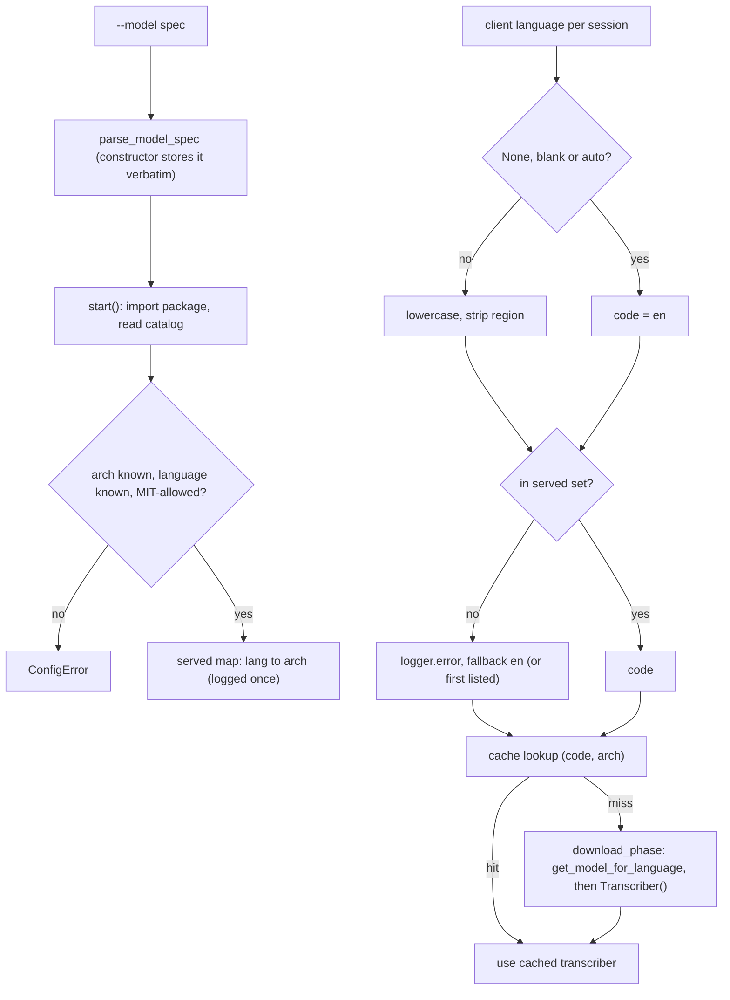
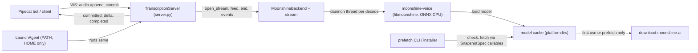
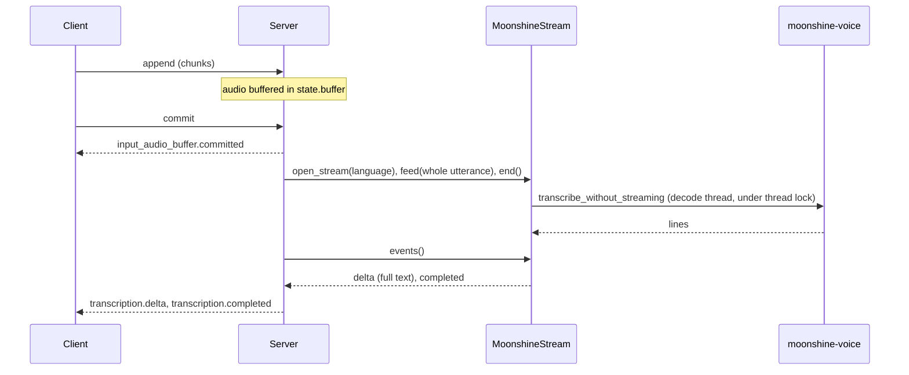

# Task: Moonshine Voice STT backend (multilingual, commit-oriented)

**Status**: Not Started
**Component**: ASR Backends
**Assigned to**: Varun Singh
**Priority**: Medium
**Branch**: feature/moonshine-streaming-backend
**Created**: 2026-11-14
**Review Gates**: full

## Objective

Add a `moonshine` backend built on the `moonshine-voice` package (MIT streaming models, ONNX on CPU, 8 languages) as a commit-oriented backend, with no change to the server's session handling and no change to the wire protocol. A streaming mode that overlaps decode with incoming audio is a separate plan (`20261114-feature-moonshine-streaming-mode.md`), started only if this plan's benchmark justifies it.

## Context

- Every backend today is commit-oriented. `_run_decode` (`stt_server/server.py`) opens a stream, feeds the whole buffered utterance once, calls `end()`, then reads `events()`. Every current backend yields at most one `delta` equal to `completed` (`stt_server/backends/nemotron.py:182-184`, `docs/protocol.md:31`). The wire follows the OpenAI Realtime transcription shape (`committed`, `delta`, `completed`); nothing in the repo defines interim or replaceable text.
- `moonshine-voice` 0.1.6 (MIT, PyPI) is not mlx-audio's v1 Moonshine port. It ships a native ONNX Runtime library (CPU only; CoreML is not shipped) behind a `Transcriber`/`Stream` API. The macOS wheel is `macosx_15_0_arm64`; Linux and Windows wheels also exist (not checked here). It declares `numpy, sounddevice, requests, tqdm, filelock, platformdirs, google-crc32c`: no MLX and no `huggingface-hub`. Models download from `download.moonshine.ai` into a platformdirs cache, not from the HF Hub.
- Model catalog (read from the installed package): `en` {medium-streaming (default), small-streaming, base, tiny-streaming, tiny}, `es` {small-streaming (default), tiny-streaming, base}, `de` {small-streaming, tiny-streaming}, `ja` {small-streaming, tiny-streaming, base, tiny}, `ar`/`zh`/`vi` {tiny-streaming, base}, `tl` {tiny-streaming}, `ko` {tiny}, `uk` {base}.
- Licence, verified against the upstream project LICENSE (2026-11-14): the non-MIT list is exhaustive and consists only of the legacy non-streaming non-English models (Arabic, Japanese, Korean, Mandarin, Ukrainian, Vietnamese Base and Tiny; Spanish Base); "any speech-to-text model not named in that list is MIT, including every streaming model". The Community Licence also carries registration terms for commercial use. The package prints a non-commercial notice to stderr for every non-`en` model, MIT ones included, which is misleading but harmless.
- Phase 0 spike (scratchpad venv, Apple Silicon, two_cities.wav, 44 s, 48 kHz input to every call, so the 16 kHz path is unmeasured). Raw numbers are in `## Findings`:
  - Listener callbacks fire synchronously on the thread that called `add_audio`/`stop`.
  - `add_audio` blocks while the model runs (medium: p95 170 ms, max 475 ms), which matters for the streaming plan, not this one.
  - Offline `transcribe_without_streaming` runs at RTF 0.075 on medium (3.35 s for 44 s) and 0.02 on tiny; it also works with the streaming models.
  - Medium en: 267 MB on disk, about 1.0 GB RSS after load.
  - Concurrent decodes gave no speedup. With two transcribers the outputs differed. The cause is unproven (the compared transcriber had already served six streams, which confounds reuse with concurrency), so decodes are serialised and Phase 1 adds a check.
  - Language ids are bare lowercase codes (`en`, `zh`); `en-US`, `EN`, `zh-CN` and `auto` raise `ValueError`.
- Review run `20261114T215650Z` raised 50 findings; the six decisions that came out of it are recorded under `### Architecture Decisions` and in `## Findings`.

## Requirements

- New `--backend moonshine` with extra `moonshine`; `uv sync --extra moonshine --inexact` installs it.
- **Model spec.** `--model` / `PIPECAT_STT_MODEL` is `[<arch>][@<lang>[,<lang>...]]`. Default `DEFAULT_MOONSHINE_MODEL = "medium-streaming@en"`. An omitted arch resolves each language to the first MIT-allowed catalog entry. Examples: `small-streaming` (en, small), `@en,es` (en and es at catalog defaults), `tiny-streaming@en,es,de`. The constructor stores the spec verbatim, with no import and no validation, so `backend.model` is exactly what the operator passed. `start()` imports the package, parses the spec, validates it against the live catalog and the licence guard, raises `ConfigError` on an unknown arch, unknown language or non-MIT combination, and logs the resolved language-to-arch map once at INFO.
- **Licence guard.** Serve only MIT models: streaming archs for any language, non-streaming archs only for `en` (matches the upstream LICENSE enumeration above). `ko` and `uk` therefore cannot be served.
- **Served-language set.** Fixed at startup from the spec. The transcriber cache is exactly that set (no eviction; memory is the sum of the listed models, documented). The downloader is never called for a language outside the set.
- **Language contract**, following the existing pattern (no server-side validation; each backend decides): `None`, blank or `"auto"` becomes `en`. Otherwise lowercase and strip the region (`en-US` becomes `en`, `zh-CN` and `zh_CN` become `zh`). A language outside the served set, or unsupported by the catalog, calls `logger.error` and falls back to `en` if `en` is served, else the first listed language; it does not raise. Moonshine has no language identification, which departs from the uniform "auto means detect" contract; this is documented, and the client gets no signal on the wire.
- **Wire shape unchanged.** One `delta` whose text equals `completed` (empty decode: `completed` only), the same as `nemotron`. No new events, no `PROTOCOL_VERSION` change, no change to `server.py` session handling.
- Decodes are serialised across sessions, with the same SIGTERM-mid-decode drain, `abort()` and `idle()` behaviour as the other backends.
- **Prefetch.** `prefetch_specs` stays the only prefetch contract. `SnapshotSpec` gains optional `check` and `fetch` callables; moonshine returns one spec per served (language, arch) with a synthetic `repo_id` (`moonshine-voice/<arch>-<lang>`), the `moonshine-voice` package version as `revision`, and callables that derive completeness from the package's own manifest (size and CRC32C per file). A size or CRC mismatch is wrapped with `mark_model_invalid`. The optional alphanumeric spelling model that `get_model_for_language` also fetches (best effort, failures swallowed) is outside the snapshot contract and is not required for a decode. Download happens under `download_phase()`; the "needs `huggingface_hub`" hint becomes conditional.
- **Pin policy.** HF SHAs do not apply. The pin is the exact `moonshine-voice` version, which fixes the model URLs. Snapshot directory names differ per model (en streaming uses `quantized_26_11_02`; non-English streaming uses `quantized_26_08_24` or `quantized_26_08_23`; non-streaming uses an undated `quantized`), so the plan reads them from the package manifest and never from a constant. An undated directory does not pin content, and CDN retention is outside the pin; both are documented.
- Model loading is lazy on first decode (like `nemotron`). A model that was not prefetched downloads on first use inside `download_phase()`, as the other backends do; only a language outside the served set is refused.
- **Latency benchmark** (feeds the go/no-go for the streaming plan): a new paced, single-endpoint script measures offline commit-to-completed latency and the library-level `stop()` flush time for 3, 5 and 10 s utterances at 16 kHz PCM16, using the real conversion path.
- **Port.** `9965` is provisional. Confirming it with the menu bar app owner is the first Phase 2 step, and Phase 2 does not merge without it; otherwise only Phase 1 ships.

## Review Focus

- Phase 1 must not touch `server.py` session handling or `protocol.py`. Every backend runs through them, and `tests/test_stt_server.py` assertions stay unchanged (moonshine rows are additions only).
- `prefetch.py` and `snapshot.py` changes are shared by every backend: the HF path must behave as before (`tests/test_prefetch_cli.py`, `tests/test_backend_registry.py`, `tests/test_supervised_cli.py`).
- The constructor must stay import-free and non-validating (`tests/test_backend_missing_extra.py`, `tests/test_backend_registry.py`).
- Licence guard and language table: pure functions, table-tested against a fake catalog.
- Prefetch integrity: size-only acceptance of an existing file in the library (`download_file.py`) means the check must compute CRC32C itself.
- Backend enumerations in Phase 2 (`justfile`, installer, plist renderer, `scripts/smoke_launchd.py`, docs port table) must land in one commit so `tests/test_justfile_recipes.py` and `tests/test_smoke_launchd.py` stay green.

## Implementation Checklist

### Phase 1: Commit-oriented moonshine backend, prefetch and benchmark

**Impl files:** `stt_server/backends/moonshine.py, stt_server/backends/__init__.py, stt_server/prefetch.py, stt_server/snapshot.py, pyproject.toml, uv.lock, scripts/benchmark_moonshine_latency.py`
**Test files:** `tests/test_moonshine_backend.py, tests/test_backend_missing_extra.py, tests/test_backend_registry.py, tests/test_prefetch_cli.py, tests/test_decode_guard.py, tests/test_supervised_cli.py, tests/test_stt_server.py, tests/test_benchmark_moonshine_latency.py`
**Test command:** `uv run --inexact python -m pytest -q`
**Validation cmd:** `uv sync --extra moonshine --inexact && uv run --inexact python -m stt_server prefetch --backend moonshine`
**Goal:** A client sees the same event shape and error semantics as every other backend (one `delta` equal to `completed`), from a backend that needs no change to session handling, and the shared prefetch path keeps its existing contract.

- `MoonshineBackend` in `stt_server/backends/moonshine.py`, mirroring `nemotron.py`: `DecodeGuardMixin` (from `stt_server/backends/_thread_util.py`) lock pair, lazy import with an actionable `ModuleNotFoundError` naming `uv sync --extra moonshine --inexact`, `abort()`, `close()` drain, `idle()`, `backend_name = "moonshine"`.
- Stream: buffer PCM16LE, convert to float32 (`/32768`, then `.tolist()`) at `end()`, then `Transcriber.transcribe_without_streaming(audio, 16000)`; join line texts with a space into one string; one `delta` equal to `completed`. No temp WAV, so no private temp dir. Inspect the raw line text first: the plan assumes space-joining is right, and `ja`/`zh` may not want it.
- Pure functions `parse_model_spec`, `resolve_language` and `resolve_arch` (see Detailed Design), table-tested against a fake catalog.
- Transcriber cache keyed by (language, arch), populated lazily under the thread lock inside `download_phase()`, fixed to the served set.
- Registry: `DEFAULT_MOONSHINE_MODEL = "medium-streaming@en"`; `BACKENDS["moonshine"]` with `local_model_paths=False`; no `PINNED_REVISIONS` entry, with a registry docstring rule saying the package pin is the pin.
- `snapshot.py`: `SnapshotSpec` gains optional `check` and `fetch` callables (default `None`, so HF specs are unchanged). `prefetch.py`: `check_spec` and `fetch_spec` branch once on them; the `huggingface_hub` hint is conditional; the event fields (`repo`, `revision`, `kind`, progress) keep their documented meaning.
- `tests/test_backend_registry.py` is relaxed from "`repo_id == default_model`" to "exactly one spec, non-empty `repo_id`" for the default spec, with the model-identity assertion (`_make_backend(name, "x/y").model == "x/y"`) kept.
- `pyproject.toml`: extra `moonshine = ["websockets>=16,<17", "moonshine-voice==0.1.6", "numpy>=1.26"]` and keywords. Run `uv lock` and check whether a `conflicts` pair is needed (expected: none).
- Verification steps (record results in `## Findings`, adjust the plan if one fails):
  - Read the per-model directory and file list from the package manifest for the default spec; assert the exact `moonshine-voice==0.1.6` pin and the manifest-derived directory in a test.
  - Decode one clip three times on one transcriber and once on a fresh one, offline and streamed, and compare the texts; record the one-transcriber concurrent result the spike printed (identical outputs).
  - Run the licence-guard table against the live catalog when the package is installed (skipped otherwise).
- Benchmark: `scripts/benchmark_moonshine_latency.py` is a single-endpoint, real-time-paced script (not an extension of `scripts/benchmark_asr_ab.py`, which probes two endpoints and sends audio unpaced). Utterances of 3, 5 and 10 s cut from the package's `two_cities.wav` and resampled to 16 kHz PCM16; 10 runs each, the first (cold) run discarded; reports p50 for offline commit-to-completed over the wire and for the library-level `stop()` flush after a paced streamed feed.

### Phase 2: Install, operations and docs wiring, then the go/no-go record

**Impl files:** `justfile, scripts/install_stt_agent.sh, scripts/render_stt_plist.py, scripts/smoke_launchd.py, docs/backends.md, docs/operations.md, docs/migration.md, docs/contributing.md, README.md, CHANGELOG.md, docs/dev_plans/README.md, .github/workflows/test.yml`
**Test files:** `tests/test_justfile_recipes.py, tests/test_render_stt_plist.py, tests/test_smoke_launchd.py, tests/test_docs_navigation.py, tests/test_docs_port_caveats.py, tests/test_install_migration.py`
**Test command:** `uv run --inexact python -m pytest -q`
**Goal:** `just stt-install moonshine` works like the other backends, every list that names backends stays in step, and the docs structure tests keep passing.

- **First step (gate): confirm port 9965 with the menu bar app owner.** If it is not confirmed, stop Phase 2.
- `justfile`: `_resolve` arms, `_agent-python` arms, `_ensure-extra` arms. Moonshine shares the default venv unless Phase 1's `uv lock` shows a conflict.
- `scripts/install_stt_agent.sh`: default-model arm (`medium-streaming@en`), port map (`9965`), the `backends with one:` error text, case validation, header docs.
- `scripts/render_stt_plist.py`: `_BACKEND_RE` and its hint string. Verify that `@` and `,` pass the renderer's and the installer's character checks for the model value (the spec grammar depends on it).
- `scripts/smoke_launchd.py`: `CANONICAL_BACKENDS`, in the same commit and the same order as the installer port arm (`tests/test_smoke_launchd.py` asserts they match).
- Tests that enumerate backends: `tests/test_justfile_recipes.py` (`BACKENDS` tuple, port and label map, the assertions that tie `_resolve`, the installer and the `docs/operations.md` port table), `tests/test_render_stt_plist.py` parametrisations, `tests/test_smoke_launchd.py`, `tests/test_docs_port_caveats.py` (reads `uv.lock`).
- Docs: `docs/backends.md` (new section: model spec grammar, licence guard and the stderr notice, language contract and the "auto becomes en" deviation, served set and memory, model download and cache location, package pin and CDN caveat), `docs/operations.md` (port table, `stt-install`), `docs/migration.md` (port list), `docs/contributing.md` (the `SnapshotSpec` check/fetch extension), README backend list (respect the 180-line and 1200-word limits and the single-owner heading rule in `tests/test_docs_navigation.py`), CHANGELOG, `docs/dev_plans/README.md`.
- CI: add `tests/test_moonshine_backend.py` to the Linux client job's explicit test list (it uses a fake module, so it needs no wheel).
- Manual verification through an installed agent: one decode after prefetch and one with an empty model cache, both through `just stt-install moonshine` (the LaunchAgent environment sets only `PATH` and `HOME`).
- **Last step: record the go/no-go for the streaming plan.** Enter the Phase 1 benchmark numbers in `## Findings`. Start `20261114-feature-moonshine-streaming-mode.md` only if, for the 5 s utterance on the default model, offline commit-to-completed p50 exceeds 300 ms and the `stop()` flush p50 is below half of the offline p50. (Both thresholds are proposals; the user confirms them before the record is written.)

## Technical Specifications

### Files to Modify
- `stt_server/backends/__init__.py` - `DEFAULT_MOONSHINE_MODEL`, `BACKENDS` entry (module `stt_server.backends.moonshine`, class `MoonshineBackend`, `local_model_paths=False`), registry docstring (the pin rule).
- `stt_server/snapshot.py` - `SnapshotSpec` optional `check` and `fetch` callables (the class is defined here, not in `prefetch.py`; `download_phase` and `mark_model_invalid` live here too).
- `stt_server/prefetch.py` - branch once in `check_spec` and `fetch_spec`; conditional `huggingface_hub` hint.
- `pyproject.toml`, `uv.lock` - new extra.
- `justfile`, `scripts/install_stt_agent.sh`, `scripts/render_stt_plist.py`, `scripts/smoke_launchd.py` - the enumerations listed in Phase 2.
- Docs and tests as listed per phase.

### New Files to Create
- `stt_server/backends/moonshine.py` - the backend.
- `scripts/benchmark_moonshine_latency.py` and `tests/test_benchmark_moonshine_latency.py` - the paced latency benchmark.
- `tests/test_moonshine_backend.py` - fake `moonshine_voice` injected with `monkeypatch.setitem(sys.modules, ...)`, following `tests/test_nemotron_backend.py:128-145`. Cases: protocol satisfaction; one `delta` equal to `completed` at backend and wire level; empty and whitespace decode; failure propagation; cancel; decode serialisation; `idle`/`abort`/`close` drain; spec grammar table (valid and invalid); licence guard table; language table (`auto`, `""`, `None`, `AUTO`, padded, `EN`, `en-US`, `zh-CN`, `zh_CN`, `zh-Hans-CN`, `xx`, `ko`, `uk`, a non-string value, a language outside the served set); `logger.error` asserted at the call site; the downloader is never called for an unlisted language; constructor imports nothing; cache equals the served set.
- Prefetch tests (in `tests/test_prefetch_cli.py`, with a fake `moonshine_voice.download`): uncached then cached; incomplete snapshot; fetch event order; fetch failure; connection error; missing extra; corrupt snapshot reported as model-invalid; local path refused.

### Architecture Decisions
- Decision 1 (grilled): the streaming mode is split into a follow-up plan. It changes `server.py` session handling that every backend runs through, so it gets its own plan, review and PR. This plan owns the paced benchmark and the go/no-go record.
- Decision 2 (grilled): Phase 1 emits one `delta` equal to `completed`, like every other backend. Per-line deltas, their separator and the "joined deltas equal `completed`" invariant move to the streaming plan.
- Decision 3 (grilled): `prefetch_specs` remains the single prefetch contract; `SnapshotSpec` gains optional `check`/`fetch` callables; no second module hook.
- Decision 4 (grilled): the served-language set is fixed at startup and carried in the model spec `[<arch>][@<langs>]`, so no new flag, environment variable or plist plumbing is needed. An unlisted language logs an error and falls back; the downloader is never called for it; the cache equals the served set.
- Decision 5 (grilled): `DEFAULT_MOONSHINE_MODEL = "medium-streaming@en"`; the constructor stores the spec verbatim and imports nothing; `start()` validates against the live catalog and the licence guard (`ConfigError`) and logs the resolved map. Rationale: the registry and missing-extra tests require an import-free constructor.
- Decision 6 (grilled): port `9965` is provisional until confirmed with the menu bar app owner, as the first Phase 2 step.
- Decision 7: the wire contract stays append-only `delta` plus `completed`. The spike showed in-progress text is rewritten constantly (46 of 63 changes on medium), so exposing it would need a replace-semantics event that nothing else in the protocol has. Revisit only in the streaming plan.
- Decision 8: serialise decodes. Concurrent runs showed no speedup and, with two transcribers, differing output; the cause is unproven and Phase 1 adds a check.
- Decision 9: the pin is the `moonshine-voice` version, not HF SHAs; directory names come from the package manifest.
- Decision 10 (user decision, 2026-11-14): `auto` or `None` maps to `en`, and an unsupported language logs an error and falls back to `en` (or the first served language). Moonshine has no language identification, so this departs from the uniform "auto means detect" contract; documented in `docs/backends.md`.

### Dependencies
- `moonshine-voice==0.1.6` (MIT; the macOS wheel needs macOS 15 or later on arm64). Transitive: `numpy`, `sounddevice` (imported lazily, so PortAudio is not needed at import time on this wheel), `requests`, `tqdm`, `filelock`, `platformdirs`, `google-crc32c`.
- Runtime state outside the repo: model cache at `~/Library/Caches/moonshine_voice` (override `MOONSHINE_VOICE_CACHE`), which the LaunchAgent must be able to read and write. The plist environment sets only `PATH` and `HOME`.

### Detailed Design

#### Module and class layout (`stt_server/backends/moonshine.py`)

| Unit | Responsibility |
|---|---|
| `parse_model_spec(spec) -> (arch \| None, langs)` | Pure. Parses `[<arch>][@<lang>[,<lang>...]]`; no catalog access. Empty language list means `en`. |
| `resolve_arch(code, requested, catalog) -> ModelArch` | Pure over a catalog mapping. Applies the licence guard (streaming archs for any language, non-streaming only for `en`); an omitted arch takes the first MIT-allowed entry. Raises `ConfigError` for an unknown arch or a non-MIT combination (called from `start()`). |
| `resolve_language(lang, served) -> (code, note)` | Pure. `None`/blank/`auto` becomes `en`; lowercase; strip region (`-` or `_`); outside the served set returns the fallback (`en` if served, else the first listed) plus an error note. The caller logs the note with `logger.error`. |
| `MoonshineBackend(DecodeGuardMixin)` | Registry entry point. Stores the spec verbatim; `start()` imports the package, validates, builds the served map, logs it. Owns the lock pair, in-flight counter, transcriber cache, `open_stream`, `abort`, `idle`, `close`. |
| `_MoonshineStream` | Buffers PCM16LE; at `end()` converts and runs the offline decode on a guarded daemon thread under the thread lock; `events()` yields one `delta` (if non-empty) and `completed`. |
| `prefetch_specs(model)` | Module-level. One `SnapshotSpec` per served (language, arch) with `check`/`fetch` callables built from the package manifest. |

#### Language and model resolution

#### Threading model
One daemon thread per decode through `_run_guarded_decode`, exactly like `nemotron.py`; the whole utterance is decoded under the thread lock, so decodes across sessions serialise. `idle()` and the `close()` drain use the mixin unchanged (`_drain_inflight`, 3 s).

#### Failure modes

| Failure | Where it surfaces | Result |
|---|---|---|
| Model download fails (offline, DNS) | first decode, inside `download_phase()` | exception from `end()`/`events()`, then `transcript.failed`; `requests` errors already classify as download errors (`stt_server/supervise.py`) |
| Cached file is corrupt (size match, bad CRC32C) | prefetch check, or first load | wrapped with `mark_model_invalid` so the supervisor classifies it as an invalid model, not a start failure |
| Decode raises | decode thread | future carries the exception, then `transcript.failed` with a generic message; details only in the server log |
| Bad `--model` spec | `start()` | `ConfigError`, exit 1 with a clear message |
| Language outside the served set or unsupported | `resolve_language` | `logger.error`, falls back; the decode proceeds; nothing is downloaded |
| Client disconnect or `cancel` mid-decode | existing server paths | `cancel()` marks the stream; the daemon thread finishes and its result is dropped |
| SIGTERM mid-decode | `close()` | bounded drain, then `abort()` |

#### Configuration surface

| Setting | Source | Default | Note |
|---|---|---|---|
| Model spec (arch and served languages) | `--model` / `PIPECAT_STT_MODEL` | `medium-streaming@en` | `tiny-streaming` is the low-memory choice (about 290 MB RSS against about 1 GB for medium) |
| Model cache directory | `MOONSHINE_VOICE_CACHE` (library) | platformdirs user cache | the LaunchAgent must be able to write it |
| Transcriber cache | the served set | n/a | memory is the sum of the listed models |

#### Audio path
PCM16LE from the wire becomes a float32 sequence in `[-1, 1]` (`numpy.frombuffer(..., "<i2") / 32768`, then `.tolist()`), because `transcribe_without_streaming` builds a ctypes array from a Python sequence. The wire is pinned at 16 kHz mono (`protocol.py`), so the sample-rate argument is always 16000. The spike's numbers all used 48 kHz input; the Phase 1 benchmark measures the 16 kHz path and the list-conversion cost.

### Integration Seams

| Seam | Writer (task) | Caller (task) | Contract |
|------|---------------|---------------|----------|
| `SnapshotSpec` callables | `moonshine.py` `prefetch_specs` (Phase 1) | `prefetch.py` `check_spec`/`fetch_spec` (Phase 1) | `check` returns the same complete/missing/invalid result the HF path does; `fetch` emits the same event fields; HF specs (callables `None`) behave exactly as before |
| Constructor vs `start()` | `MoonshineBackend` (Phase 1) | registry and missing-extra tests | constructor never imports the package or validates; `start()` raises `ConfigError` or `ModuleNotFoundError` |
| Backend enumerations | Phase 1 registry | Phase 2 justfile, installer, plist renderer, smoke harness, docs port table | every list that names backends gains `moonshine`; `tests/test_justfile_recipes.py` and `tests/test_smoke_launchd.py` assert the sets are equal |
| Benchmark to go/no-go | Phase 1 benchmark | Phase 2 last step | the recorded p50 numbers are the only input to the streaming-plan decision |

## Architecture & Call Flow

Component graph:

Trigger order for one turn (commit-oriented, this plan):

Context lifecycle:

| Step | Trigger | Enters context | Cleared/persisted | Turn boundary |
|------|---------|----------------|-------------------|---------------|
| 1 | `start()` | package import, catalog, served map | served map lives for the process | server ready |
| 2 | Prefetch or first decode of a served language | model download and ONNX load under `download_phase()` | transcriber cached for the process; files persist in the model cache | none |
| 3 | `commit` | whole utterance, language fallback applied | buffer cleared at commit (server) | `committed` sent |
| 4 | `end()` | float32 conversion, offline decode under the thread lock | stream freed after `events()` | `completed` sent |
| 5 | `cancel` or `close` | stream marked cancelled; bounded drain | result dropped; backend `abort()` | session closed |

## Testing Notes

### Test Approach
- [ ] Unit tests for the backend with a fake `moonshine_voice` module (no wheel needed in CI)
- [ ] Table tests for spec grammar, licence guard and language normalisation
- [ ] Prefetch tests through `SnapshotSpec` callables with a fake `moonshine_voice.download`
- [ ] Contract tests extended with moonshine rows: `tests/test_decode_guard.py`, `tests/test_supervised_cli.py` (download and model-invalid tagging, `abort()`), `tests/test_stt_server.py` (`_make_backend`, argparse, lazy import: rows added, no existing assertion changed)
- [ ] Backend-enumeration tests pass (`test_justfile_recipes`, `test_render_stt_plist`, `test_smoke_launchd`, `test_backend_registry`)
- [ ] Manual: real decode of `moonshine_voice/assets/two_cities.wav` through the running server for en medium-streaming; one non-English model with an operator-supplied clip of a known phrase (the repo has no non-English audio); one decode through an installed LaunchAgent, with the model cache populated and empty
- [ ] Run the suite with `uv run --inexact` (or `--no-sync`): plain `uv run` prunes the installed backend extras and crash-loops LaunchAgents. `--inexact` is accepted by uv 0.13.8; whether it keeps the extras is confirmed on the first run. Invoke pytest as `python -m pytest`: `uv run --inexact pytest` failed with "Failed to spawn: pytest" in this checkout (2026-11-14), while `uv run --inexact python -m pytest` ran `tests/test_docs_navigation.py` (5 passed).
- [ ] Run the full suite in the background, not the foreground

### Test Results
- [ ] All existing tests pass
- [ ] New tests added and passing
- [ ] Manual verification complete

### Edge Cases Tested
- [ ] Empty or near-silence audio (empty decode contract)
- [ ] Odd language values (see `tests/test_moonshine_backend.py` list above)
- [ ] Cancel and close mid-decode; SIGTERM drain with a decode thread alive
- [ ] Two sessions committing at once (serialised)
- [ ] First decode when the model is not cached (download failure path); corrupt cache
- [ ] Raw line text for `ja` and `zh` (space-joining check)

## Acceptance Criteria

- `uv sync --extra moonshine --inexact` followed by `python -m stt_server --backend moonshine` serves a real English utterance over the wire as `committed`, one `delta` equal to `completed`, then `completed`.
- A non-English language from the supported set loads and returns non-empty text for an operator-supplied clip. If no clip is available, the criterion is limited to "loads and decodes without error".
- `ko`, `uk` and non-streaming non-English archs are refused with `ConfigError` at `start()`. A client language outside the served set logs an error and falls back; no download is attempted for it.
- `prefetch --backend moonshine` fetches the served set and exits non-zero on a missing or corrupt snapshot, like the HF backends.
- `just stt-install moonshine` installs and probes a LaunchAgent on the confirmed port, and the backend-enumeration tests pass.
- No change to `PROTOCOL_VERSION`, `protocol.py` or `server.py` session handling. No existing assertion in `tests/test_stt_server.py` changes.
- The Phase 1 benchmark numbers (offline p50 and `stop()` flush p50 for 3, 5 and 10 s at 16 kHz) and the go/no-go for the streaming plan are recorded in `## Findings`.
- Code reviewed and approved; the full suite passes; docs updated (backends, operations, migration, contributing, README, CHANGELOG).

<!-- reviewed: 2026-11-15 @ 7152a9544daf806622b5acb5a7420bc9dc98bf57 -->

<!-- /review-plan writes the marker line above. Everything below is the workspace: edits here do NOT invalidate the marker. -->

## Progress

- [x] Phase 0: Spike (moonshine-voice behaviour, threading, languages)
- [ ] Phase 1: Commit-oriented moonshine backend, prefetch and benchmark
- [ ] Phase 2: Install, operations and docs wiring, then the go/no-go record

## Findings

### Phase 0 spike (2026-11-14, Apple Silicon Mac, `moonshine-voice` 0.1.6, throwaway venv in the session scratchpad; two_cities.wav is 44.4 s at 48 kHz, passed at 48 kHz to every call)

| | tiny-streaming (en) | medium-streaming (en, default) |
|---|---|---|
| Model on disk | 43 MB | 267 MB |
| RSS after load / peak | 287 MB / 727 MB | 1000 MB / 1953 MB (two transcribers) |
| Unpaced stream (RTF) | 0.10 | 0.27 |
| `add_audio` p50 / p95 / max | 0.3 / 55 / 81 ms | 0.4 / 170 / 475 ms |
| Offline `transcribe_without_streaming` | 0.99 s | 3.35 s |
| First non-empty partial | 1.9 s of audio | 1.9 s of audio |
| Non-prefix text revisions | 43 of 59 changes | 46 of 63 changes |
| 2 threads, 1 transcriber: wall time, outputs identical | 9.2 s (single 4.7 s), yes | 28.1 s (single 12.7 s), yes |
| 2 threads, 2 transcribers: wall time, outputs identical | 8.0 s, yes | 24.9 s, no |

- Callbacks fire on the calling thread (`MainThread` in the spike). A second stream on the same transcriber works after the first one's `stop()`.
- Catalog and language errors were read from `moonshine_voice.download._stt_catalog()` and `find_model_info`.
- Not measured: tail-flush latency after `stop()`, non-English models, Linux behaviour, a soak under concurrency, and the 16 kHz path. The cause of the differing outputs with two concurrent transcribers is not known; the compared transcriber had already served six streams.
- The spike left about 310 MB in `~/Library/Caches/moonshine_voice`. The script and venv are in the session scratchpad and are not part of the repo.

### Review 2026-11-14 (run `20261114T215650Z`)
- Five lenses completed (none fell back to opus); the Contradiction Pass errored with a network error and was not retried, so the envelope is pass A's: raw 52, merged 2, unique 48, 3 Contradiction findings found by the lenses. Full JSON: `.review-plan/latest-claude.json`. The lenses read the plan from disk instead of having it embedded in the prompt.
- Finding #1 (licence guard, Critical) resolved as a fact: the upstream LICENSE enumerates the non-MIT models exhaustively and every streaming model is MIT, so the guard in Requirements matches it. The stderr notice for non-`en` models is documented.
- Decisions 1-6 were grilled and accepted; Decision 1 was clarified by the user as "split only if it impacts other models", which holds because the streaming mode changes `server.py` session handling that every backend uses.
- Findings that apply only to the streaming mode moved to `20261114-feature-moonshine-streaming-mode.md`: #4, 5, 6, 10, 11, 14, 18, 28, 29 and Minor 38, 47, 48, plus the streaming halves of #20, 21 and 27.
- Mechanical findings applied in this plan: #2, 12, 13, 15 (citations to `snapshot.py`), 19 (full-suite gate), 24, 25, 26, 34, 35, 36, 37, 39, 40, 41, 42-46, 49, 50.

### Review Waivers

(none)

## Issues & Solutions

(none yet)

## Final Results

(fill when complete)
