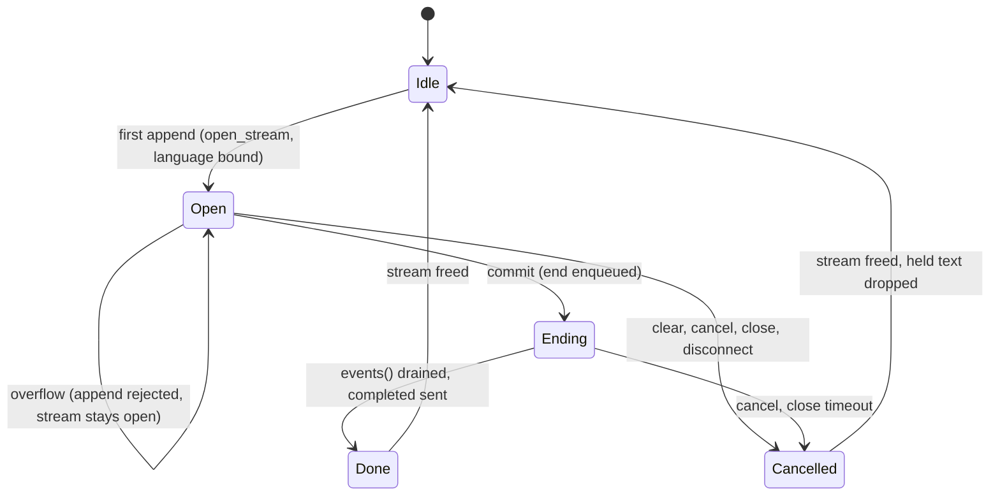

# Task: Moonshine streaming mode (decode overlapped with incoming audio)

**Status**: Not Started
**Component**: ASR Backends
**Assigned to**: Varun Singh
**Priority**: Low
**Branch**: (create when started, e.g. feature/moonshine-streaming-mode)
**Created**: 2026-11-14
**Review Gates**: full

## Objective

Let a streaming-capable backend start decoding at the first `audio.append` of a turn, so commit-to-completed latency is the tail flush instead of a whole-utterance decode. The wire protocol does not change: deltas are still held until after `committed`, and `completed` still carries the full transcript.

## Context

- Split out of `20261114-feature-moonshine-backend.md` (decision 1, grilled 2026-11-14) because it changes `stt_server/server.py` session handling that every backend runs through. That plan ships the commit-oriented backend first and owns the paced benchmark.
- **Do not start until the go/no-go in that plan's last Phase 2 step says go**: for a 5 s utterance on the default model, one-shot commit-to-completed p50 above 300 ms and `stop()` flush p50 below half of the one-shot p50 (proposed thresholds, to be confirmed by the user). If the benchmark says no-go, close this plan unimplemented.
- Facts from the Phase 0 spike (see the sibling plan's `## Findings`): listener callbacks fire synchronously on the thread that called `add_audio`/`stop`; `add_audio` blocks while the model runs (medium: p95 170 ms, max 475 ms), so it can never run on the event loop; in-progress line text is rewritten constantly (46 of 63 changes on medium), and only `LineCompleted` text is final; concurrent decodes gave no speedup and, with two transcribers, differing output (cause unproven). Unpaced streaming costs RTF 0.27 against 0.075 offline on medium, so the gate can pass while streaming delivers no gain; the paced `stop()` flush measurement is the real test.
- Wire ordering constraint: the item id is minted at commit, and OpenAI-style ordering is `committed`, `delta`, `completed`. A streaming backend therefore holds its line texts until `events()` is read after `end()`; nothing reaches the client earlier. This buys lower commit latency, not earlier text.

## Requirements

- Backend opt-in: an optional class attribute `streams_during_append` (read with `getattr(backend, ..., False)`; a runtime-checkable Protocol cannot check a bool value). Non-streaming backends keep today's path unchanged: open the stream at commit, feed once.
- The moonshine stream picks its mode from the resolved arch: a streaming arch uses `Stream.add_audio`/`stop`; a non-streaming arch (`tiny`, `base`, `en` only) buffers internally and runs `transcribe_without_streaming` as one worker operation at `END`.
- A single persistent worker thread per backend is the only caller of `moonshine-voice`. `feed()` only enqueues and never blocks the event loop. `END` carries a future completed through `loop.call_soon_threadsafe`.
- Delta rule: one `delta` per completed line after `end()`, then `completed` with the full text. State the separator and the invariant that the joined deltas equal `completed`; the wire-level test asserts it.
- Listener captures `Error` events as well as `LineCompleted` (a failed final flush does not raise from `Stream.stop()`; it emits an `Error` event, and listener exceptions are swallowed). A captured error fails the `END` future, so a truncated transcript is never sent as `completed`.
- Pre-commit failures: `open_stream`/`feed` at append never raise and never block on a model load; transcriber acquisition is queued as a worker operation; the error is stored on the stream and raised from `end()`, which becomes `transcript.failed` through the existing path. State the server behaviour if either call still raises (today an exception in `_handle_binary_audio` becomes a per-message `internal_error` with no item id).
- Serialisation and accounting: every library call goes through the one worker; `_mark_inflight_start` on enqueue and `_mark_inflight_end` when the operation finishes or is discarded, so `DecodeGuardMixin.idle()` and `_drain_inflight` work unchanged. A queued-audio warning at 10 s.
- Overflow: reject the append and leave the stream open (matches today's "reject the append, keep buffered audio committable").

## Review Focus

- Wire ordering: no `delta` before `committed`.
- The non-streaming path must stay byte-for-byte unchanged for all existing backends (`tests/test_stt_server.py` assertions unchanged).
- Threading: no `moonshine-voice` call on the event loop; `idle()`, `abort()` and `close()` hold with the worker alive; callbacks only enqueue.
- `clear`, `cancel`, `close`, overflow, disconnect and teardown with an open stream.
- `server.status` `uncommitted_bytes` and `BUFFER_EMPTY` keep their meaning.

## Implementation Checklist

### Phase 1: Server support and the streaming backend (two commits)

**Impl files:** `stt_server/backend.py, stt_server/server.py, stt_server/__init__.py, stt_server/backends/moonshine.py, docs/protocol.md, docs/architecture.md, docs/backends.md`
**Test files:** `tests/test_streaming_session.py, tests/test_moonshine_backend.py, tests/test_backend_protocol.py`
**Test command:** `uv run --inexact python -m pytest -q`
**Goal:** Decode overlaps with the incoming audio without any change to wire event shapes or ordering, and without any change for non-streaming backends.

- Commit 1: the `backend.py` hook (documented in the optional-hook block), `server.py` support, status counter handling and the export, tested with a fake streaming backend. Commit 2: flip `streams_during_append` on in `moonshine.py`, so reverting that commit alone restores the commit-oriented behaviour.
- `server.py`: for a streaming backend, open the stream at the first append of a turn (language bound then; a later `session.update` language change applies to the next turn) and `feed()` each chunk. Prefer keeping `state.buffer` for every backend and feeding the stream as well, with the streaming commit in its own method so `_run_decode` stays untouched; if a byte counter replaces the buffer instead, `_on_status` (reports `uncommitted_bytes` from `len(state.buffer)`), `_on_commit` (`buffer_empty`) and `_on_clear` change too. `_on_cancel`, `_on_close` and `_teardown_session` cancel the open stream.
- `moonshine.py`: `_Worker` and a streaming `_MoonshineStream` (see Detailed Design).
- Tests (`tests/test_streaming_session.py`, with a fake streaming backend that raises in each call): ordering (`committed` before any `delta`); empty commit and commit after clear give `buffer_empty`; `server.status` reports the right count; rejected appends are neither fed nor counted; base64 appends feed; a second turn gets a new stream and `item_id`; a mid-turn language change applies next turn; disconnect and shutdown cancel an uncommitted open stream; overflow leaves the stream open and a later commit works (both backend kinds, and the exact 300 s boundary); non-streaming parity.
- Tests (`tests/test_moonshine_backend.py`, with a fake `Stream` firing callbacks on the calling thread and emitting in-progress and `LineCompleted` events, recording the calling thread): `events()` yields nothing before `end()`; uncompleted-line text is never sent; a cancelled turn drops held text; `feed()` never blocks; a dead worker is replaced; `idle()` tracks the queue; the queued-audio warning; a failed flush fails `END`; two sessions never mix text; joined deltas equal `completed`.

## Technical Specifications

### Files to Modify
- `stt_server/backend.py` - the optional attribute, in the optional-hook documentation block.
- `stt_server/server.py` - `_SessionState`, `_handle_binary_audio` (append, overflow check), `_on_commit`, `_on_clear`, `_on_cancel`, `_on_close`, `_teardown_session`, `_on_status`; the language comment in `_run_decode`.
- `stt_server/__init__.py` - export of any new runtime-checkable protocol.
- `stt_server/backends/moonshine.py`, docs as listed.

### Architecture Decisions
- Decision 1: deltas held until after `committed` (wire ordering; no new events).
- Decision 2: one persistent worker per backend, not a thread per call, because `add_audio` runs about ten times a second per stream.
- Decision 3: serialise everything through the one worker (single FIFO); two sessions interleave at `add_audio` granularity, and head-of-line latency of up to about 475 ms on medium is accepted.

### Detailed Design

#### Stream state

#### Worker
One daemon thread, FIFO queue of `FEED`, `END` and `CANCEL` operations. It is the only caller of `add_audio`/`stop`; its callbacks append completed-line text to the stream's own thread-safe list and capture `Error` events. A dead worker is replaced lazily and operations queued behind the failure fail with the stored exception. `close()` drains for 3 s (the `_drain_inflight` default), then `abort()` stops the worker with a sentinel.

#### Failure modes (additions to the sibling plan's table)

| Failure | Where it surfaces | Result |
|---|---|---|
| Model load or download at first append | worker operation | stored on the stream, raised from `end()`, then `transcript.failed` |
| Worker thread dies | next enqueue | worker replaced; queued operations fail with the stored exception |
| RTF above 1 (queue grows) | none on the wire | bounded by `MAX_UNCOMMITTED_SECONDS` (300 s); warn when queued audio exceeds 10 s |
| Failed final flush | listener `Error` event | `END` future fails; no truncated `completed` |

### Open items carried from the review run `20261114T215650Z` (to settle in this plan's own review)
- Streaming and non-streaming arch handling in one stream class (finding #4): proposed above; confirm.
- Error code and stream state for an append-time failure (#5, #14): proposed above; confirm the wire result.
- Overflow with an open stream (#6, Minor 38): proposed above (reject, keep open); confirm and document in `docs/protocol.md`.
- Cache pinning while a stream is open: moot while the cache equals the served set (sibling plan decision 4); revisit only if that changes.
- Gate measurement (#10, #27): the paced benchmark in the sibling plan produces the numbers; this plan's start condition is their go/no-go.
- Worker and `DecodeGuardMixin` accounting (#18), failed-flush handling (#11), test lists (#28, #29), buffer-versus-counter (Minor 47) and the two-commit order (Minor 48): addressed in Requirements and the checklist above; confirm in review.

## Testing Notes

- Run the suite with `uv run --inexact`, in the background.
- Manual: a real paced stream through the running server for en medium-streaming, comparing commit-to-completed latency against the commit-oriented path on the same utterances.

## Acceptance Criteria

- Commit-to-completed latency is measured before and after on the same paced utterances and recorded in `## Findings`.
- No `delta` precedes `committed`; joined deltas equal `completed`; the ordering and lifecycle tests pass.
- No change to `PROTOCOL_VERSION` or event shapes. Non-streaming backends behave exactly as before; `tests/test_stt_server.py` assertions are unchanged.
- Code reviewed and approved; the full suite passes; docs updated.

<!-- reviewed: YYYY-MM-DD @ <hash> -->
<!-- /review-plan writes the marker line above. Everything below is the workspace: edits here do NOT invalidate the marker. -->

## Progress

- [ ] Phase 1: Server support and the streaming backend (two commits)

## Findings

- (append findings here as work proceeds)

### Review Waivers

(none)

## Issues & Solutions

(none yet)

## Final Results

(fill when complete)
